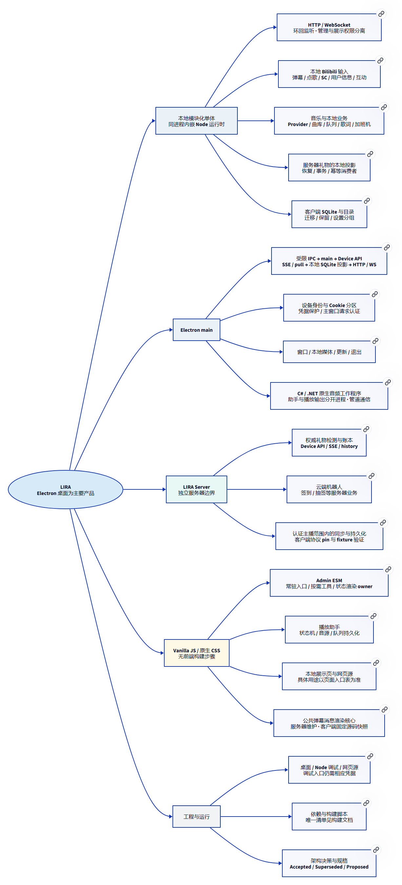
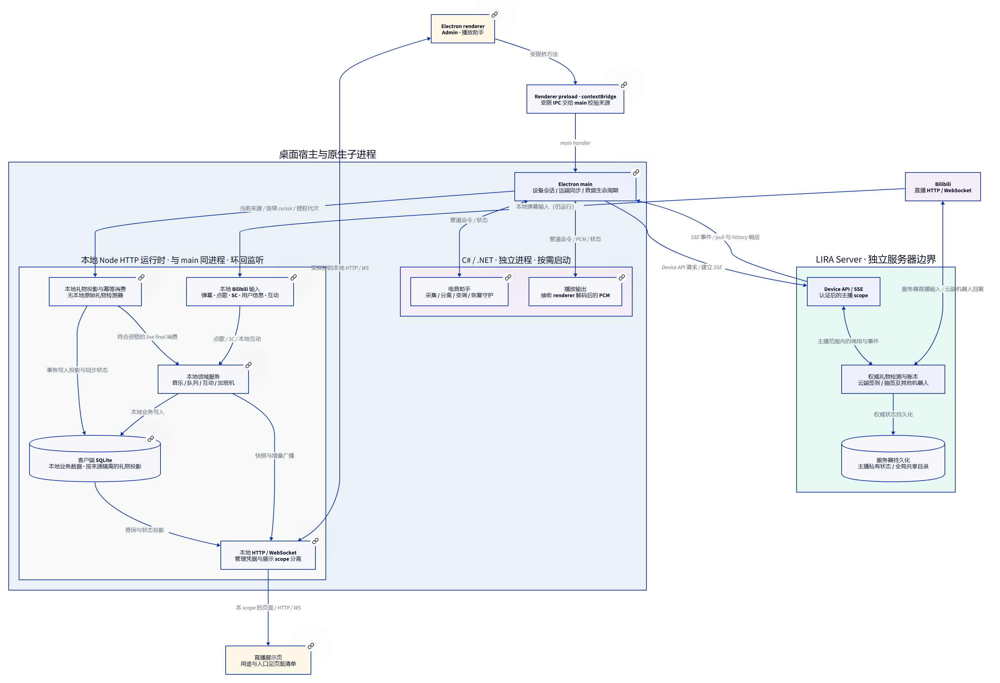

# LIRA 架构

本目录维护系统职责、进程与信任边界、依赖方向、数据流和架构决策。接口、传输对象（DTO）、表结构、常量及操作命令见 [技术参考与事实地图](../reference/README.md)。文档分类与维护规则见 [文档入口](../README.md)。

## 进程与产品边界

LIRA 是以 Electron 桌面应用为主界面的模块化单体。Electron 主进程同进程内嵌本地 Node 后端；渲染进程使用原生 JavaScript ES modules 和 CSS，本地 HTTP/WS 负责提供管理端数据与叠加层展示投影。OBS 和哔哩哔哩直播姬通过浏览器源加载叠加层页面，目标直播平台为 B 站。

| 边界 | 稳定职责 | 实现参考 |
| --- | --- | --- |
| 本地后端 | 装配本地业务服务、HTTP/WS 接口、本地存储及 B 站直播输入 | [服务核心](../reference/backend/server-core.md) |
| Electron 主进程 | 管理窗口、设备会话、平台登录、受限 IPC、远端同步与应用生命周期 | [主进程](../reference/desktop/main.md)、[认证](../reference/desktop/auth.md) |
| 原生音频工作程序 | 负责音频采集、人声分离、变调及异常恢复；同一可执行文件的“内置播放输出”与“电音助手”分进程运行，避免采集到自身处理后的声音；由 Electron 按需启动并通过管道通信，不开放网络端口 | [电音助手生命周期](../reference/desktop/main.md#电音助手生命周期)、[播放输出](../reference/desktop/main.md#内置播放原生输出) |
| 渲染进程（Renderer） | 负责界面状态与用户交互，通过受限预加载脚本桥接调用桌面能力 | [Admin](../reference/frontend/app.md)、[通信](../reference/frontend/comms.md) |
| LIRA Server | 负责权威礼物检测与账本、云端机器人及设备认证同步接口 | [礼物投影](../reference/backend/bilibili/gift.md)、[服务器契约锁](../../server-contract.lock.json) |
| 直播叠加层展示 | 仅读取范围受限的展示投影，无法获取管理权限或设备凭据 | [页面入口](../reference/frontend/pages.md)、[叠加层参考](../reference/frontend/overlays.md) |

管理页依赖桌面端提供的本地授权；独立 Node 启动入口仅用于调试，且同样受凭据与权限边界约束。本地 B 站连接负责处理弹幕、点歌、醒目留言（SC）、用户信息与互动；礼物原始检测及签到/抽签执行由服务端负责。

## 跨端与数据所有权

- 主播身份由已认证的服务端边界确定，以稳定的 `streamerId` 作为租户隔离主键，`roomId` 仅作外部属性。设备凭据由主进程保管，渲染进程不能自行切换租户或读取凭据。授权、账号切换与 Cookie 规范见 [认证参考](../reference/desktop/auth.md)。
- 设置（settings）、歌库（songs）与 B 站配置各自有明确的同步与恢复归属模块：组合根负责装配接线，控制器负责并发与取消控制，存储层保证原子提交。详见 [主进程同步生命周期](../reference/desktop/main.md#22-云端同步生命周期) 和 [存储参考](../reference/backend/storage.md)。
- 本地场景服务与存储按授权账号管理布局、样式选择与发布版本，共享外观与本机弹幕外观仍由各自配置模块维护；组合画面与独立组件来源共用同一已发布场景，通过范围受限的场景访问凭证读取展示投影；浏览器预览会话仅转发编辑指令，实际保存仍由桌面控制器完成。架构边界见 [ADR-0022](adr/0022-local-component-scenes.md)，交付口径见 [弹幕外观与事件的交付边界](engineering/ai-workflow.md#弹幕外观与事件的交付边界)，接口与用法见 [本地场景](../reference/backend/api.md#本地场景)、[浏览器组件预览](../reference/backend/api.md#浏览器组件预览) 和 [组件与浏览器源指南](../guides/component-sources.md)。
- 主进程结合实时推送与 HTTP 补偿，将服务端礼物账本写入按来源隔离的本地 SQLite 投影；符合接收条件的连续终态（final）记录与同步游标在同一事务中原子提交，提交后再派发给本地业务消费者和 HTTP/WS。详见 [礼物参考](../reference/backend/bilibili/gift.md) 与 [ADR-0021](adr/0021-atomic-live-gift-progress.md)。
- 跨仓库协议通过固定提交与样本（fixture）摘要校验，不在运行时跨仓库导入代码。[ADR-0020](adr/0020-shared-danmaku-source.md) 约定公共弹幕渲染核心由服务端维护、客户端保存固定源码快照，具体样式规则和消息队列（feed）生命周期仍由两端各自维护。

## 架构图表

图表只表达稳定组件、边界与数据流向；易变清单由技术参考维护。D2 源与 SVG/PNG 同步更新，渲染命令见图源头部。

[全貌图源](diagrams/overview.d2)

[组件图源](diagrams/components.d2) · [点歌与播放时序](diagrams/song-request-flow.md)

## 工程边界与变更入口

- [模块化规范](engineering/modularity-standard.md)：依赖方向、组合根、持久化边界与公共接口兼容约束。
- [AI 任务路由](engineering/ai-workflow.md)：各业务域的归属模块、规范文档、常见调用方与关联测试定位入口。
- [遗留边界](engineering/legacy-boundaries.md)、[模块化债务](engineering/modularity-debt.md)：现存技术限制与复审责任。
- [构建与发布](../reference/engineering/build.md)、[测试](../reference/engineering/test.md)：命令与工程操作参考。

## 架构决策

| 决策 | 状态与关系 |
| --- | --- |
| [0001-runtime-boundaries](adr/0001-runtime-boundaries.md) | 已采纳 |
| [0002-server-authoritative-timing](adr/0002-server-authoritative-timing.md) | 已采纳 |
| [0003-settle-once-per-gift-group](adr/0003-settle-once-per-gift-group.md) | 已采纳 |
| [0004-reuse-monolith-and-gift-db](adr/0004-reuse-monolith-and-gift-db.md) | 已采纳 |
| [0005-built-in-overtime-backgrounds](adr/0005-built-in-overtime-backgrounds.md) | 已采纳 |
| [0006-shared-gift-detection-core](adr/0006-shared-gift-detection-core.md) | 已采纳（原客户端检测核心已迁至服务端，仅保留客户端消费者隔离、资格冻结与幂等交付原则） |
| [0007-explicit-module-boundaries](adr/0007-explicit-module-boundaries.md) | 已采纳 |
| [0008-ai-assisted-change-governance](adr/0008-ai-assisted-change-governance.md) | 已采纳 |
| [0009-first-run-onboarding](adr/0009-first-run-onboarding.md) | 已替代；现用交互式引导，见 ADR 内的替代说明 |
| [0010-bilibili-user-info-facade](adr/0010-bilibili-user-info-facade.md) | 已采纳 |
| [0011-source-partitioned-gift-ledger-projection](adr/0011-source-partitioned-gift-ledger-projection.md) | 已采纳；来源身份由 [ADR-0019](adr/0019-stable-gift-source-owner.md) 替代，实时提交由 [ADR-0021](adr/0021-atomic-live-gift-progress.md) 扩展，永久明细假设由 [ADR-0024](adr/0024-gift-retention.md) 替代 |
| [0012-local-paid-gift-catalog](adr/0012-local-paid-gift-catalog.md) | 已采纳；旧目录 schema/图片兼容策略的替代关系见 ADR 首段及 [ADR-0014](adr/0014-gift-identity-bound-overtime.md) |
| [0013-persistent-desktop-user-data](adr/0013-persistent-desktop-user-data.md) | 已替代（由 [ADR-0015](adr/0015-install-local-desktop-data.md) 替代） |
| [0014-gift-identity-bound-overtime](adr/0014-gift-identity-bound-overtime.md) | 已采纳 |
| [0015-install-local-desktop-data](adr/0015-install-local-desktop-data.md) | 已采纳 |
| [0016-separated-client-data-lifecycles](adr/0016-separated-client-data-lifecycles.md) | 已采纳 |
| [0017-incremental-modularity-size-gate](adr/0017-incremental-modularity-size-gate.md) | 已采纳；行数硬上限与登记政策由 [ADR-0023](adr/0023-purpose-aware-file-size-review.md) 替代 |
| [0018-unified-logging-and-diagnostics](adr/0018-unified-logging-and-diagnostics.md) | 已采纳；分阶段实施，未完成范围见 ADR 状态说明 |
| [0019-stable-gift-source-owner](adr/0019-stable-gift-source-owner.md) | 已采纳；替代 [ADR-0011](adr/0011-source-partitioned-gift-ledger-projection.md) 的旧来源身份 |
| [0020-shared-danmaku-source](adr/0020-shared-danmaku-source.md) | 已采纳；公共消息渲染核心及独立发布的固定源码快照 |
| [0021-atomic-live-gift-progress](adr/0021-atomic-live-gift-progress.md) | 已采纳；连续 SSE 礼物与游标原子提交，HTTP 保留恢复与周期核对 |
| [0022-local-component-scenes](adr/0022-local-component-scenes.md) | 已采纳；本地场景归属、完整外观版本与独立只读来源；本地范围已实现并验证 |
| [0023-purpose-aware-file-size-review](adr/0023-purpose-aware-file-size-review.md) | 已采纳；按文件类型、职责与用途评审，行数仅作提示 |
| [0024-gift-retention](adr/0024-gift-retention.md) | 已采纳；双端 90 天基础保留、日汇总及 11-11 扩展（服务端 90 天、本机 365 天与有序批处理）均已实现；物理删除默认关闭 |
| [0025-audio-component-delivery](adr/0025-audio-component-delivery.md) | 已采纳；音频组件独立 CDN 交付，6.0.0 本地复用与版本固定 |

## 事实地图

完整的事实归属表统一维护在 [技术参考索引](../reference/README.md#事实地图单一事实源归属)。新增实现细节时先更新对应归属文档；发生架构调整时同步更新本页、架构图及相关 ADR。历史 ADR 仅保留当时决策背景，若状态或替代说明有更新，以最新说明为准。
