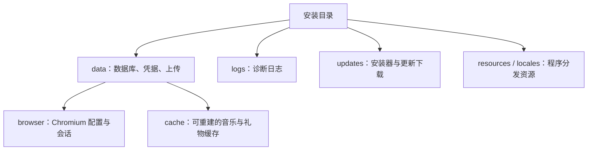

# ADR-0016: 按保留周期分离客户端数据

## 状态

已采纳（2026-09-13）

参考成熟桌面应用的目录分层实践，细化 [ADR-0015](0015-install-local-desktop-data.md) 的安装目录内部结构，不改变数据随安装目录保存的原则。

## 背景

旧版将业务数据库、用户上传素材、授权文件与 Chromium 配置、持久化登录分区及缓存混放在 `data/` 根目录中，仅靠目录结构难以区分可重建缓存与必须留存的用户核心资料。

成熟桌面软件普遍按归属与生命周期分层：[VS Code Portable Mode](https://code.visualstudio.com/docs/setup/portable) 在程序旁 `data` 下分离用户资料与扩展；[JetBrains](https://www.jetbrains.com/help/idea/directories-used-by-the-ide-to-store-settings-caches-plugins-and-logs.html) 区分配置、缓存、插件与日志；[Chromium](https://chromium.googlesource.com/chromium/src/+/HEAD/docs/user_data_dir.md) 的 profile 同时包含 Cookie 等持久资料与 Windows 浏览器缓存。LIRA 采用按归属与保留周期分类的原则，兼顾本地单体形态与安装目录整体可迁移性。

## 决策

- `dataDir` 继续作为业务数据根目录，五个 SQLite 数据库及其 WAL/SHM、配置、加密凭据、授权私钥、用户上传与媒体允许清单保持原位置与格式不变。
- Chromium `userData` 与 `sessionData` 统一指向 `data/browser`，整体保留默认会话与持久化登录分区；该目录含用户登录状态，不属于可整目录随意删除的缓存。崩溃报告位于其 `Crashpad` 子目录（`data/browser/Crashpad`）。
- 音乐 API 缓存、歌词、礼物图片及目录/初始化镜像归入 `data/cache`。礼物镜像连同图片与索引一起迁移，对外 HTTP 图片 URL 保持不变。
- 运行日志与更新文件继续存放在安装级 `logs/` 与 `updates/lira-updater/`；更新目录依据安装路径解析，不从新浏览器目录推断。
- 新旧版本使用同一个业务数据根目录申请 Electron 单实例锁，持锁之后、Electron `ready` 之前执行目录迁移并设置浏览器路径。
- 迁移仅移动已知旧条目：先落盘迁移日志，再在同卷逐项原子重命名；正常运行中不删除源数据、不合并目标目录、不丢弃未知文件。中断后按日志续跑；遇到两端并存、两端缺失、符号链接或旧进程仍在运行等冲突时停止启动并保留现场文件。
- 安装器继续整体保护 `data/`，涵盖浏览器目录、缓存与迁移日志；升级时的原地保留与备份切换规则遵循 [ADR-0015](0015-install-local-desktop-data.md)，未完成的安装恢复优先于目录迁移执行。

## 备选方案与影响

若只移动浏览器缓存，无法解决登录分区与业务数据混放问题；若把全部业务数据再迁入 `data/app`，则会无谓改动数据库、凭据与上传路径。当前方案保留核心业务数据路径不变，集中隔离 Chromium profile 与可重建缓存。

目录整理本身不会直接减少磁盘占用，也不新增自动清理策略。同卷重命名避免了复制整份缓存的开销，但要求旧进程完全退出，且迁移失败时不得以空 profile 继续启动。完成迁移后的目录结构无法被旧版直接识别，不支持直接降级写入；如需回退旧版，须使用升级前完整备份。

## 验证

[迁移回归](../../../test/storage/data-directory-migration.test.js) 覆盖数据保留、冲突处理、中断续跑与活动进程检测；[启动接线](../../../test/desktop/electron-startup-data.test.js) 校验单实例锁与启动就绪顺序；[原生 Electron 回归](../../../test/desktop/electron-data-layout.test.js) 使用临时 profile 验证 Cookie、音乐分区、`localStorage`、`safeStorage` 与单实例约束。权威目录树见 [storage.md](../../reference/backend/storage.md)。
