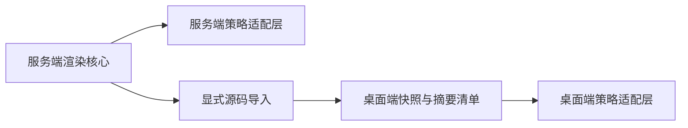

# ADR-0020: 以固定源码快照分发公共弹幕渲染核心

## 状态

已采纳（2026-10-10，适用范围：LIRA 桌面端与 LIRA Server）

## 背景与采纳范围

2026-10-10 批准了交付效率优化与可复用模块方案，重启此前于 2026-09-21 暂缓的公共渲染器提案。桌面端与服务端需要渲染一致的弹幕 DOM 结构，但二者的消息队列时序与系统消息样式策略有意不同；同时服务端 ADR-0049 要求服务端可独立部署，两端也均不希望引入新的运行时依赖或前端构建步骤。

本决策采纳的范围仅限消息渲染核心本身。样式默认值与校验、各样式专用装饰器、弹幕队列（feed）以及拟议的 protobuf 读取器仍由原归属模块维护，不因本决策视为同步落地。

## 决策

LIRA Server 维护权威源码 `public/overlay/danmaku-renderer-core.js`，桌面端在 `public/js/overlays/danmaku-renderer-core.js` 提交一份经 LF 换行规范化的完全一致快照。既有 `danmaku-message-renderer.js` 保留为薄适配入口，维持原导出签名并显式注入各自的系统消息与入场延迟策略：桌面端不附带系统消息样式类并使用 `min(index, 8) * 24ms` 延迟，服务端保留系统消息样式类且延迟为 0。两端核心仅导入本地样式装饰器；消息队列、过期清理、裁剪、观察者与动画调度继续归各自本地维护。

桌面端通过 `src/shared/danmaku-source-manifest.json` 记录清单版本、源仓库、源/目标路径及 LF 规范化后的 SHA-256 摘要。该清单独立于固定线路协议样本的 `server-contract.lock.json`。源码与快照支持独立评审与发版，服务端最新 `HEAD` 无需与历史上已发布的每个桌面端快照强绑定。

桌面端仓库提供同步工具 `scripts/sync-danmaku-source.cjs`，支持三种操作模式（具体命令行参数以脚本为准）：

- 离线校验本地快照与清单摘要是否一致（不依赖服务端检出，只读不写）；
- 对比显式指定的服务端仓库目录，存在偏差时直接报错且不修改文件；
- 显式从指定服务端仓库导入源码并更新摘要清单（执行前须人工评审）。

服务端维护者直接编辑权威模块，不引入生成产物，现有资源快照机制会自动纳入该核心。桌面端工程测试持续校验本地快照完整性；导入变更时需同步做跨仓比对并运行双端渲染测试套。两端部署时只加载各自仓库内文件，不引入运行时读取兄弟目录、远程拉取、符号链接、前端打包器或独立发包流程。

## 备选方案与权衡

两端各自维护一套可编辑渲染器会造成缺陷重复修复与实现分叉；引入运行时共享依赖会破坏桌面端离线渲染与独立部署能力；改为独立发包或前端构建则为单个小模块平添整套发版基础设施。采用固定源码快照既保证了单一源码归属与独立发版，代价仅是显式评审与导入步骤，同时清晰限定不涵盖无关主题文件或全部样式规则。

## 验证

[danmaku-source.test.js](../../../test/engineering/danmaku-source.test.js) 校验快照完整性、CRLF 规范化、显式导入、指定服务端偏差检测与只读失败行为；既有渲染器、队列与浏览器测试覆盖文本安全 DOM、可信图片回调、礼物/SC 渲染与主题表现，双端适配层均具备显式策略回归。交付证据见 [弹幕交付效率优化计划](../../../specs/plans/archive/2026-10-10-danmaku-delivery-efficiency.md)。
