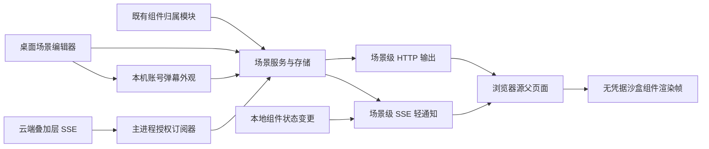

# ADR-0022: 本地组件场景归属与发布架构

## 状态

已采纳（2026-09-30 起分阶段实施 P3 与本地 P4；本地范围已实现并验证，验收证据记录于归档实施计划）

## 背景

各类组件的默认配置分别归属本地或云端不同模块，单纯的多组件编辑器既不能直接提供稳定可消费的直播场景，也不具备跨领域原子保存条件。目标设计要求支持本地组合画布、独立组件实例与完整视觉版本切换，同时不改变既有业务状态归属。

## 决策

### 1. 场景发布模型与受限展示通道

在现有模块化单体中新增场景服务与存储。每次场景发布生成一份不可变的布局与样式选择快照。浏览器源父页面仅持单场景专属访问凭证，读取范围受限的展示投影，并向子组件提供无凭据的沙盒渲染实例；切版本时先在后台准备完整新版本，待所有必需渲染器就绪后再一次性切换容器。

主进程按已授权账号仅维护一条可信云端公共叠加层 SSE 连接，不新增服务端端点。云端访问凭证留在主进程内，当前归属主体取自已认证的服务端身份，不以本地示例或本地 B 站流替代云端叠加层事件。

本地场景专属访问凭证以哈希加 `safeStorage` 加密的归属绑定包形式持久化，仅被对应场景输出与通知 HTTP 路由接受，不可用于通用 HTTP/WS 鉴权；各组件默认配置仍归原业务模块维护。

### 2. 本机弹幕外观与跨场景共享参数

2026-10-28 确认将弹幕外观迁至按「已授权服务端源地址 + `streamerId`」隔离的本机配置表（通过 `songDb` 迁移新增）。配置控制器通过本地管理 API 与既有场景通知机制更新；首次成功读取时一次性导入旧远端配置，不把外观逐份抄写到每个场景，失败或过期导入不覆盖写入默认值。此后远端下发的外观事件不再覆盖本机参数，也不阻断合法实时事件。本机写入绑定桌面授权代次（`generation`），允许令牌续期期间保留草稿，但拒绝跨账号或旧登录周期写入。已发布场景保留自身布局与所选样式，实时接收当前共享参数且不重播历史消息。新样式、字体与素材随桌面端交付，旧远端叠加层与 HTTP/IPC 保持兼容，不要求服务端镜像同步本地样式；[ADR-0020](0020-shared-danmaku-source.md) 的公共渲染核心源码快照校验保持不变（完整交付边界见 [弹幕外观与事件的交付边界](../engineering/ai-workflow.md#弹幕外观与事件的交付边界)）。

2026-10-08 共享参数需求替代了早期“发布时冻结共享外观”的做法：桌面端已保存设置优先于旧场景副本，既有组件/设置归属模块与资源样式库按已发布条目 ID 提供白名单实时外观投影。编辑器对同一样式的所有实例复用同一数据源，时钟方案与开场媒体继续按样式隔离；组件保存仍归原控制器，本地显示字段复用当前挂载画布的访问凭证（带 `Origin` 校验及读体后二次鉴权）。保存后的外观变更直接到达现有输出帧，既不发布未保存的草稿几何布局，也不重播事件。场景私有字段、布局、样式选择及第三方媒体/CSS 实例仍由场景模块管理，不引入批量重写场景、表结构迁移或跨模块原子保存。

### 3. 固定输出像素与单组件独立来源

2026-10-01 固定像素需求由场景存储统一管理当前账号各组件的默认输出尺寸。共享尺寸与场景快照在同一事务中原子发布；原组件浏览器源通过既有叠加层主体读取已保存尺寸，独立组件来源地址则借助场景访问凭证直接投影同一已发布场景中的指定条目，不新增第二套外观或业务状态归属。输出像素独立于浏览器视口，编辑器缩放单独控制。

### 4. 外部浏览器组件与画布原位更新

2026-10-05 外部浏览器源需求在自有组件之外新增独立的 `browser` 条目。第三方源 URL 可能携带对方访问凭证，因此复用场景密钥编解码器按「账号/场景/条目」绑定加密保存，导入模板时须重新填写 URL。该条目不获取任何 LIRA 凭据或组件数据，继续运行在不透明源（`opaque origin`）iframe 沙盒中；其 `load` 事件仅表示导航完成，不代表第三方业务就绪（限制详见 [组件场景规格](../../../specs/component-scenes.md)）。

当新发布保留相同的可见实例 ID/类型、自有外观与外部浏览器 URL 时，已就绪的渲染帧直接原位应用布局与视口调整，保持 DOM 父节点与实时连接不断开，并同步推进版本号与投影确认；其余结构性变更仍走完整新版本预备与切换流程。

### 5. 场景级轻通知 SSE 通道

2026-10-05 延迟优化新增按场景鉴权的本地只读 SSE 通知流（通过 `Authorization` 请求头携带片段凭证并省略浏览器凭据）。运行期变化按受影响组件类型聚合后仅推送轻量状态通知，数据投影、游标语义与最终访问校验仍由既有输出 API 负责。通知流绑定归属纪元（`epoch`）、场景、访问凭证与可选条目，活跃投影回执在渲染器提交前保留旧组件订阅；每次推送前及周期性重验访问权与授权状态，停机时先关闭通知流再执行在途请求排空。

浏览器端串行化输出读取并周期执行健康检查；当通知流缺失、达到并发上限或断开时自动降级为轮询并执行有界重连。仅通知接口首次 HTTP 出错不会直接清空健康画面，只有显式撤销事件或输出接口鉴权失败才撤销输出。本地运行时限制并发通知流上限，为 HTTP/1 数据与静态资源预留连接容量，不改变通用 WebSocket 主体或远端服务端协议（具体间隔、并发上限与事件名见 [本地场景参考](../../reference/backend/api.md#本地场景)）。

### 6. 外置美术素材包

2026-10-06 需求将月光主题等美术资源外置为独立素材包，同时保留受信任的客户端渲染器。ZIP schema 2 声明已知预设与完整素材映射，禁止携带 JavaScript 或样式表；场景外观同时保留预设标识与按包固定的资源 URL。既有资源库负责分阶段导入与删除，各业务模块仍管时间、弹幕、心愿与动效行为；CSS 来自客户端固定注册表，仅替换经过校验的资源 URL。新增渲染器仍需客户端更新，但基于既有渲染器扩展新样式无需发版，从而避免开放通用插件执行面并支持变量子集与同类型组件复用。

### 7. 场景预设与安全删除

2026-10-06 场景预设需求保持单一活跃画布输出，预设直接复用既有的独立场景文档，由按账号隔离的轻量绑定记录维护原始输出身份与上次应用的预设。切换或保存预设不改动线上输出；显式发布画布时校验预设修订号（`revision`）与输出版本，将快照、当前预设与共享尺寸原子提交，并将外部浏览器 URL 按输出身份重新加密。浏览器中继仅暴露经桌面端托管的预设操作，不开放通用场景管理权限，不新增独立运行时或业务归属。

2026-10-10 安全删除需求进一步解耦可编辑预设与固定输出身份：删除当前正在输出的预设时，先确认影响，再以剩余已保存预设或透明空白文档原子替换输出。存储层保留固定的输出记录与访问凭证，仅隐藏已删除预设；编辑器可保持空白状态，重新打开时不会擅自重建预设。所有操作继续由既有场景服务与存储事务负责。

## 备选方案与权衡

- **否决跨组件事务回滚**：独立的云端与本地写入无法构成统一的跨端原子事务。
- **否决通过含凭据的原组件地址拼装自有组件**：会扩大访问凭证权限范围，且无法提供完整版本预备与原子切换边界（用户自填外部浏览器源按上文第 4 节的严格沙盒例外处理）。
- **轻通知 SSE 与轮询降级权衡**：只传信号的 SSE 消除了常态轮询延迟，同时保留既有 WS 安全模型与云端游标/缺口语义，代价是增加连接生命周期与重验逻辑；轮询保留为兼容降级与健康检查机制，外部第三方帧维持自身直连数据通道。
- **本地运行与加密恢复代价**：本地场景源依赖桌面运行时在线，加密访问凭证依赖同一操作系统密钥保护；端口回退规则保持不变，网络地址变动时需重新复制来源地址。
- **范围边界**：模板与历史仅包含展示文档；跨设备云端发布与 OBS 远控属于后续独立议题。

## 验证与参考

完整验收条件与交付证据（含 3,280 项全量测试套与隔离 Electron/浏览器源验证）见 [组件场景规格](../../../specs/component-scenes.md) 与 [组件工作台归档计划](../../../specs/plans/archive/2026-09-30-component-workspace.md)（自动化合成测试不替代线上真实直播账号验收）。实时通知增强与兼容性检查见 [场景实时更新归档计划](../../../specs/plans/archive/2026-10-05-scene-live-updates.md)。
