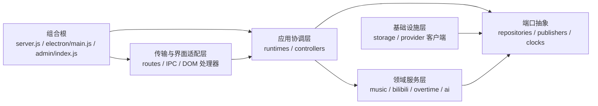

# 模块化与低耦合工程规范

> 适用范围：新代码及当前任务改动涉及的代码
>
> 覆盖目录：`src/`、`public/`、`scripts/`、`tools/`、`test/`，以及 `build/` 下维护的安装程序源码

本规范明确 LIRA 模块化单体的依赖方向、组合根装配、持久化边界与渐进迁移规则。目标不是堆砌抽象层数量，而是让业务改动收敛在归属模块与显式调用方之内。

## 1. 设计目标

- 保持本地后端内嵌于 Electron 主进程。不新增独立服务、后台进程、监听端口、部署单元、Web 框架或前端构建系统。
- 默认保持 HTTP、WebSocket、IPC、SQLite 表结构、持久化数据及浏览器页面接口向后兼容。
- 运行时资源由显式构造的运行时实例管理；加载模块时不得隐式创建数据库、连接、定时器或监听器。
- 依赖关系必须通过 `import`、`require` 或工厂参数显式可见；全局变量仅允许存在于已登记的兼容边界内。
- 新增抽象必须隔离真实的变化源或守护明确边界，不为单一调用方添加无边界价值的透传包装层。

## 2. 允许的依赖方向

强制方向规则：

1. `src/server/routes/` 只接收应用层能力，不直接接收数据库句柄。
2. 领域服务只需专用存储接口、仓储、发布器、时钟或提供方时，不得传入宽泛的 `context` 或完整 `db` 对象。
3. `src/storage/` 可依赖纯共享工具，但不得依赖 `src/server/`、`src/electron/` 或 `public/`。
4. `src/server.js`、`src/electron/main.js` 与前端入口可依赖内部模块，但内部模块禁止反向导入这些入口。`src/electron/entry.js` 仅负责加载 Electron 组合根并在同步启动失败时上报退出，不承担业务装配，同样禁止被内部模块导入。
5. 跨领域调用须经由显式门面、消费者或端口；禁止直接读取另一领域的内部可变状态。

### 2.1 目录职责划分

| 代码位置 | 架构角色 | 允许的依赖 | 禁止的依赖 |
| --- | --- | --- | --- |
| `src/server.js`、`src/electron/main.js`、前端入口 | 组合根（Composition Root） | 内部模块的公开工厂与适配器 | 被内部模块反向导入 |
| `src/server/routes/`、`src/electron/ipc/`、DOM 处理器 | 传输 / 界面适配层 | 应用层门面、稳定规范、纯工具 | SQLite 句柄、领域内部状态 |
| `src/server/*-runtime.js`、前端控制器 | 应用协调层 | 领域服务、端口、公开基础设施工厂 | 组合根入口、未声明全局变量 |
| `src/music/`、`src/bilibili/`、`src/overtime/`、`src/ai/` | 领域服务层 | 本领域模块、专用端口、纯共享规范 | 组合根入口、Electron、DOM、直接 SQL |
| `src/storage/`、音源/外部客户端、Electron 适配器 | 基础设施层 | 领域规范、纯共享工具、平台 API | 组合根的可变状态 |
| `src/shared/`、`public/js/shared/` | 稳定共享层 | 标准 API、同主题纯工具 | 领域服务、组合根入口、运行时资源 |

跨目录能力必须通过命名清晰的公开工厂、门面、消费者或端口对外暴露，禁止仅因文件路径可达就直接导入另一领域的私有实现。针对整目录边界的结构测试必须遍历整个目标目录，不得只抽查单个已知文件。

## 3. 组合根约束

组合根负责创建对象、连接回调、选定具体实现、启动资源并按逆序释放资源。

- 业务决策、重试策略、状态格式化与日志结构组装归属对应运行时或领域服务。
- 组合根可以导入多个模块，但禁止构造可供任意模块随意读写的可变依赖对象。
- 工厂函数只接收自己实际使用的字段；应通过拆分职责理清边界，而非把模糊接口塞进 `sharedDeps` 或泛化上下文。
- 初始化顺序可通过具名回调端口协调，禁止借助可变前置声明制造隐式循环依赖。
- 谁创建运行时资源，谁负责提供幂等清理逻辑。

## 4. 前端模块约束

- 新前端代码一律使用具名 ESM 导入导出。
- 禁止重新引入 `window.AdminApp` 或类似的全局服务注册表（旧桥接已退役，详见 [遗留边界](legacy-boundaries.md)）。
- 存量传统脚本或 IIFE 模块可在渐进迁移期保留，但其遗留全局依赖债务只减不增。
- 入口文件可对已登记的兼容模块使用副作用导入，应用代码只调用显式专用接口。
- `EventBus` 仅用于一对多事件通知，不得充当隐式请求—响应通道或隐藏必选依赖。
- 仅当生产代码确实按注册解析服务时才引入依赖注入容器；只注册不解析的容器没有价值。
- DOM、`window.musicAPI` 与网络请求属于基础设施边界；当隔离具有测试价值时，核心逻辑应通过专用适配器或注入函数调用它们。

## 5. 持久化约束

- SQL 语句、表名、列名与事务管理统一收归 `src/storage/` 下的存储或仓储适配器；存量例外仅作冻结债务，不可作为新代码范例。
- 领域服务依赖语义化行为接口（如 `queueStore.addRequest(input)`），而非 `db.prepare()` 或 `db.exec()`。
- 事务边界由存储层或仓储负责；单库跨表原子写入应使用单一协调仓储或工作单元方法，不为此拆库或引入新进程/新依赖。
- 存储层返回值必须是稳定的领域对象，不得向外泄露 `DatabaseSync`、预编译语句或 SQLite 原生结果对象。
- 变更表结构时，须同步更新迁移脚本、受影响的存储模块、回归测试以及 [存储参考](../../reference/backend/storage.md)。

## 6. 共享模块约束

共享代码应跨领域、无副作用且语义稳定：

- 按单一主题组织工具函数（例如文本、时间或文件编解码）。
- 平台、协议或特定领域的规则留在各自归属模块内。
- 禁止为了减少 `import` 行数而新建大杂烩式 `utils.js` 聚合文件。
- 兼容重导出必须具备明确的迁移理由、移除条件及结构回归测试。

## 7. 规则登记表

状态含义：

- **已强制（Enforced）**：确定性自动化检查能够全面阻断违规。
- **渐进执行（Incrementally Enforced）**：测试冻结了已知存量债务或仅覆盖部分路径。
- **迁移目标（Migration Target）**：已明确演进方向，但尚未实现全面机器校验。
- **需评审（Review Required）**：语义边界依赖人工评审，自动化报告仅提供辅助信号而不作通过/失败裁决。

| 规则 ID | 规则内容 | 状态 | 执行方式 |
| --- | --- | --- | --- |
| `MOD-COMPOSITION-001` | 组合根仅负责组件装配与生命周期 | 渐进执行（Incrementally Enforced） | 生命周期行为测试、组合根导入守卫及归属评审 |
| `MOD-STORAGE-001` | 领域服务不直接执行 SQL | 渐进执行（Incrementally Enforced） | 存储目录外的接收器感知无 SQL 扫描（零白名单）、目录级领域导入守卫 |
| `MOD-STORAGE-002` | 存储层负责事务边界 | 渐进执行（Incrementally Enforced） | 核心存储原子性测试加代码评审 |
| `MOD-ADMIN-001` | 新 Admin 代码不新增全局状态访问 | 渐进执行（Incrementally Enforced） | 全量扫描前端模块的 Admin 注册表读写与发布（原债务配额已移除） |
| `MOD-FRONTEND-001` | 新前端代码使用显式 ESM 边界 | 渐进执行（Incrementally Enforced） | `test/engineering/esm-module-boundaries.test.js` 拦截 `public/js/` 下 ES 模块未声明/未导入标识符；显式导出与传统脚本例外由评审把关 |
| `MOD-SHARED-001` | 共享工具保持领域无关 | 渐进执行（Incrementally Enforced） | 禁止共享层导入运行时/界面模块；Node 可复用纯浏览器共享规范；语义内聚靠评审把关 |
| `MOD-DEPENDENCY-001` | 生产 JavaScript 模块依赖无环 | 渐进执行（Incrementally Enforced） | 扫描 `src/` 与 `public/js/` 静态 ESM 声明及可执行字面量 `require`/`import`；计算路径与注入回调靠评审把关 |
| `MOD-CONTRACT-001` | 公共接口默认保持兼容 | 渐进执行（Incrementally Enforced） | 既有回归测试（全量接口清单后续完善） |
| `MOD-SIZE-001` | 按文件类型、职责与用途评审规模 | 需评审（Review Required） | `scripts/check-modularity.js` 输出提示信号；`test/engineering/modularity-size.test.js` 校验计数与报告逻辑，不判定语义内聚 |
| `MOD-FUNCTION-001` | 长函数与复杂函数需做语义拆分评审 | 迁移目标（Migration Target） | 在 [模块化债务](modularity-debt.md) 登记具体项与触发条件；不设全库函数硬上限 |

仅靠人工评审或局部覆盖的规则，不得标为 `已强制（Enforced）`。

## 8. 测试与架构适应度函数

涉及架构边界的变更应按以下流程执行：

1. 条件允许时，先补充最小化的失败结构测试或单元回归。
2. 运行受影响的模块测试及对应边界的架构检查。
3. 仅当变更的公共接口与调用方影响面需要时，再扩展语法、快速或全量测试套；遵循 [根目录按风险分级验证规则](../../../AGENTS.md#bug-fixing-and-verification)，无强制逐级升级要求。

公共接口兼容性回归应覆盖受影响部分的以下维度：

- **HTTP**：请求方法、路径、状态码、响应字段与对外错误语义。
- **WebSocket**：消息类型、必填字段、快照字段与关键顺序。
- **IPC**：通道名、参数、返回结构与对外错误结构。
- **SQLite**：旧表结构迁移兼容、数据保留、原子性及重复启动幂等性。

当前架构适应度函数已拦截或冻结的回归包括：

- 歌库、队列与醒目留言服务直接执行 SQLite 语句，以及存储目录外已知数据库接收器执行 SQL。
- 任何前端模块重新读取或发布 Admin 全局注册表。
- 领域层导入存储/传输/桌面实现、共享层导入上层模块，以及生产 JavaScript 模块依赖图中出现循环引用。
- `src/` 或 `public/js/` 中的空 `catch` 或纯注释 `catch` 债务增长。
- 表格或 ZIP 编解码入口回流至通用共享工具文件。
- 公共 ESM 模块引用既未声明也未导入的标识符。
- 内部后端模块通过字面量 CommonJS 导入后端组合根入口（按目录遍历检查）。
- 存储适配器导入服务端、Electron 或浏览器模块。
- 已复审的队列、点歌、加班机与盲盒叠加层自行构造 Socket，绕过其归属传输适配器。
- 误删转盘清理逻辑。

此外，配置规范由本地与云端适配器共享，配置批量写入原子性已通过内存 SQLite 测试覆盖；云端请求、礼物重试与追赶、转盘定时器、播放请求与缓存归属、叠加层连接均具备生命周期回归测试。SSE 读取留在远端客户端内，叠加层连接器留在对应适配层内，二者均不抽为通用共享工具或全局同步管理器。

上述静态检查覆盖静态 ESM 声明与可执行字面量 `require`/`import` 路径；计算路径、注入回调、前端装配方向、组合根依赖粒度及子系统状态归属仍需结合运行时与停机行为测试进行人工语义评审，仅凭工厂名、局部变量名或注释无法证明边界成立。

### 文件规模评审

[ADR-0023](../adr/0023-purpose-aware-file-size-review.md) 已替代 ADR-0017 的行数硬上限与到期登记机制。评估文件应保留还是拆分，应以文件类型、职责、调用方和用途为依据；仓库体量不决定单文件合理长度，短文件同样可能混杂无关职责。

| 文件类型 / 用途 | 提示阈值 | 评审重点 |
| --- | --- | --- |
| 业务逻辑、控制器、适配器与可执行脚本 | 超过 600 物理行 | 独立工作流、状态与资源归属、函数复杂度及依赖方向；保持完整生命周期内聚 |
| CSS | 超过 800 物理行 | 组件/页面作用域、层叠顺序、重复覆盖与可复用样式；相关布局、状态、动画与响应式规则可集中维护 |
| HTML 与模板 | 超过 800 物理行 | 完整页面/区块语义、重复组件与内嵌脚本；静态帮助文档可长于交互表单 |
| 测试与可执行测试辅助 / 样本（fixture） | 超过 800 物理行 | 行为/提供方/生命周期场景、用例隔离与清晰构造；保留完整的集成断言 |
| 纯数据、目录清单、Schema、快照与生成产物 | 无通用行数阈值 | 结构合法性、单一事实来源与可复现性；必要时评审对应生成器或调用方 |

以上阈值仅为评审信号，既不是硬上限，也不构成自动豁免：601–800 行的 CSS 无需特殊报备，职责内聚的文件超过提示线亦可原样保留。若当前任务触及超过提示线的文件，在常规变更评审中说明该文件用途、保留或抽离真实职责的收益及对应验证即可，不再另建审批单、精确行数配额、到期日或登记项；无关存量文件不会仅因出现在扫描报告中就变成强制清理任务。

当文件出现独立变化的职责、无关调用方、混乱依赖或难以测试的逻辑时再行拆分。禁止单纯按行号硬切、把单一可变状态拆散、增设透传包装层、删减断言/注释或压缩代码格式来凑行数。无论文件长短，鉴权、租户隔离、存储、生命周期与依赖规则均具备强制约束力；手写迁移执行器与静态分析器属于可执行逻辑，不能以“样本/生成物”为名规避行为检查。

`npm run verify:modularity` 会打印规模提示信息并在扫描完成后返回成功（即使存在超线提示）；`verify:architecture`、`verify:quick`、`verify` 与 `npm test` 仍保留报告逻辑测试及独立架构检查。规模报告通过仅代表扫描完成，不代表代码内聚或格式合规。

- 行数统计按磁盘物理行计算（含注释与空行；空文件为 0 行，末尾换行不额外计行，CRLF/LF/CR 结果一致）。变更源码请使用仓库格式化工具，扫描脚本不代为格式化。
- 扫描范围涵盖 `src/`、`public/`、`scripts/`、`tools/`、`test/` 与 `build/` 下的 `.js`、`.mjs`、`.cjs`、`.css`、`.html`、`.json`、`.ps1`、`.cmd`、`.bat`、`.nsh`（含未跟踪文件，详见 `scripts/check-modularity.js`）。CSS/HTML 采用各自提示线，`test/` 下其他可执行文件采用测试提示线，JSON 仅计数不告警；其他数据/生成文件在评审中判定，不靠文件名绕过检查。
- 上述根目录之外的配置文件、Markdown、媒体及运行期数据不纳入自动扫描，但人工评审维护中的源码时仍遵循本策略。
- [modularity-baseline.json](modularity-baseline.json) 仅作为过往评估的历史快照，其行数上限与日期均已失效，无需再更新或续期；语义债务继续登记在 [模块化债务](modularity-debt.md)。

移动测试文件时需同步维护 `test:admin` 等命名脚本；固定地址主题目录的数据约定与帮助章节的内容边界（禁止内联脚本和业务表单）属于内容规范，与文件长度无关。

### 函数复杂度评审与存量债务

函数跨度超过 **80 物理行**（尤其超过 **120 行**）、分支估算超过 **20** 或嵌套深度超过 **4** 时，作为拆分评审信号而非强制提取红线。应结合独立职责与认知复杂度判断，确需暂缓的问题记入债务清单。跨度统计包含内部嵌套回调；取消控制、令牌、定时器、事务与清理逻辑应保留在同一归属模块内，把代码搬进类或可变依赖对象并不改善边界。

为保持与原复审报告口径一致，分支估算从 1 起算，计入条件分支、循环、非 `default` 的 `switch` 分支、`catch`、三元表达式与逻辑运算符/赋值；嵌套函数单独计算，可选链与默认参数不计入。嵌套深度统计控制结构与三元表达式，`else if` 不额外增加层级。该估算仅作评审参考，不替代正式 ESLint 复杂度检查；在引入任何机器函数门禁前须先固定解析器与工具版本，禁止以正则估算充当硬性阻断。

[模块化债务](modularity-debt.md) 登记了已知的长工厂函数、初始化入口与历史迁移及其归属、保护测试和复核触发条件，相关改动时同步复核。

## 9. 变更工作流

1. 明确行为不变量及允许改动的边界。
2. 通过事实地图与 AI 任务路由表定位归属模块。
3. 针对问题补充最小化的专项回归测试。
4. 以最小改动通过测试。
5. 仅清理本次改动产生的失效导入、临时兼容代码或多余抽象。
6. 同步更新归属架构文档；若涉及重要依赖方向变化，补充 ADR 记录。
7. 按受影响接口与调用方风险分级验证，遵循 [根目录验证规则](../../../AGENTS.md#bug-fixing-and-verification)（专项、快速与全量测试套按需选用，无强制串联顺序）。

禁止顺手重排、格式化或迁移与当前任务无关的模块。

## 10. 非功能要求

- **性能**：模块化重构在无明确需求时不得增加网络跳转、数据库连接或额外持久化操作。
- **可靠性**：启动、重连、播放恢复与退出排空须保持幂等。
- **安全性**：鉴权令牌、Cookie、`safeStorage`、渲染进程权限隔离与 `local-media://` 源校验边界不得削弱。
- **可维护性**：当边界需要时，新增领域能力应支持通过轻量假存储、假提供方、假时钟或假发布器完成离线测试。
- **运维形态**：遵循第 1 节模块化单体约束，不新增进程、端口、服务或部署单元。
- **依赖管理**：模块化调整不新增第三方依赖包或修改 lockfile，依赖升级须单独评审。

## 11. 例外与评审

永久修改本规范须经由 ADR 记录。临时例外必须写明：所违背规则、责任人、受限范围、原因、备选方案、到期日期或版本、移除条件以及防回流测试。已过期的例外不得继续合入，也不允许存在无退出条件的临时兼容层。
