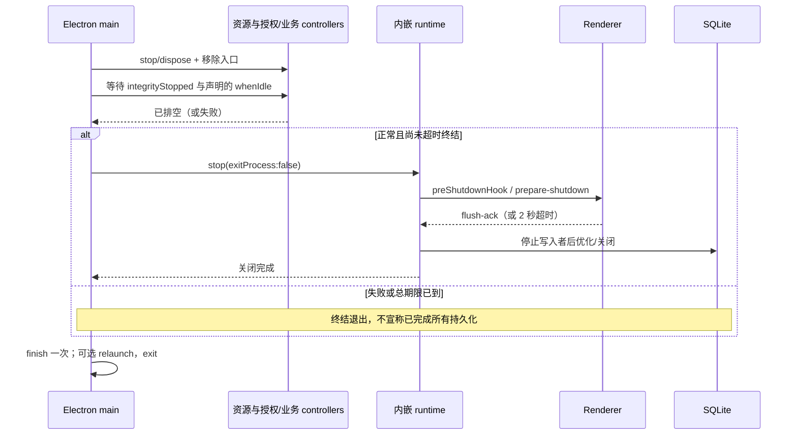

# 桌面壳主进程:窗口、协议与生命周期

## 电音助手生命周期

实时进程采集（含 LIRA 内置播放）的版本下限为 Windows 10 2004（Build 19041），也允许 Windows 11；由 `ProcessCapture.SupportsWindowsVersion` 定义，`AudioSession.Start` 在改动设备路由前检查。本地文件不经过进程采集检查。微软[示例说明](https://learn.microsoft.com/en-us/samples/microsoft/windows-classic-samples/applicationloopbackaudio-sample/)标注 20348，但 [OBS 官方实现](https://github.com/obsproject/obs-studio/blob/master/plugins/win-wasapi/plugin-main.cpp)对同一接口采用 19041；本实现沿用该兼容边界。版本通过不跳过实际接口、设备隔离或失败恢复检查。

`main.js` 装配 `audio-assistant.js` 与受限 IPC。打开电音助手设置或启用入口时才启动原生工作程序；一个桌面实例复用一个进程。设置页须同时满足百宝箱主页面激活、该子面板未隐藏；登录时仅恢复上次选中项不触发启动。`audio-component-manager.js` 为助手和播放输出提供已验证的程序路径：优先复用本机组件或旧版文件，首次授权后才补齐缺失组件。使用 Electron 自带 Node 管理标准输入/输出，不开放网络端口。无窗口 C# 宿主复用成熟分离、变调、WASAPI 与路由守护，renderer 只消费统一会话状态。

组件准备与原生进程启动分离。readiness 在授权后启动一个共享准备任务；完整本地命中不请求 CDN，客户端版本或账号变化不触发重下。内置描述固定包路径、大小及 SHA-256，ZIP 中每个文件再按描述校验，禁止额外成员、重复成员、链接及路径穿越，全部成功后才发布版本目录。下载失败不自动循环重试；下载中心可明确重试，下一次启动重新检查。关闭取消准备任务，等待中的助手/输出不会在退出后启动。路径与旧版迁移见 [存储](../backend/storage.md#音频组件文件)，上传见 [CDN 指南](../../guides/cdn-resources.md#音频组件独立交付)。

`AudioDevices` 分别枚举 Windows 活跃播放、录音端点，包含驱动暴露的实体声卡、线路和硬件回送。设备来源 `input` 用 WASAPI 共享录音，`loopback` 用指定播放端点回送；[DeviceCapture.cs](../../../native/audio-assistant/DeviceCapture.cs) 按设备格式接收 PCM，选取单声道或相邻立体声对，再转为处理核心的 48 kHz 双声道浮点。自动声道对单声道输入复制左右声道，多声道取前两个声道；其他通道由用户明确选择。最终输出复用 `PlaybackOutputs` 的实际接口工厂，旧端点 ID 继续按 WASAPI 共享播放；不宣称采集 ASIO 专用、独占或未由驱动开放的硬件内部声音。

设备来源不会启动播放器路由守护、静音端点或监测切歌；启动前重新确认输入可用性，回送端点与最终输出相同会拒绝启动。输入的音乐处理默认关闭，声伴强度按 0 处理，实时速度保持 100；升降调、原声对比与输出音量仍可用。采集/输出停止事件进入已有停止路径，释放采集、输出和 DSP；接回设备或恢复偏好不会自动开始。硬件回送的内部混音必须由声卡排除最终输出，不以端点 ID 不同推定无反馈。

主开关关闭会停止当前处理；播放器模式的切歌、换播放器、设备冲突由原生会话自动停止。处理期间用播放器 PID 和启动时间识别正常退出，在通道静音检查前停止；音频停止回调也识别这种退出，避免把恢复守护归还静音误报成通道干扰。正常桌面退出将工作程序的 stdin 关闭并纳入现有 shutdown 排空；故障退出后独立路由守护仍负责恢复。播放器已退出时先归还通道静音并释放端点锁，应用输出设置的撤销记录保留到其下次自然启动并可读取音频路由时自动还原，无需用户为收尾而重开播放器。通道已还原、记录有效且守护无错误存活时，快照标记安全延期，界面恢复正常关闭状态；端点还原失败、记录损坏或守护异常仍显示待恢复。不会安装驱动或改变系统默认输出。边界见 [IPC](preload.md#电音助手)、[本机数据](../backend/storage.md#电音助手本机数据) 与 [资源构建](../engineering/build.md#电音助手原生资源)。

原生宿主每 500ms 保留安装退出检查，但未处理且没有待恢复任务时，`AudioSession.Tick()` 直接返回，不扫描播放器或推送快照。启动阶段由实际阶段变化通知；处理期间保留 500ms 的输入/输出电平，以及适用于播放器的歌曲及路由检查，播放器来源每 4 秒重新检查播放器与通道占用。未处理但原声待恢复时，每 5 秒重试恢复，只在状态文案、待恢复或安全延期标记改变时推送。首次初始化和显式 `refresh` 读取来源与设备，`start` 在接管前重新读取播放器或所选输入；命令响应仍主动返回快照，不依赖空闲心跳。

安装/卸载是独立的维护退出：每个音频进程拥有 `Local\LiraAudioAssistant-Install-<PID>` 事件，安装器核实完整可执行路径后通知。bridge 复用正常停止；路由守护先尝试恢复原声，只有端点静音已还原才可保留延期播放器记录并退出。端点还原失败时仍持续恢复，安装器超时停止，不强杀。下次启动电音助手会重新接管保留的恢复记录；普通退出后的后台等待行为不变。

## 内置播放原生输出

`playback-output.js` 惰性启动同一已打包组件的 `--playback-output` 模式，不加载分离模型、不开放端口。它与电音助手分开进程，保证进程采集能区分播放器原声和处理后的输出。main 将自己持有的可采集 worker PID 传给助手；ASIO 绕过 Windows 混音，不能据此承诺进程回送，需使用厂商暴露的录音/硬件回送端点。

`PlaybackOutputs` 拥有真实接口枚举、稳定端点映射和输出创建。DirectSound 通过端点 GUID 创建；WaveOut 索引每次由 `waveOutMessage` 的端点 ID 重查；ASIO 仅列已安装驱动，打开时校验声道和采样率。DirectSound 停止线程异步退出，包装器先锁住并脱离数据源，再允许处理核心释放资源。

`PlaybackOutputContext` 等待设备首次读取才确认打开，PCM 缓冲最多 500ms，IPC 两端有界排队、流代次和序号校验。超时、设备失联、缓冲溢出或 worker 退出会暂停播放；重载、主 frame 导航、renderer 崩溃和桌面退出停止本实例输出。数据目录为 `<dataDir>/playback-output`，不存储 PCM 或歌曲文件。Windows 启动使用 Electron 支持的 `disable-renderer-backgrounding`，主窗口从创建时设置 backgroundThrottling=false。实测仅运行中切换页面节流不足以保证隐藏窗口的 PCM 时钟；代价是 Windows renderer 不再因不可见而降低进程优先级，主窗口后台任务也保持运行。

`playback-output.js` 普通命令最多排队 4 个；队列满时仍允许额外 1 个停止命令，接收 stop 后立即使当前流失效。同代次重复 stop 合并，新的 open 改变代次后，后续 stop 独立排队，避免清理被拥堵丢弃或迟到的 open 重新激活已停止的流。

为使媒体元素进入 Web Audio，`audio-media-cors.js` 只对本实例主窗口主 frame、精确桌面 origin、GET/media、已知音乐 CDN 的响应设置该 origin 的 CORS 头。`local-media` 开启标准 CORS 支持，但仍逐文件验证 allowlist，仅给精确桌面 origin 返回许可头；不关闭 webSecurity，不扩大文件访问。IPC 载荷见 [播放输出桥](preload.md#内置播放输出)。

## 使用中的本机画面与退出

窗口关闭或普通退出时，`requestDesktopClose()` 直接进入原有有序关闭流程，不因
浏览器源连接而弹出确认框。重复关闭复用同一个关闭任务和五秒期限；先排空同步
控制器并保存播放快照，再关闭本地服务和退出进程。退出后本机浏览器源停止更新。
启动失败退出和程序重启沿用各自的原流程。

更新器启动安装后发出的 Electron `before-quit-for-update` 事件直接调用
`desktopLifecycle.requestShutdown()`，随后 `before-quit` 复用同一关闭任务。
仅下载完成不会把普通关窗改为安装或重启；所有退出仍等待原有同步排空和播放快照 flush。

## 豆包账号会话

豆包账号会话在 `createDesktopRuntime` 前由 main 创建并初始化，经 runtime options 注入 AI 域；退出时和其他认证 controller 一起先 `dispose()`、再等待 `whenIdle()`，终止本会话的请求及窗口。具体持久化与登录合同见 [auth.md](auth.md#17-豆包个人账号)。

main 另将 `shell.openExternal` 以 `openAiLoginBrowser` 注入 AI runtime，供固定官方 ChatGPT OAuth 地址在系统浏览器授权。账号、加密存储、loopback 与关闭由 AI 域拥有，无新增 renderer IPC；见 [AI 订阅契约](../backend/ai.md#45-chatgpt-订阅与-kimi-api)。

## 礼物保留快照同步

[remote-gift-retention.js](../../../src/electron/remote-gift-retention.js) 由既有
remote-gift-controller 调用，沿用 main 持有的 DeviceBearer、来源和授权代次。
探测 giftRetentionVersion=1 后，首次或游标失效时下载完整汇总及匹配近期明细；
正常运行每 10 分钟检查变化日，限流保存页位置，失效令牌重新取快照。
激活后由原 catch-up/SSE 处理后续 final；同步协调只唤醒同一个本地回收 owner。
桌面启动传入 `deferMaintenance:true`，在主窗口 onReady 后调用
`startBackgroundMaintenance()`；自动保留开关、授权来源及可信汇总共同控制删除。
启动、同步激活、每小时维护合并请求，批间让出 25ms，停止登记及 timer 后才关闭数据库。
授权切换、清库与停机沿用原 fence 和 AbortController，不新增进程或 renderer 通道。
远端 epoch 变化仍先走原投影重建入口，清除旧来源副本及结转；同 epoch 的过期
游标恢复保留同 epoch 已收到的一年明细；若跳过了未消费 cursor，旧日期完整性证明
失效并显示“部分明细”，不会用旧副本冒充完整恢复。
存储事务与本地消费者保护见 [storage.md](../backend/storage.md)。

## 服务器固定回复设置

固定文案回复中，签到和抽签全天可用，其他项目（含点赞、分享和关注感谢）仅在确认直播中生效。下播保留设置、取消未发送工作；下一次开播恢复新事件处理，不补发旧消息。云端统一使用本场直播回复 source，桌面点歌与关键词回复共用直播发送入口，见[弹幕客户端参考](../backend/bilibili/danmaku.md)。

自定义回复和定时/随机弹幕由服务器配置、匹配和发送。桌面通过
`getFixedReplySettings()` 读取既有 `GET /api/device/cloud-state` 的 `settings.values`，
`updateFixedReplySettings(patch)` 仅将本次修改提交给 `PUT /api/device/cloud-settings`；
字段省略即保留云端原值。两者沿用 `overlayOperation` 和通用授权生命周期保护，
主进程及 IPC 回包后再次检查账号代次，不把凭据或服务端其他设置交给 renderer。
通道、来源检查和返回值见 [preload.md](preload.md)。

[fixed-reply-contract.js](../../../src/shared/fixed-reply-contract.js) 校验精确/定时回复与互动感谢的可选 patch 字段，
每次至少一个：`customExactReplyEnabled` 与 `scheduledDanmakuEnabled` 均为 boolean、默认关闭；
`customExactReplies` 为最多 30 条 `{trigger,reply}`，去掉首尾空白后分别为 1–30 和 1–120
Unicode 字符，触发词唯一且不能占用内置“菜单”。`scheduledDanmaku` 保存完整配置：
`mode` 为 `fixed`/`random`、`intervalSeconds` 默认 300、`minSeconds` 默认 300、
`maxSeconds` 默认 600，秒数均为 10–86400 的整数且最小值不大于最大值；
`selection` 为 `sequential`/`random`、默认顺序，`messages` 为最多 300 条、每条 1–120 字，
未保存定时配置时由服务器提供 199 条可编辑的 B 站文案；已有配置（包括显式空词库）保留。容量升级需两端配套发布：旧客户端拒绝读取超过 100 条的词库，旧服务器拒绝保存超过 100 条的词库。
参数拒绝未知字段及控制字符。旧服务器缺少新字段明确返回不支持，不回落成本地发送。

互动感谢新增 like/share/follow 各自的 ThanksEnabled 与 ThanksMessages 六字段；前三者为 boolean，词库为 0–30 条、每条 1–120 Unicode 字符，禁止控制字符。开关默认关闭，各类服务器默认提供 3 条文案，支持 {username}，随机选词并只使用对应词库；保存文案不联动开关。全部六字段缺失时保留旧四字段响应并禁用新增 UI；部分缺失拒绝 INVALID_RESPONSE。相同 IPC 与云设置请求承载三类读写，renderer 不另起订阅；三份草稿独立，失败保留、切换账号清空。运行时由服务器既有 RoomMonitor/FixedReplyService 拥有，本机不额外捕捉或发送个人感谢。

桌面只在 `custom-reply-service` 内存中保存已确认的精确触发词、开关与云端 revision，
不会持久化这份投影，也不会加入默认云同步上传键。云同步读取/写入回包和固定回复 IPC
成功后立即更新投影，旧 revision 不能覆盖新结果；授权停止、切换账号会清空。
已有签到、抽签和点歌命令优先；其余消息完整 trim 后命中“菜单”或精确触发词时返回
`cloud-owned`，阻止本地关键词回复和 AI 再次回复。菜单固定回复“签到、抽签、今日礼物、今日盲盒；礼物特效后接数字ID”；菜单与精确自定义回复的每一段都通过 B 站原生回复关联原弹幕发送者，并为完整昵称预留长度。网络不可用时不会排队重放设置写入。
回归见 [fixed-reply-settings-ipc.test.js](../../../test/bots/fixed-reply-settings-ipc.test.js)、
[custom-reply-service.test.js](../../../test/bots/custom-reply-service.test.js) 与
[cloud-fixed-reply-projection.test.js](../../../test/cloud-sync/cloud-fixed-reply-projection.test.js)。

## PK 播报与欢迎

`liraLicense.getPkReportSettings()` / `updatePkReportSettings(patch)`
通过固定 `license:get-pk-report-settings` / `license:update-pk-report-settings`
调用 DeviceBearer 的 `GET/PUT /api/device/pk-report-settings`。IPC 只允许非空已知字段 patch：
`enabled`、`reportEnabled`、`visitorWelcomeEnabled` 为 boolean，
`visitorWelcomeDelaySeconds` 为 0–300 整数，`visitorWelcomeMessages` 沿用欢迎词库的
1–30 条、每条 1–80 Unicode 字符、无控制字符及 trim 规则。
[pk-report-settings-contract.js](../../../src/shared/pk-report-settings-contract.js) 统一校验并只投影白名单字段。
旧服务器仅返回 `{ ok: true, enabled }` 时保留原总开关，新增编辑控件禁用并提示更新服务器；
只出现部分新增字段或字段类型错误的响应拒绝确认。main 的账号 owner
检查覆盖异步结果和认证重试；Renderer 不接触凭据或选择租户/发送房间。

固定回复中的“PK 播报与欢迎”沿用默认关闭的 `enabled` 总开关，服务端持久化独立设置。
`reportEnabled` 默认 true，保留旧开场播报意愿；`visitorWelcomeEnabled` 默认 false。
总开关关闭时停止两项功能，保留子开关和欢迎设置；子开关各自只提交一个字段。
欢迎延时默认 5 秒，服务器提供 8 条默认串门欢迎词，每次随机选一条并替换 `{username}`。
服务器升级时一次性补齐仍为原始默认单句的词库，保留自定义词库及其他偏好；之后的编辑不会被再次补齐。
延时和词库共用一个独立草稿域，
点击“保存欢迎设置”只提交这两个字段。读取和开关操作保留草稿，保存期间继续编辑以代次保护，
失败保留草稿，账号切换清空草稿和未添加文案。同步中和失败时
保持最近确认状态，关闭失败显示“关闭尚未同步，服务器可能仍在播报”；不离线重放。
账号切换清空旧状态并忽略迟到结果；旧服务器显示暂不可用，允许刷新。退出客户端
不关闭云端开关。播报大航海、在线榜人数及榜内身份；身份和金额档统一使用“榜内”“对面在线榜”，
金额档位按用户确认的 1 元＝10 贡献值估算，百元/千元/万元档互不重叠，
只展示正人数；说明中明确贡献值估算。串门欢迎仅在 PK 期间对进入本直播间的观众生效，
服务器复用对手在线榜中取得的 UID 和来访者佩戴的对手粉丝牌推断归属，不增加对面直播间连接或轮询。
它独立于普通进场欢迎的开关、荣耀门槛和本房间粉丝牌筛选，经既有欢迎流程、冷却和发送队列处理，同次进场不重复欢迎；
延时不证明观众仍在房间。客户端不实现取数、统计、识别或发送。

服务器权威合同：lira-server `docs/protocol/pk-opponent-report.md` 和 Device OpenAPI。
共享示例为服务器 `docs/protocol/fixtures/pk-report-settings.json`，客户端通过
`server-contract.lock.json` 和 `readServerFixture` 校验提交与 SHA-256 后消费；验收
`test/gifts/pk-report-settings-ipc.test.js` / `test/gifts/pk-report-settings-owner.test.js` / `test/gifts/frontend-pk-report.test.js` 覆盖认证通路、
非法 IPC、最小响应、新增字段校验、切账号、同步失败、草稿保护和页面释放。UI 使用
`public/js/admin/danmaku-pk-report.js`、`danmaku-pk-report-switch.html` 和
`danmaku-pk-report-settings.html`；设置区接入既有单活动编辑器。Electron 合成交互和保存读回复用
`scripts/verify-welcome-settings.cjs`。

> 涉及文件:[src/electron/main.js](../../../src/electron/main.js)、[src/electron/desktop-user-data.js](../../../src/electron/desktop-user-data.js)、[src/electron/cloud-sync-controller.js](../../../src/electron/cloud-sync-controller.js)、[src/electron/remote-gift-controller.js](../../../src/electron/remote-gift-controller.js)、[src/electron/desktop-auth-controller.js](../../../src/electron/desktop-auth-controller.js)、[src/electron/desktop-update-controller.js](../../../src/electron/desktop-update-controller.js)、[src/electron/desktop-logger.js](../../../src/electron/desktop-logger.js)、[src/electron/media-request-headers.js](../../../src/electron/media-request-headers.js)、[src/electron/license/license-manager.js](../../../src/electron/license/license-manager.js)、[src/electron/license/license-runtime-policy.js](../../../src/electron/license/license-runtime-policy.js)、[src/electron/desktop-lifecycle.js](../../../src/electron/desktop-lifecycle.js)、[src/electron/desktop-main-window.js](../../../src/electron/desktop-main-window.js)、[src/electron/desktop-permissions.js](../../../src/electron/desktop-permissions.js)、[src/electron/playback-flush.js](../../../src/electron/playback-flush.js)、[src/electron/terminal-log.js](../../../src/electron/terminal-log.js)、[src/electron/local-media-access.js](../../../src/electron/local-media-access.js)、[package.json](../../../package.json)

本文档是 Electron 桌面壳的**唯一事实源**:进程入口、启动序列、主窗口规格、`local-media://` 协议、请求头伪装、关闭时序与日志只在此成文。IPC 通道全量注册表见 [preload.md](preload.md),登录会话见 [auth.md](auth.md),辅助窗口见 [windows.md](windows.md),自动更新运行时见 [update.md](update.md);后端服务生命周期见 [../backend/server-core.md](../backend/server-core.md),数据目录树见 [../backend/storage.md](../backend/storage.md)。

**主进程模块边界:** `main.js` 是唯一 Electron 组合根，接线 app/window/protocol/IPC；关闭流程与主窗口分别由 `desktop-lifecycle.js`、`desktop-main-window.js` 持有。`cloud-sync-controller.js` 协调三个云端 scope 的 revision、dirty、SSE 失效通知、低频兜底和应用，`remote-gift-controller.js` 负责服务端权威礼物的 DeviceBearer SSE、final cursor 对账、断线重连和本地投影，本地 `gift-sync-store` 在 SQLite 投影事务中保存按来源隔离的恢复状态与 final cursor；`desktop-auth-controller.js` 管理登录窗口和认证快照，`desktop-update-controller.js` 持有更新状态和启动检查定时器，`desktop-logger.js` 持有运行标识、日志序列并执行有序写入与单条/单文件准入。`media-request-headers.js` 安装唯一请求头监听，组合媒体规则与 `desktop-request-auth.js` 的管理主框架认证；后者拥有精确 frame/session 校验、重定向凭据剥离和主窗口导航监听。授权域由 `license-manager.js` 持有身份、会话和生命周期状态，`license-runtime-policy.js` 定义授权状态、重新认证条件和维护计时常量。辅助模块通过显式回调访问窗口/路径，不反向读取 `main.js` 的可变全局。

礼物同步进入 `LIVE` 或 `LEGACY_PARTIAL` 后，`remote-gift-controller.js` 每 **10 秒**经现有串行队列补拉 final cursor，覆盖 SSE 保持连接但未送达礼物通知的情况。补拉结束后重新计时，不叠加慢请求；离开上述状态、停止、销毁或切换 generation 时取消定时器，回调仍校验 source/auth/controller/projection fence。SSE 继续负责即时投影，定时补拉不改变历史导入、幂等结算或授权边界。

礼物 SSE 的原始 JSON 只在 `license/gift-protocol.js` 通过 `normalizeProcessedGiftEvent` 执行严格 wire 字段校验；回调传递的是含整数分派生字段的 canonical event。`remote-gift-controller.js` 使用 `canonicalizeProcessedGiftEvent` 处理该内部对象，不能再次用 wire 字段白名单拒绝这些派生字段；合法且连续的 final 仍走即时 importer，再按游标对账。

`scene-cloud-controller.js` 的云弹幕连接由 `scene-runtime` 的共享展示需求驱动：读取弹幕投影或默认外观，以及含弹幕的有效本机通知流成功发送 ready/change/心跳时续期；最后一次读取或有效通知活动后 15 秒自动停止，重新使用时在授权有效下恢复。页面读取暂停而通知流仍健康时不主动断开；其他类型场景、撤销和失败写入不续期。多个本机来源仍共用一条连接，停止时清理读取、超时和退避并清空旧实时事件。展示 owner 使用 `getAuthorizationGeneration()` 的当前授权生命周期，普通 token 续期不重连或清空；退出、失效、重新授权及账号/服务器变化仍终止旧上下文，授权管理器的 token epoch 契约不变。设置读取的取消信号贯通授权等待和远端 GET；退出时可及时结束当前调用，继续既有的 runtime 停止和播放状态 flush 顺序。`license-overlay-ipc.js` 把已校验的设置读取/保存结果连同请求前捕获的 owner scope/epoch 回填场景外观缓存；缓冲拒绝旧账号结果，不需要常开云 SSE 才能保存样式。原 IPC 返回值和渲染进程权限不变。

主进程将云弹幕 `connecting/connected/stopped` 写入现有 `desktop.log`，主动停止区分 `DISPLAY_IDLE`、`OWNER_CHANGED`、`AUTHORIZATION_UNAVAILABLE` 与 `APP_STOPPED`。异常进入现有 `errors/desktop.log` 的 `scene-cloud-error`：区分设置读取、非法来源、网络请求、HTTP 错误、错误响应、流读取/结束、事件格式/大小、首次状态超时与心跳超时；附数字 HTTP status（已取得时）和本次重试等待，不记录 URL、原始错误/响应、正文、凭据或账号身份。首次状态仍限 15 秒，已初始化流仍限 45 秒静默，重连退避仍为 1–30 秒。

云弹幕订阅携带 `superchatDelete=1`，保留 SC 可选的本场匿名 `messageId`，旧服务器无 ID 的消息继续显示。`scene-cloud-controller.js` 校验 `superchat-delete` 的 1–128 个唯一小写 64 位 hex ID；初始化前或格式错误的事件仍关闭连接，初始化后其他场次的撤回直接忽略。同场撤回作为增量事件进入 `cloud-display-buffer.js`，消费者按序应用并移除对应 SC，后续快照与样式重建不会复活它们；不进入本地结算或点歌流程。

## 本机客户端外观

[client-appearance.js](../../../src/electron/client-appearance.js) 在创建 runtime 和主窗口前读取
`dataDir/client-appearance.json`，只持久化 `{ themeId }`。合法值由
[client-theme.js](../../../src/shared/client-theme.js) 的统一配色目录定义，包含 `dusty-rose`（烟粉 · 灰玫瑰）、`moss-linen`（雾苔 · 亚麻）和 `cocoa-champagne`（墨咖 · 香槟）；未设置默认 `terracotta`（暖陶），坏 JSON、未知 ID 或读取失败本次回退默认并记录适度诊断，
不覆盖原文件。外观保存按请求顺序写临时文件并原子替换；成功才更新内存快照，失败保留旧状态。
替换遇到 `EPERM` / `EBUSY` 时按 50、100、150、200 毫秒间隔最多重试四次；持续占用或其他写入错误仍返回原有保存失败结果，不删除旧记录。
关停先移除写入 IPC 并等待已接受的写入完成。

它与账号、直播间、业务 settings、云同步和浏览器缓存分离，普通缓存清理不删除外观记录。
runtime 只收到 `getClientTheme()` 只读 getter；HTML 初始化边界见
[server-core.md](../backend/server-core.md)。桥与错误码见 [preload.md](preload.md)。
主窗口原生底色使用统一配色目录中的对应页面底，与 `desktop/palettes.css` 一致；烟粉 · 灰玫瑰为 `#d4b6bd`，雾苔 · 亚麻为 `#f0f1e9`，墨咖 · 香槟为 `#1c1916`。
主 frame 导航时重新选择，登录仍为 `#f7f3ef`，不更改 `nativeTheme`。

## 本机系统通知

[desktop-notifications.js](../../../src/electron/desktop-notifications.js) 在桌面启动时读取
`dataDir/desktop-notifications.json`，拥有独立于云设置的日程通知开关、礼物通知开关与人民币门槛。
修改串行写入随机临时文件并原子替换；写入或替换失败保留旧状态，暂态 Windows 文件锁沿用外观设置的有界重试。
字段、默认值和受限设置桥见 [preload.md](preload.md#25-dailybotsfanprofiles-与-giftexport)。

日程定时与通知仍由 [planner-reminder-controller.js](../../../src/electron/planner-reminder-controller.js)
拥有；关闭开关取消定时器并关闭持有的通知，保留已同步日程，再次开启跳过关闭期间到期的提醒，仅恢复未来日程。
大额礼物通知复用 `src/server.js` 的结算后 `onGiftFlushed` 回调，仅在当前授权有效时传给桌面 owner，
不新增订阅或轮询，不参与入账。单次 final 的 `total_price` 按整数分严格大于门槛才通知，不重复乘数量；
以 `updated_at` 排除本次启动或重新启用前的旧礼物。历史导入、final 重放与消费者重试继续沿用投影层既有去重。

Windows 启动时由 `configureNotificationIdentity` 设置应用身份：安装版继续使用 `com.aurorawhisperer.lira`，开发运行使用其 `.development` 后缀。开发启动仅在用户开始菜单 `Electron.lnk` 仍使用生产身份且目标路径精确匹配当前开发可执行文件时，将该快捷方式的 AUMID 更新为开发身份。安装版也处理这一遗留冲突，但须同时确认目标为项目内的 `node_modules/electron/dist/electron.exe`、项目 `package.json` 的名称为 `lira` 且构建 appId 与生产身份一致。不改链接其他字段、正式 LIRA 快捷方式或其他应用链接；无冲突时不写入。读取或更新失败只记录固定错误代码，下次启动仍可重试。这样避免旧开发快捷方式使任务栏和通知把正式应用识别为 Electron。

两类提醒都使用 Electron `Notification`，窗口最小化或切页不取消，退出后不提醒。
点击礼物通知恢复并聚焦主窗口；关闭礼物通知或退出时释放仍持有的原生通知，退出移除设置 IPC 并等待写入完成。
通知失败仅记录固定错误代码，不记录观众或日程正文，也不重试弹窗。Windows 10/11 的原生通知是否弹出仍受
系统通知权限、横幅与勿扰/专注设置控制；Windows 的应用身份要求见 [Electron 官方说明](https://www.electronjs.org/docs/latest/tutorial/notifications#windows)。

## 1. 进程形态与入口

### 服务器进场欢迎设置

弹幕姬固定回复区的进场欢迎开关和欢迎词库由服务器拥有；本地不新增欢迎发送器。
`liraLicense.getWelcomeSettings()` / `updateWelcomeSettings(patch)` 通过
`license:get-welcome-settings` / `license:update-welcome-settings` 调用固定 Device
`GET/PUT /api/device/welcome-settings`。patch 仅允许 boolean `enabled` 和 1–30 条、
每条最多 80 Unicode 字符且非空无控制字符的 `messages`；两者均可单独提交。
响应只投影 `ok`、`enabled`、`messages`，不向 renderer 暴露凭据或租户身份。
沿用主窗口同源校验及授权账号变化保护；账号切换丢弃旧响应和草稿，网络失败
显示未确认并保留当前草稿，不自动重放写入。服务器负责 20 条初始词库、随机
选择、当前昵称和舰队身份、去重及取消；客户端只在有效服务器响应后报告成功。
上述 V1 桥保留。新页面使用 `getWelcomeSettingsV2()` / `updateWelcomeSettingsV2(patch)`，
读写固定 `/api/device/welcome-settings/v2`。完整字段和依赖由服务器 Device OpenAPI
维护；主进程以 [welcome-settings-contract.js](../../../src/shared/welcome-settings-contract.js)
白名单验证参数、各类词库与完整回包，错误只投影字段/原因。仅 GET 明确 HTTP 404
才回落 V1，并显示新增能力不可用；网络、鉴权、畸形成功及写入均不自动回落。

V2 的 `userWelcomeMessages` 通过同一 IPC/API 按精确 B 站 UID 保存个人欢迎词，
主进程验证 UID 字符串、唯一性和文案并仅投影已知字段。新服务器返回数组；
旧 V2 缺少该字段时保留缺失，只禁用个人欢迎编辑器。独立保存只提交该列表，
空数组清空，参数/通用词库等其他写入省略它。多天未到欢迎的 `returningEnabled` 与 `returningMessages` 增量字段由共享欢迎契约校验；旧 V2 缺少能力时只禁用新项，独立保存统一完整文案词库，服务器回包缺少新能力时不得确认成功。首次欢迎满足参数及欢迎名单条件后优先个人文案，
未匹配时优先符合条件的多天未到欢迎，再沿用重点关注/通用词库；二次问候、延迟与发送限制保持，服务器仍为发送 owner。词库不按天数分组，初始 20 条，支持 `{username}` / `{uname}` 和 `{days}`；完整模板不再叠加固定前缀。服务器保留无变量旧客套话的拼接方式，只将完全未改动的旧默认库替换为新默认，自定义内容不覆盖。配套发布先更新服务端，再启用客户端完整模板编辑。

V2 的 `timeWelcomeEnabled` 与 `timeWelcomeMessages` 扩展提供默认关闭的时段欢迎。
词库页关闭时编辑普通欢迎，开启时选择北京时间的 5 个固定时段，每段初始 20 条；
`public/js/shared/welcome-time-periods.js` 为界面与主进程共用的时段契约，与 Server 同源模块保持一致。
主进程校验固定时段键及每段 1–30 条、每条最多 80 字。旧 V2 同时缺少两项时只禁用时段能力，
半缺失或非法回包拒绝；写回未确认新字段时保留草稿。普通首次欢迎由 Server 按进场北京时间选词，
个人、多天未到欢迎和高荣耀文案优先，PK 与二次问候不变。普通/时段词库分别保留，模式开关只提交开关；
每个时段有独立草稿代次，保存只提交当前时段，服务端在事务内合并其余时段的现有值，避免跨设备覆盖。
请求允许非空时段子集，完整回包必须包含五段。主欢迎关闭不清除模式选择。

V2 的 `welcomeOwnMedalOnly` 为可选 boolean，默认 false；独立即时保存，省略保留，主欢迎关闭也保留偏好。
旧 V2 未返回时仅禁用粉丝牌筛选，非法类型拒绝；保存未回显该 boolean 时不确认成功。
服务器以本次进场的粉丝牌房间匹配当前真实房间，缺失或他房间证据不通过，不从大航海或缓存推断；无需点亮。
白名单豁免筛选及首次荣耀门槛；黑名单优先，PK 保留独立资格。客户端不复制资格逻辑。

V2 的 `welcomeWhitelist` / `welcomeBlacklist` 使用同一 IPC/API 与租户欢迎设置保存精确 UID 字符串列表。
主进程校验唯一性和范围，拒绝数字 UID、重复或非法值，错误只投影 `INVALID_USERS` 字段原因。
旧 V2 同时缺少两项时仅禁用名单编辑；半缺失或非法回包拒绝，名单写回未确认完整能力时保留草稿。
白名单豁免普通首次欢迎的荣耀门槛和本房间粉丝牌筛选；黑名单优先，阻止普通/个人/PK 欢迎及二次问候，并取消命中 UID 的未发送任务。
普通欢迎开关、直播准入、冷却与发送限制保持，白名单不改变二次问候和高荣耀文案门槛；画面屏蔽名单继续独立。
两份名单各自保存，只提交正在保存的字段，空数组清空；其他保存省略名单字段，V1 不暴露或覆盖名单。

参数、各词库、用户欢迎词及两份欢迎名单各有草稿代次，写入串行、输入可继续编辑；开启欢迎阶段且有数值草稿时原子提交
并明示“开启并保存参数”，词库仍使用已确认值。纯关闭只带开关，失败保持未确认；
欢迎关闭联动子功能由服务器执行。独立昵称注音也经同一账号配置保存。读取可保留
草稿，切账号清空所有草稿/未添加输入并忽略旧响应。延时不证明观众仍在房间。

弹幕互动按「互动回复」「欢迎答谢」「弹幕发送」「AI 助手」分类，固定回复入口按各自类别展示。「清单」按常用时间、指定时间和名称分组，并排展示礼物与盲盒指令，详细规则收进问号说明，开关和礼物页共用 `giftStatsQueryEnabled` 与原有受限 IPC。标题、问号与开关就近排列。点歌回复保留共享问号，并复用“说明”按钮展开系统生成的无匹配／冷却回复示例，无需词库；PK 播报说明使用共享问号。PK 状态保留在总览，手动重读使用分类导航旁统一的“刷新云端状态”（同时读取签到/抽签、欢迎、PK、查询和新增回复设置）。
`danmaku-fixed-replies.js` 协调点歌回复说明、欢迎、PK 播报与欢迎、两类自定义回复、定时弹幕、签到与抽签的单个活动编辑器，
共用 `danmakuFixedEditorDialog`，切换时只隐藏、不卸载编辑区。「欢迎规则」「欢迎词库」「用户定制」「欢迎对象」位于同一编辑器的四个页签；欢迎对象集中粉丝牌筛选与黑白名单；
`danmaku-welcome-audience.js` 拥有名单页的两个独立 UID 编辑列表、每页六人的分页和保存入口，沿用共享保存/账号代次；
`danmaku-welcome-custom.js` 拥有用户定制视图中的规则列表和分页。每项欢迎规则将标题/开关、
参数和对应词库入口就近分组。首次欢迎、二次问候、高荣耀文案、多天未到欢迎四卡按两列两行排列，
延时与荣耀输入同行且保留间距，同排卡片的词库按钮底部对齐；容器小于 760px 时卡片改为单列，
小于 480px 时双输入改为纵排。注音与保存操作位于规则下方。
固定回复的自定义下拉沿用共享单选样式，选中项以竖条与高亮表示，不显示对勾，
展开箭头统一使用 SVG。公开发送范围和规则通过共享问号组件说明。
IPC 通道定义见 [preload.md](preload.md)。

验收：开关不覆盖词库、保存不改变开关、增删改、读取或保存期间继续编辑、关闭失败、
账号切换、IPC 拒绝非法输入与外部窗口。测试为 `welcome-settings-ipc.test.js`（V1 与 V2）和
`frontend-welcome.test.js`；实际 Electron 验证为
`scripts/verify-welcome-settings.cjs`，使用合成账号、真实页面片段/样式及 IPC，
不连接直播间。页面入口为 `danmaku-tool.js` / `danmaku-welcome.js`。

| 事实     | 值                                                                                                                    | 出处                                                                                         |
| -------- | --------------------------------------------------------------------------------------------------------------------- | -------------------------------------------------------------------------------------------- |
| 入口     | `package.json` 的 `main` 指向 `src/electron/entry.js`，由其加载组合根 `main.js`                                        | [package.json](../../../package.json)                                                   |
| 运行形态 | `npm run desktop` → `electron .`;后端 HTTP 服务与 Electron main **同进程**(`require('../server')` 的运行时适配,见 §2) | [package.json](../../../package.json)、[server-core.md](../backend/server-core.md) §1 |
| 应用名   | `app.setName('LIRA')`；持久化目录使用固定 appId 名称，不再依赖产品展示名派生                                               | [main.js](../../../src/electron/main.js)                                                     |

[entry.js](../../../src/electron/entry.js) 先取得 Electron 的 `app/dialog`，再加载组合根；捕获组合根及其依赖的同步加载异常（包括缺失生产依赖）后，尽力加载本地路径解析与日志模块保存启动诊断，诊断不可用也继续显示错误。提示包含“LIRA 启动失败”和原始错误，建议使用完整安装包覆盖原目录；关闭提示后以 `app.exit(1)` 结束进程，错误提示自身失败也保证退出，避免没有窗口的残留进程阻塞下一次安装。正常启动由 `main.js` 接线，运行中的关闭流程由 `desktop-lifecycle.js` 拥有。[原生启动回归](../../../test/desktop/electron-startup.test.js) 使用隔离 Electron 模拟依赖加载失败和错误提示失败，验证确定退出及正常加载。

`whenReady` 后的异步启动失败由 `main.js` 记录并提示，再进入 `desktopLifecycle.requestShutdown({ exitCode: 1 })` 清理已创建资源；错误提示自身抛错也不能跳过关闭。相关证据见 [electron-startup-data.test.js](../../../test/desktop/electron-startup-data.test.js)。

**单实例锁**:`app.requestSingleInstanceLock()` 拿不到锁立即 `app.quit()`([main.js](../../../src/electron/main.js));`second-instance` 事件时还原并聚焦主窗口([main.js](../../../src/electron/main.js));锁在退出流程末尾释放(§7)。

`window-all-closed` 时非 darwin 平台直接 `app.quit()`([main.js](../../../src/electron/main.js))。

主进程状态归各自 owner：`desktop-lifecycle.js` 私有保存关闭任务、确认任务和总期限，`desktop-main-window.js` 私有保存主窗口及服务 URL；`desktop-update-controller.js` 保存更新状态与启动检查定时器，`desktop-logger.js` 保存运行标识和日志序列。`main.js` 保留装配引用和冻结的路径配置，通过窄方法接线，不再共享跨域可变状态袋。

## 2. 启动序列 startDesktopApp

远端礼物的来源标识、历史能力、投影替换、游标页连续性和恢复错误分类由 [remote-gift-recovery-rules.js](../../../src/electron/remote-gift-recovery-rules.js) 提供纯规则；来源 key 继续对规范化 origin、账号和 streamerId 按既有字节格式计算 SHA-256。[remote-gift-history.js](../../../src/electron/remote-gift-history.js) 拥有历史分页 token、重复 token 检查、一次过期重启与恢复快照校验。`remote-gift-controller.js` 捕获单次恢复的 fence，提交/重启回调完成时立即更新自己的 currentState；控制器继续独占授权/来源/投影代次、串行任务、HTTP/SSE 取消和定时资源。

批次 C 将授权/目录就绪后的导航与恢复交给 [desktop-readiness-controller.js](../../../src/electron/desktop-readiness-controller.js)。main 在创建主窗口后启动它，退出时先 dispose，再注销系统恢复监听、排空同步并关闭 runtime。就绪控制器拥有两类订阅及恢复代次；内部导航协作者独占 route 与 loadURL 代次。授权恢复绑定稳定的 `getAuthorizationGeneration()`，同主体正常 token 续期不会取消等待中的恢复；撤销、授权轮换或 dispose 后，云同步完成不能继续恢复旧授权工作。旧导航失败不能清除较新路由。

模块初始化时先由 `desktop-user-data.js` 解析稳定目录。需要一次性旧 AppData 迁移时，先在来源业务数据根申请旧版单实例锁，持锁检查来源 runtime 已停止并完成复制/发布，随后释放来源锁；再在安装目录的业务数据根申请运行期单实例锁，迁移浏览器/缓存并设置 Electron `userData` 与 `sessionData`。迁移失败保留数据并停止启动，避免应用以空 profile 继续运行。`app.whenReady()` 后执行:

1. `configureDesktopEnvironment()` — 配置迁移后的数据/日志目录、环境变量、terminal 日志及 local-media 访问控制；随后创建播放输出、电音助手与外观适配器，注册各自 IPC(§3/§5/§8)
2. `migrateLegacyPartitions({ app, writeLog })` — 旧 `%APPDATA%` 登录分区完整复制后发布；Windows 短暂占用导致发布返回 `EPERM`/`EBUSY` 时，仅重试已完成副本的重命名，最多 5 次，间隔为 50/100/150/200 ms，不重复复制。发布期间正式目标已出现、其他错误或重试耗尽时抛错，沿用异步启动失败清理与退出，不继续初始化账号会话(§3.2)
3. `configureMenu()` — `Menu.setApplicationMenu(null)`([main.js](../../../src/electron/main.js))
4. `configureLocalMediaProtocol()` — 注册 `local-media` handler(§5)
5. `registerDesktopShellIpc()` / `registerMusicIpc()` / `registerBilibiliIpc()` — 注册桌面外壳、音乐和 Bilibili IPC handler；桌面外壳 owner 为 [desktop-shell-ipc.js](../../../src/electron/ipc/desktop-shell-ipc.js)，不改变通道和来源校验(通道清单见 [preload.md](preload.md) §2)
6. 创建本地请求授权适配器，再执行 `configureMediaRequestHeaders()` 与 `configureAudioMediaCors()`(§6)
7. `configureAutoUpdater()` — 从 `desktopUpdate` 适配器取得的自动更新接线；适配器由 [createDesktopUpdateController](../../../src/electron/desktop-update-controller.js) 创建([update.md](update.md) §3)
8. `await restoreMusicCookieSnapshots()` → `await restoreBilibiliCookieSnapshot()` — **先于服务器启动**恢复会话([auth.md](auth.md) §8)
9. 初始化豆包账号会话，再将 `createDesktopRuntime(serverRuntimeModule, options)` 的结果保存在 `runtime`，注册 `setPreShutdownHook(requestPlaybackFlush)`；options 注入数据目录、`safeStorage`、模型会话与授权等能力([main.js](../../../src/electron/main.js))
10. `await runtime.start(serverOptions)` — 启动内嵌 HTTP 服务(注入契约见 [auth.md](auth.md) §11,[server-core.md](../backend/server-core.md) §6.1)
11. 创建 `licenseManager`,注册 license IPC,再 `await licenseManager.bootstrap()`;本地服务此时仍通过动态 `licenseGate` 拒绝 Admin、业务 API 和 WebSocket
12. 创建 `cloudSyncController`，注入授权 manager、本地 runtime 与仅 main process 可访问的 Bilibili Cookie 适配器；创建 `remoteGiftController` 并注入本地 runtime 的 SQLite 礼物同步 owner。场景云订阅、粉丝档案等控制器在各自授权约束下接线；启动恢复由后续就绪控制器协调
13. 由 `license/license-resume.js` 的 `createLicenseResumeHandler` 注册 `powerMonitor` 的 `resume` 监听;系统唤醒时由 main process 立即调用 `licenseManager.resume()` 重新确认设备会话，并在成功后请求云端同步和远程礼物 cursor resume
14. `registerLocalFontPermissionHandler(...)` — 将本机字体权限限制为内嵌服务的精确 origin,并用原生对话框取得用户明确同意(§4)
15. 创建 `readinessController`，按其 `initialRoute` 创建主窗口，再调用 `readinessController.start()`。未授权或首次目录尚未完成时加载 `/license`，初始化卡通过受限 IPC 展示目录/图片进度，完成后导航 `/admin?desktop=1`；已有完成状态的授权启动立即进入 Admin。每次启动强制执行一次条件请求（仍携带 ETag），持续运行每 12 小时检查并增量补图；后续实际下载使用同一受限 IPC 在 Admin 显示单条进度 toast，无变化时保持安静
16. 就绪控制器在已授权启动时先调用 `remoteGiftController.start()` 建立来源切换隔离，再调用 `cloudSyncController.start()`；云同步完成且授权与恢复代次仍有效后，恢复本地 Bilibili 工作。授权离开 `AUTHORIZED` 时停止远程礼物流，并按授权状态切回 `/license`；不由 main 另行重复启动恢复

`createDesktopRuntime` 定义于 [desktop-runtime.js](../../../src/electron/desktop-runtime.js)，由 main 调用：若传入模块已是运行时（具备 `start/stop/setPreShutdownHook`）则直接返回；若暴露 `createServerRuntime(options)` 则将 options 传入工厂创建运行时；其他模块会报运行时不可用。

开发模式(未打包)在窗口就绪后把更新状态置为 `dev-disabled`([main.js](../../../src/electron/main.js),见 [update.md](update.md) §2)。

### 2.1 设备授权生命周期

远程 transport 由 [license/license-transport.js](../../../src/electron/license/license-transport.js) 拥有 HTTP/SSE 读取、认证头、期限、取消、响应预算和错误转换；公共错误值由 `remote-license-error.js` 定义。`gift-protocol.js`、`song-protocol.js`、`display-settings-protocol.js`、`cloud-account-protocol.js` 各自拥有领域固定端点、专有预算/请求头、响应校验与授权操作，`remote-license-client.js` 和 `license-operations.js` 仅装配相应工厂，不反向承载领域规则。HTTPS 根 origin 校验复用 `shared/remote-url-policy.js`，不合并歌曲、礼物和粉丝的持久 owner key 格式。

[license/device-authentication.js](../../../src/electron/license/device-authentication.js) 拥有设备激活/认证端点、指纹与构建证明采集、签名、challenge/verify 及一次 challenge 重试；激活继续按既有顺序暂存、提交设备密钥。`license-manager.js` 保留身份接受、beforeAccept、令牌/会话、生命周期代次、操作互斥与维护定时器，设备证明流程在异步边界使用管理器注入的有效性判断。

`license-manager.js` 是设备身份状态、内存 access token、续期和 heartbeat 的唯一所有者。持久化文件只保存公开设备资料;私钥由 Electron `safeStorage` 加密,access token 不写磁盘也不进入 preload/renderer 返回值。

`bootstrap` 与 `activate` 共用互斥的在途操作，并记录操作类型。用户在启动或系统唤醒的授权检查期间提交激活时，先等待该检查结束，再校验并处理激活入参；返回激活自身的 `{ok,state,error?,streamer?}`，不复用检查的状态字符串。已有激活在途时仍合并重复激活；等待期间 dispose 后不发起激活或恢复会话。

`license/build-integrity.js` 在启动认证、激活及续期需要构建信息时，使用 Electron `original-fs` 异步读取原始 `app.asar`，复用一个 64 KiB 缓冲区逐块计算 SHA256，并在成功或失败后关闭文件。这样避免整包同步读取和计算占用主线程，也避免每块重新分配缓冲区。结果不缓存，`buildId` 与 `integrityStatus` 格式及失败语义不变。认证和激活等待摘要后重新核对既有生命周期；已失效操作不再发起授权请求或暂存激活密钥。

`license-transport.js` 的普通 JSON 响应默认限制为 1 MiB（按 UTF-8 字节数计），其他端点沿用领域工厂传入的独立上限。公共礼物目录独立限制为 32 MiB，按解码后的响应流累计字节；超过时取消读取并返回 `RESPONSE_TOO_LARGE`，不替换上一份完整内存/磁盘目录或 ETag。首次没有可用目录时保持初始化失败，仍沿用现有重试入口。固定来源、总期限、结构校验和完整目录 schema 不变，不截断礼物或分页。该容量约为 2026-09-25 官方目录实测 1,689,296 字节的 19.9 倍；超过支持容量时需显式调整合同。验收见 [容量边界与旧缓存保留](../../../test/gifts/remote-catalog-cache.test.js)。

- 状态为 `CHECKING / NEEDS_ACTIVATION / NEEDS_CONNECTION / AUTHORIZING / AUTHORIZED / BLOCKED`;只有 `AUTHORIZED` 打开本地业务 gate
- token 续期使用全局单飞 Promise,其他受保护请求和 heartbeat 必须等待该 Promise,避免旧 `token_jti` 与新 token 并发
- `getProfile()` 只合并同一授权生命周期内正在进行的读取，完成或失败后清除；切账号、重新授权和退出不会复用旧请求。仅展示初始账号/URL 的 UI 使用已有安全 `getState()` 快照与状态订阅，完整设备信息和明确刷新仍读取远端。
- 默认 `10m` token 在到期前 90 秒续期;heartbeat 每 150 秒执行一次
- 续期失败(token 仍有效时)按 `license/retry-policy.js` 做有界指数退避:基础 5s 倍增、封顶 60s、jitter 系数 `[0.5, 1.5)`,延迟同时受 token 剩余有效期钳制;连续 10 次失败(`nextDelay()` 返回 `null`)停止重试并进入 `NEEDS_CONNECTION`,续期成功或状态切换时序列重置
- HTTP 408/429/5xx、DNS 和 timeout 在 token 已失效时进入 `NEEDS_CONNECTION`,但不删除设备身份;仍有效 token 的单次网络失败保持 `AUTHORIZED`
- Device/License/Streamer 撤销和 Session 拒绝立即清空内存 token、停止维护定时器并进入 `BLOCKED`;main 监听状态后暂停授权业务并切回 `/license`
- 系统唤醒时立即 heartbeat;若此前为 `NEEDS_CONNECTION`,则重新执行 challenge/verify

### 2.2 云端同步生命周期

云端 SSE 通知合并各 scope 的最高 revision；排队任务执行前重新对照已接纳版本，上传响应或前一轮拉取已经覆盖的通知不再触发 GET。排队期间出现的其他 scope 或更高 revision 继续保留；显式同步、重连和兜底轮询仍强制核对，不能被自身上传回声的去重规则跳过。

账号边界使用 `licenseManager.getCloudSyncIdentity()` 返回的已保存 `accountName` 和 `streamerId`，与认证服务器 origin 一起构成同步 owner；该方法仅供 main process 内部使用，不新增 IPC。控制器在首轮同步及身份变化时，先通过 runtime 的 `prepareCloudRoomAccount` 同步完成[房间归属事务](../backend/storage.md#8-云端-scope-的本地落盘)，再允许 HTTP/SSE。无有效身份或事务失败时不发请求；房间变化后配置本地 runtime 并广播 `cloud:settings`，不发 dirty 回声。同一 owner 的重启或临时授权中断保留房间，其他/未知 owner 的旧房间不能进入新账号的首次播种或 dirty 上传。没有已建立账号边界时的 settings mutation 不取得待上传归属。

磁盘歌库另以私有 `cloudSongAccountKey` 记录实际归属；切换账号后，待传恢复或云端拉取成功之前，不将旧歌库视为新账号内容。`getCloudSongsSnapshot(accountKey)` 在当前库上传与手动数量确认前检查归属，未就绪返回 `CLOUD_SONGS_NOT_READY`，不标记 songs dirty。`replaceCloudSongsSnapshot(input, accountKey)` 原子替换歌曲与归属；内容相同的待传恢复及云端明确未初始化时由 `acceptCloudSongsAccount(accountKey)` 接纳归属，后者继续原有首次播种。同账号离线编辑仍可保存并产生待传快照。

每轮同步在入队时捕获生命周期代际和取消信号；停止时递增代际并取消在途 HTTP/SSE，请求返回及每次本地写入前再次检查代际。旧轮次不能因新的 `start()` 恢复为有效，也不能在 `dispose()` 后发起下一 scope 或修改本地状态。云端与礼物控制器保持独立，共用远端 SSE 读取/reader 清理和 [cancellable-delay.js](../../../src/shared/cancellable-delay.js) 的可取消长延迟调度；各自维护业务恢复与退避状态。

Device SSE 使用 15 秒连接期限和 60 秒完整事件块空闲期限；注释心跳也续期（服务器心跳为 25 秒）。调用方取消信号同时传给 fetch 和有界 reader，同一缓冲块内取消后不再交付后续事件。超时返回可重试的 REQUEST_TIMEOUT，由各控制器恢复；停止/账号变更仍取消并释放 reader。重连等待遵守 Retry-After，超出 Node 计时上限时分段等待，不重新增加业务退避或重算原期限；替换/停止后旧 timer 回调无效。

`cloud-sync-controller.js` 是 Electron 进程内的同步协调者，不持久化云端 revision。授权成功后立即同步并建立一条 main-process DeviceBearer SSE；事件只含 scope revision，收到更新 revision 后通过既有 GET 对账。SSE 正常结束或失败后按 1–60 秒有界退避重连，重连成功立即同步。系统 resume 在设备会话恢复后调用 `syncNow()`。可 `unref()` 的 10 分钟单次 timer 只作为代理假在线或漏通知的自动兜底，每轮结束（包括读取失败）都会重新调度。授权离开 `AUTHORIZED` 时 abort SSE 并停止 timer；退出时 `dispose()` 同时移除本地 mutation 与授权状态 listener。

[cloud-settings-sync-controller.js](../../../src/electron/cloud-settings-sync-controller.js) 拥有设置快照的待传读取、当前菜单投影、上传确认、失效盲盒身份修复和拉取应用；菜单上传签名随父控制器停止而重置。[cloud-bilibili-sync-controller.js](../../../src/electron/cloud-bilibili-sync-controller.js) 拥有凭据上传与拉取应用，复用本地认证 owner 的 session revision 栅栏。两者不创建队列、订阅或 timer，始终使用父控制器注入的账号有效性、dirty/revision 判定和取消信号；revision 由父控制器的窄回调记录，保持设置应用后先记录 revision、再按需播种的次序。

三个 scope 各自跟踪 revision、dirty 和本地 mutation 代次。成功的本地 mutation 先递增代次、标记 dirty 并立即串行上传；上传只在完成时代次仍未变化的情况下清除 dirty，因此上传期间出现的新修改会再上传一次。失败保留 dirty，下一轮重试，且 dirty 上传成功前不应用该 scope 的云端快照。songs/Bilibili 在等待远端内容后、写入本地 owner 前再次检查 dirty 与 revision，避免首次判断后发生的本地修改被旧拉取覆盖。未初始化的云端 settings/songs 由首台授权客户端上传本地快照；未初始化的 Bilibili scope 清除本地登录态，不从旧本地 Cookie 自动播种云端凭据。云端 revision 较新时，settings 与 songs 通过本地 runtime owner 应用，Bilibili 凭据只通过 [auth.md](auth.md) §13 的 main-process 内部方法导入。离线期间服务端不排设备事件；启动、resume、SSE 重连与低频兜底直接比较云端当前 revision。

歌曲库的新增、编辑、删除和清空由 Electron 客户端本地管理页完成；每次成功 mutation 都在本地事务中保存账号所属的待传快照，并立即触发 songs scope 的完整快照上传。[cloud-song-sync-controller.js](../../../src/electron/cloud-song-sync-controller.js) 负责歌曲恢复、上传和拉取；父控制器保留授权、调度、revision 与 dirty 代次。账号准备阶段同步恢复该账号的待传快照，内容相同时保留原歌曲 ID；每轮及拉取落盘前重新检查待传状态。成功且生命周期仍有效的上传只确认其发送的 `mutationId`，较新的修改与其他账号的快照继续保留，停止或退出不删除待传数据。详见[本地落盘契约](../backend/storage.md#8-云端-scope-的本地落盘)。Streamer `/manage` 只展示最新同步歌单，不提供歌曲新增、编辑、启用切换、保存或删除控件。服务端既有歌曲 CRUD API 继续保留以兼容既有调用方，初次播种、云端 revision 和完整快照契约不变。

settings 也保留账号所属的持久待传快照：启动或切回账号先恢复，再上传；存在待传记录时拒绝云端拉取覆盖。上传确认同时检查生命周期、修改代次和 `mutationId`，包括携带普通设置的礼物互动提交；迟到响应不能清除更新的修改。原子写入与私有记录格式见[本地落盘契约](../backend/storage.md#8-云端-scope-的本地落盘)。

Bilibili 交互登录/退出也从操作开始绑定同一同步 owner，旧窗口不能在切号后为新账号上传。退出意图在清本地 Cookie 前持久保存，重启或切回账号先清本地登录并重试云端 DELETE；失败时阻止旧云凭据恢复，只有匹配的成功确认或该 owner 随后的成功显式登录才清除意图。此持久保证仅覆盖退出；登录 Cookie 仍使用原加密快照与进程内 dirty 重试，完整认证边界见[auth.md §13](auth.md#13-云端-bilibili-凭据同步边界)。

上传遇到 `INVALID_GIFT_BLIND_BOX_CONFIG` 时，只按服务器当前有效自定义身份移除已被接管/删除的旧 `customId`，保留其他本地设置、有效项的编辑和未分配身份的新草稿，再尝试一次。读取期间发生新编辑或换账号则放弃该次修复，成功回执之前保留持久待传记录；没有可确定移除的旧身份时报告冲突并保留原记录，不放宽服务端校验。普通网络失败沿用原重试行为。

手动歌库同步先由主进程核对歌库归属并返回完整数量与确认代次，确认后进入同一串行队列，在执行时读取完整本地/待传快照。界面筛选不参与上传；确认期间的修改会进入最新快照，账号或授权生命周期变化则要求重新确认。归属检查通过后、请求入队前标记 songs dirty，阻止已在途云端拉取覆盖；成功、失败与较新修改的确认沿用自动路径。兼容 `syncSongs(songs)` 仍上传显式 payload，但也进入这条队列，不确认其他本地 pending。

`song-protocol.js` 的 `syncSongs` 授权操作在授权生命周期复核后验证服务器上传确认：`ok` 必须为 true，`count` 必须与提交快照长度一致。缺失、非法或不匹配的确认返回 `INVALID_RESPONSE`，不确认 pending、不清除 dirty，也不把本地数量作为服务器成功数量。

[gift-interaction-controller.js](../../../src/electron/gift-interaction-controller.js) 拥有自动感谢、数据查询两个开关及礼物答谢文案的提交状态、订阅和公开结果。它使用 `cloud-sync-controller.js` 注入的同一账号代次与串行队列；设置上传和持久待传确认复用 `cloud-settings-sync-controller.js`，revision/dirty 更新和重试仍由父同步控制器完成，不维护第二套同步状态。四组候选文案以可选 `giftThanksReplies` 写入完整云设置，保留旧 `giftThanksTemplates` 通道；省略保留服务器值，不写本机 settings。服务器不返回文案库时回退原双模板编辑器，对不支持的格式保存返回 GIFT_THANKS_UNSUPPORTED。完整配置确认后才报告保存成功，账号切换拒绝旧结果并清理草稿。受限文案与快照见 [preload](preload.md)。

### 2.3 服务端权威礼物接收生命周期

礼物 SSE 额外声明 `X-Lira-Gift-Effects: 1`，接收独立 `gift-effect` frame。
`gift-protocol.js` 校验代码并移除传入媒体后交给 `remote-gift-controller.onEffect`；
runtime `publishGiftEffect` 共用测试播放的 `domainServices.gifts.resolveEffect`。
异步解析前后均检查本地开关和原授权/连接 fence，停用或过期结果不广播。
该临时展示事件不进入导入器、账本或 cursor 恢复。见 [弹幕礼物特效规格](../../../specs/gift-effect-danmaku.md)。

初始化、历史 bootstrap 或增量拉取的可重试错误会按有上限的指数退避重新进入恢复流程；不可重试的契约错误保留错误态。礼物控制器按代际合并尚未完成的 cursor catch-up，需要恢复的同批 final 通知共享一次拉取，拉取期间出现的新通知通过 dirty 标记保留。成功追平后重置退避；停止或切换代际后，旧重试和旧回调均失效。

`remote-gift-controller.js` 只在授权状态为 `AUTHORIZED` 时执行。它先发现远端历史能力和 sync epoch，使用当前 source 的 SQLite 记录恢复 bootstrap 页或进行 cursor catch-up，再建立 main-process SSE 并追平连接窗口内的事件。没有历史能力的旧服务明确进入 `LEGACY_PARTIAL`，不把 baseline 当成完整历史。在线 progress 只在 LIVE 时直接投影；控制器处于干净 `LIVE`、bootstrap 已完成、SSE epoch 已验证且 cursor 连续时，`final` 通知通过既有 `commitGiftCatchUpPage` 同步提交记录和游标，随后执行消费者，不额外触发逐条补拉；有效连接上已提交的 cursor 直接忽略。事务失败保留旧进度；提交后通知失败则先重读已保存的进度再补拉；初始化、已有恢复、乱序、断线或 epoch 未验证时仍只走 pull/rebuild，恢复真相源仍是 pull。

历史页/page token、增量页/cursor 和连续 SSE final/cursor 由 `gift-sync-store` 在同一事务中提交；旧 JSON cursor 文件不再是当前状态源。重复 final 按游标与事件身份幂等处理。`latestCursor` 表示已观察到的服务器 final 水位，`syncedAt` 仍是最近成功 HTTP 追平的时间；SSE 提交不刷新该时间或重置每 10 秒的兜底核对期限。回调还校验当前 SSE 句柄，关闭或替换连接的旧回调失效。SSE 断开按 1–60 秒退避重连；停止时取消 HTTP、SSE 和恢复 timer，异步任务由四字段 fence 阻止迟到写入。B 站上游断线期间服务端不承诺零丢失。

## 3. 数据目录决策

### 3.1 业务数据与浏览器持久化路径

| 事实     | 值                                                                                                          | 出处                                                               |
| -------- | ----------------------------------------------------------------------------------------------------------- | ------------------------------------------------------------------ |
| 打包版   | `<安装目录>/data`；首次安装有 D 盘时默认 `D:\LIRA`，无 D 盘时沿用 builder 默认；升级沿用本机原安装目录，用户可选择其他目录 | [desktop-user-data.js](../../../src/electron/desktop-user-data.js)、[installer.nsh](../../../build/installer.nsh) |
| 开发版   | `ROOT_DIR/data`(仓库根)，保持现有开发数据和脚本行为                                                          | [desktop-user-data.js](../../../src/electron/desktop-user-data.js) |
| 日志     | `path.dirname(dataDir)/logs`；打包版为 `<安装目录>/logs`                             | [main.js](../../../src/electron/main.js)                           |
| 会话与崩溃记录 | `sessionData = userData = data/browser`；业务 `dataDir` 仍为 `data`，`crashDumps = data/browser/Crashpad` | [main.js](../../../src/electron/main.js) |
| 更新缓存 | `<安装目录>/updates/lira-updater`，不再使用默认 AppData 更新缓存 | [update-manager.js](../../../src/electron/update-manager.js) |
| 环境变量 | `process.env.SONG_PLUGIN_DATA_DIR = dataDir`、`process.env.ELECTRON_DESKTOP = '1'`、`HOST` 缺省 `127.0.0.1` | [main.js](../../../src/electron/main.js)                           |

目录树(六库、`music-auth/`、`bilibili-auth/`、`Partitions/`、允许清单)见 [../backend/storage.md](../backend/storage.md) §2 — 本文件不重复成树。

单实例锁先使用原业务数据根申请，再切换 Chromium profile，保证新旧版本及重复启动共享同一锁身份。迁移在 ready 前完成；`.browser-layout-v1.json` 与 `.cache-layout-v1.json` 记录待迁条目并在完成后标记，重启可继续未完成的重命名。具体约束见 [ADR-0016](../../architecture/adr/0016-separated-client-data-lifecycles.md)。

### 3.2 升级迁移

NSIS 在选定目录后的首个隐藏安装 section 中确认对应安装路径的 LIRA 及音频进程已退出。普通同目录更新在确认实际旧卸载器支持保留数据后，直接保留 data，不复制或恢复；识别依据是安装成功时记录的卸载器 SHA-256，不能仅凭版本号或标记存在判断。完整条件、安装上下文与退出重试规则见[构建文档](../engineering/build.md#6-nsis-安装脚本buildinstallernsh)。

旧卸载器可能递归删除安装目录；未知旧版、换目录、旧 AppData 或遗留捆绑音频等兼容情况仍将数据完整复制到 `<新安装目录>.lira-data-backup.partial`，复制返回码 0–7 后发布到同级备份。失败中止安装并保留源；已有恢复备份或不同目标数据产生冲突时停止，不覆盖。首次升级到支持能力记录的安装器仍可能执行完整备份。

兼容路径在程序替换完成后、启动新版前，将备份恢复为 `<新安装目录>/data`；快路径直接使用原数据。升级调用新版卸载器时保留 `data/`、`logs/`、`updates/`；普通卸载清理日志和更新文件，默认保留数据，只有勾选并确认后才删除用户数据，详见 [卸载策略](../engineering/build.md#6-nsis-安装脚本buildinstallernsh)。恢复失败保留备份并报告具体位置。Electron 发现未完成恢复的同级备份时拒绝启动后端，避免生成空库。

只有本地 `data/` 不存在时，安装器和 `desktop-user-data.js` 才把 `%APPDATA%/com.aurorawhisperer.lira/data` 作为兼容来源，完整复制后发布到安装目录；已有本地目录优先，历史 AppData 副本保留，不再作为活动写入目标。启动侧迁移在复制前持有来源旧版单实例锁，并检查 `.server-runtime.json`；来源实例仍在运行、runtime 标记损坏或无法确认进程已退出时停止启动，不发布目标。来源锁一直保持到唯一 staging 目录完成复制和重命名，防止检查后旧客户端重新启动造成主库/WAL 不一致；进程锁文件不复制，成功与失败均释放来源锁，之后才申请安装目录的运行期锁。复制失败清理本次 staging、保留来源供重试；已有目标不获取来源锁，也不会被历史副本覆盖。授权私钥继续使用 `safeStorage`，文件位置改变不改变机器绑定或加密边界。决策见 ADR [0015](../../architecture/adr/0015-install-local-desktop-data.md)。Windows 注册表及安装解压使用的系统临时目录不属于客户端持久数据目录。

更早期 `%APPDATA%/LIRA/Partitions/` 仅在当前 browser profile 的 `Partitions/` 不存在时兼容迁移：先复制到同级唯一 `.Partitions.migration-*` 目录，完整成功后重命名发布。复制或发布失败时尽力清理本次暂存目录，保留旧来源并中止启动；不会继续恢复音乐、Bilibili 或豆包账号会话，以免创建空目标阻断下一次重试。现有目标始终保留，不自动覆盖或补并旧分区；旧版本已经留下的残缺目标没有可靠完成标记，无法与迁移后新增状态安全区分，应在应用关闭、来源与当前目标均已备份后单独评估恢复，不能直接删除目标重跑。回归见 [分区迁移测试](../../../test/desktop/desktop-user-data.test.js)、[启动失败隔离](../../../test/desktop/electron-startup-data.test.js)及[隔离 Electron 恢复](../../../test/desktop/desktop-user-data-electron.test.js)。

## 4. 主窗口

### 礼物 PNG 导出

`gift-export-ipc.js` 只接受主窗口、主 frame、精确本地 origin 的管理页调用；preload 提供 prepare/configure/save/cancel/openFolder 和进度订阅，不接收任意输出路径或页面 URL。`gift-export-controller.js` 从 runtime 取得冻结记录、配置及目录，默认保存到系统图片目录 `LIRA/礼物导出/日期/时间-随机标识`，替换根目录只能通过原生文件夹对话框。预览不创建目录；任务目录独占创建，PNG 用 wx 防覆盖。

隐藏沙箱窗口固定加载 `/gift-export`，无 Node/preload，拒绝导航及新窗口，顺序 capturePage。每次保存先向该窗口传递一次冻结配置与礼物目录，并建立一次图片索引；逐图只传当前条目和背景，复用同一索引直到窗口销毁。横幅基础为 428×72、间隔 8px；2× PNG 每行基础为 856×144、间隔 16px，每图最多 39 条（基础 856×6224），数量文字可向右扩宽，同页取最宽横幅。支持透明/白色及合图/逐条。捕获后核验实际 PNG 尺寸并统一 2× 输出。取消、来源失效、导航和应用关闭释放窗口；失败保留成功文件并报告真实数量。截图验证脚本 `scripts/verify-gift-export.cjs`、`scripts/verify-gift-history.cjs` 使用隔离合成数据。

[desktop-main-window.js](../../../src/electron/desktop-main-window.js) 的 `create(baseUrl, authorized)` 创建并持有唯一主窗口；初次 URL 使用 main 注入的就绪结果，后续 `/license` 与 `/admin?desktop=1` 切换由 [desktop-readiness-controller.js](../../../src/electron/desktop-readiness-controller.js) 的授权和礼物初始化状态监听器驱动：

| 事实           | 值                                                                                                                 | 出处                                                       |
| -------------- | ------------------------------------------------------------------------------------------------------------------ | ---------------------------------------------------------- |
| 尺寸           | **1260×820**,minWidth 1024,minHeight 680                                                                           | [desktop-main-window.js](../../../src/electron/desktop-main-window.js) |
| 窗口形态       | `frame: false`(自绘标题栏)、`backgroundColor` 跟随本机客户端外观（登录仍为 `#f7f3ef`）、`show: false` 等 `ready-to-show` 再显示 | [desktop-main-window.js](../../../src/electron/desktop-main-window.js) |
| 加载 URL       | 已授权且礼物目录已初始化时 `{baseUrl}/admin?desktop=1`，否则 `{baseUrl}/license`                                  | [desktop-readiness-controller.js](../../../src/electron/desktop-readiness-controller.js)、[desktop-main-window.js](../../../src/electron/desktop-main-window.js) |
| webPreferences | `preload: preload.js`、`contextIsolation: true`、`nodeIntegration: false`、`sandbox: true`                        | [desktop-main-window.js](../../../src/electron/desktop-main-window.js) |
| 图标           | 打包资源 `build/icon.png` 存在时附加                                                                               | [desktop-main-window.js](../../../src/electron/desktop-main-window.js) |

导航与管理认证由 [desktop-request-auth.js](../../../src/electron/desktop-request-auth.js) 在 loadURL 前绑定，实例由 main 创建并通过 `bindRequestAuth` 接入窗口 owner。`setWindowOpenHandler` 拒绝创建窗口，只对现有外链规则允许的目标调用 `shell.openExternal`；`will-navigate` 仅放行精确服务 origin 的管理 aliases、`/license` 和管理页发起的 `/api/*` 下载，其余允许的外链交系统浏览器。`will-redirect` 对同一范围重新校验，拒绝跳入展示页或外域。管理 Bearer 只由 main 为受信任主 frame 的请求附加，完整契约见 [auth.md](auth.md) §11.1。

最大化状态:窗口 `maximize`/`unmaximize` 事件由 [desktop-main-window.js](../../../src/electron/desktop-main-window.js) 经 `desktop:window-maximized` 推给渲染进程，窗口关闭时移除该 owner 注册的事件监听；消费方见 [preload.md](preload.md#3-消息订阅与播放持久化)。

`ready-to-show` 后:显示窗口、下发当前更新状态,并触发首轮自动更新检查(仅打包版且 `enableAutoUpdate==='true'`,延迟 1s,见 [update.md](update.md) §1)。

本机字体权限:`desktop-permissions.js` 只处理 Chromium `localFonts` 请求,并用 `hasExactOrigin(requestingUrl, baseUrl)` 拒绝非 LIRA origin 与所有其他权限。可信页面请求时显示 Electron 原生对话框,明确说明只读取字体名称、不读取字体文件/路径/内容;用户选择“允许”才向 Chromium 放行。管理页的直播歌词、点歌板风格 3–6 与大播放器字体选择器通过 `shared/local-font-library.js` 共用一次 `window.queryLocalFonts()` 查询,去重、排序后分别保留各自的内置选项和当前值;若 Chromium 首次调用要求瞬时用户激活,管理页在用户首次正常点击/按键时自动重试,不新增 IPC 或文件访问桥。

### 周表 PNG 导出

[weekly-schedule-export-controller.js](../../../src/electron/weekly-schedule-export-controller.js) 拥有周表保存任务，通过[窄IPC桥](preload.md)只接收主窗口模板数据。默认原生保存位置为当前程序 EXE 同级的 `周表/主播或模板名_周一日期.png`，由 `app.getPath('exe')` 定位程序目录；不读取后端日程或榜单，不新增图片服务器。编辑器与固定内部页共用 [renderer.js](../../../public/js/admin/weekly-schedule/renderer.js)。

隐藏窗口的画布固定1920×1080，`sandbox`、`contextIsolation`、`webSecurity`开启，无Node/preload，拒绝导航、重定向及新窗口。使用非持久 `lira-weekly-schedule-export` session，拒绝权限请求；只允许固定本地导出页、同origin静态资源和本机data/blob图片。首次固定页loadURL仅通过header传本次管理凭据，不改主session的请求鉴权，不将token放URL/DOM，也不增加overlay scope。

固定页加载后用 `setContentSize` 恢复1920×1080内容区，避免构造窗口时被当前显示器尺寸限制。字体、图片解码及布局完成后，最终文字适配再等待两次动画帧，使离屏窗口绘出调整后的字号；要求画布为1920×1080、实际renderer viewport至少覆盖整张画布，且最终文字适配无溢出，才允许capturePage；按系统DPI必要调整捕获结果后，再核验PNG头中的1920×1080像素尺寸。仅对 Chromium 的 `UnknownVizError` 在下一渲染帧重试截图一次；其他错误或第二次失败按原错误路径退出，仍受任务取消/超时约束。[真实Electron回归](../../../test/desktop/weekly-schedule-electron.test.js)覆盖初始窗口960×540及1920×1080，并核对导出PNG四角的最新标记像素，防止旧帧、裁切局部后放大仍通过尺寸检查。

主进程接受缺少新增外观参数的旧模板；存在 `background`、`typography`、图像旋转/不透明度/翻转、花纹浓度时检查类型及限额。二维码、三个头像和自定义图标的可选变换，以及每张图片的亮度/对比度/饱和度/阴影/柔光、背景像素位移和缩放也在此校验，防止畸形参数进入渲染。编辑器范围、默认值与本机兼容方式见[Admin周表说明](../frontend/app.md#周表生成器)。

同一controller只允许一项任务。主frame导航、窗口销毁或IPC释放取消任务、销毁隐藏窗口；结束移除请求拦截并清理session存储。保存用同目录排他临时文件、flush后rename，渲染失败不覆盖目的文件，异常清理自己创建的临时文件。实现/安全聚焦证据见 [weekly-schedule-export.test.js](../../../test/desktop/weekly-schedule-export.test.js)，模板与界面存储见[Admin周表说明](../frontend/app.md#周表生成器)。

## 5. local-media:// 协议(唯一成文处)

用途:让前端 `<audio>` 播放本地音频文件,同时绕开 Chromium 对本地文件的加载限制。

**协议特权**(启动前注册):`protocol.registerSchemesAsPrivileged` 声明 `standard/secure/supportFetchAPI/stream/bypassCSP`([main.js](../../../src/electron/main.js))。

**URL 格式**:`local-media://media/<base64url 编码的绝对路径>`(URL 由 `music:resolve-local-media-urls` 生成,见 [preload.md](preload.md) §2.1)。

**handler 流程**([local-media-protocol.js](../../../src/electron/local-media-protocol.js)):

1. 解析 URL pathname,base64url 解码出文件路径;非法 → 400
2. `fs.realpathSync` 规范化路径,防止符号链接逃逸;失败 → 404
3. `localMediaAccess.isAllowed(canonicalPath)` 校验失败 → 403
4. **音频扩展名白名单**校验(`.mp3`/`.flac`/`.wav`/`.aac`/`.ogg`/`.m4a`/`.wma`);非白名单扩展名 → 403
5. 按扩展名给 MIME:`.mp3 → audio/mpeg`、`.flac → audio/flac`、`.wav → audio/wav`、`.aac → audio/aac`、`.ogg → audio/ogg`、`.m4a → audio/mp4`、`.wma → audio/x-ms-wma`
6. 请求带 `Range` 头时回 206(`Content-Range`/`Content-Length`,起始 ≥ 文件大小回 416);否则回 200 全量
7. 两类响应均带 `Accept-Ranges: bytes` 与 **`Cache-Control: no-store`**(本地文件无需缓存)

**访问控制**([local-media-access.js](../../../src/electron/local-media-access.js)):`createLocalMediaAccess(dataDir)` 维护允许清单,持久化到 `dataDir/local-media-access.json`。

新增允许路径先写入包含旧路径的候选清单，落盘成功后才替换内存集合；写盘失败保留原授权，相同文件再次选择仍会重试持久化。

**安全模型(H05 限制)**:

- **仅允许清单内路径**:不再隐式允许 dataDir 子树访问,防止渲染进程通过 `local-media://` 读取数据库、会话 token、配置文件等敏感文件
- **音频扩展名白名单**:`allowPaths` 授权时与 `isAllowed` 检查时双重验证扩展名,拒绝 `.txt`/`.js`/`.db`/`.json` 等非音频文件
- **符号链接规范化**:`allowPaths` 使用 `fs.realpathSync` 将符号链接解析为真实路径,防止攻击者通过符号链接逃逸到未授权目录;协议处理器同样规范化请求路径
- **IPC 来源校验**:`music:resolve-local-media-urls` 使用 `hasExactOrigin(senderUrl, baseUrl)` 验证请求来自可信 origin([music-ipc.js:69-70](../../../src/electron/ipc/music-ipc.js#L69-L70))

`music:select-local-files` 文件对话框过滤器限定音频扩展名([music-ipc.js:33](../../../src/electron/ipc/music-ipc.js#L33)),返回前调用 `allowPaths` 将选中路径规范化并写入清单。

## 6. 请求头伪装(唯一成文处)

Chromium `session.defaultSession.webRequest.onBeforeSendHeaders` 由一个合并监听器为音乐和 B站媒体/API 请求补齐 Referer/Origin，避免同一事件后注册的处理器覆盖前者；**仅当请求头缺失时注入，不覆盖既有值**。host 小写化后匹配域名本身或以点分隔的子域。唯一成表处:

| 匹配 URL 模式                                                    | host 判定                                          | 注入                                                                      |
| ---------------------------------------------------------------- | -------------------------------------------------- | ------------------------------------------------------------------------- |
| `*://*.music.163.com/*`、`*://*.music.126.net/*`                 | 以 `music.163.com` / `music.126.net` 结尾          | `Referer: https://music.163.com/`                                         |
| `*://*.qqmusic.qq.com/*`、`*://*.gtimg.cn/*`、`*://*.y.qq.com/*` | 以 `qqmusic.qq.com` / `gtimg.cn` / `y.qq.com` 结尾 | `Referer: https://y.qq.com/` + `Origin: https://y.qq.com`                 |
| `*://*.bilibili.com/*`、`*://*.hdslb.com/*`                      | 以 `bilibili.com` / `hdslb.com` 结尾               | `Referer: https://www.bilibili.com/` + `Origin: https://www.bilibili.com` |

出处：[media-request-headers.js](../../../src/electron/media-request-headers.js) 的 `configureMediaRequestHeaders`，按 Electron session 私有记录注册；同一认证 owner 幂等安装，替换 owner 时先移除旧监听，旧 disposer 不移除新注册。返回的 disposer 在最终关闭阶段移除自有监听。管理认证与这些媒体规则共用同一监听；全 URL 过滤用于清理管理请求的重定向残留头，凭据注入仍按精确主框架与目标白名单限制。

## 7. 关闭序列与播放状态冲刷

主窗口 `close`（包括 `desktop:close-window` 和原生关闭）、`before-quit`、`desktop:restart` 与异步启动失败共用 [desktop-lifecycle.js](../../../src/electron/desktop-lifecycle.js) 的 `requestShutdown({ restart = false, exitCode = 0 } = {})`；该 owner 私有保存关闭状态，main 注入排空、停止运行时、最终清理等窄能力。窗口 `close` 先阻止默认销毁，保留 renderer 完成播放冲刷；最终由 `app.exit(exitCode)` 结束窗口，正常退出为 0，启动失败为 1，重复关闭不重置期限：

1. 每个受控 `before-quit` 都先 `event.preventDefault()`，再请求同一关闭任务。尚无后端且没有受控任务时保留 Electron 默认退出；重启入口在后端缺失时也能完成
2. 首个请求保存共享 Promise 并启动唯一 **5s 总兜底定时器**，后续请求复用任务，不刷新期限，也不改变首次的退出/重启意图
3. 在总期限和清理异常处理建立后，保存 `resourceIntegrity.stop()` 返回的 `integrityStopped`，取消更新 owner 的启动检查定时器，dispose readiness 并置空，注销系统 resume；随后依次调用抽奖授权、礼物互动、礼物导出、粉丝档案、云端每日机器人 IPC 的 disposer，阻止新入口
4. dispose 动态抽奖授权；保存当前 remoteGift、cloudSync、fanProfile、desktopAuth controller 集合并逐个 dispose，再置空 main 的前三个 controller 引用。取消/代次失效使晚结果不能继续提交；客户端退出不表示云端业务关闭，也不保证撤回已发出的上游请求
5. `await Promise.all([integrityStopped, dynamicLotteryAuth.whenIdle(), ...controllersToDrain.map(c => c.whenIdle())])`。此时 runtime/SQLite 保持可用；等待完成且未被 5 秒终结抢先结束后，才进入后端关闭
6. `stopRuntime()` 委托 `runtime.stop({exitProcess:false})` → [server-core.md](../backend/server-core.md) §6.2，其中 `preShutdownHook` 为 `requestPlaybackFlush`，正常路径等待 renderer 冲刷与后端资源/数据库关闭
7. 完成、清理失败或超时均进入同一幂等 finish：清 timer、分别移除媒体请求监听、dispose 管理请求认证与 license manager（单项失败记录后继续）、释放单实例锁，按首次请求决定是否 `app.relaunch()`，最后 `app.exit(exitCode)`。失败记录 shutdown-error；超时记录 QUIT_TIMEOUT，其他终结记录 QUIT_DONE

| 资源与创建 owner | 取消入口 / 排空 | 数据依赖与晚完成保护 |
| --- | --- | --- |
| [desktop-resource-integrity.js](../../../src/electron/desktop-resource-integrity.js) / resource-integrity-manager，由 main 创建 | 开始关闭时 `stop()`，等待返回 Promise；不是另加 whenIdle | 只读打包资源，不访问业务 SQLite；发布取消终态并 abort 当前检查，等待文件句柄释放；后续 check 返回 unavailable，不重新启动扫描 |
| [desktop-readiness-controller.js](../../../src/electron/desktop-readiness-controller.js)，runtime/license bootstrap 后创建 | `dispose()`；无单独 drain | 移除就绪订阅与排队资格；阻止晚结果导航窗口，实际远端工作由对应 controller 取消 |
| license resume handler，由 main 注册 | `unregister()` | 去掉 powerMonitor 监听，不能把注销监听理解为撤回已在执行的网络请求 |
| [dynamic-lottery-auth.js](../../../src/electron/dynamic-lottery-auth.js)，main 创建 | 先移除其 IPC，再 dispose 授权会话，等待 `whenIdle()`（登录/登出及串行队列） | 持有独立 Cookie session/加密快照；后端抽奖任务与 lotteryDb 另由 runtime.stop 取消并排空 |
| [remote-gift-controller.js](../../../src/electron/remote-gift-controller.js) | `dispose()` + `whenIdle()` | SQLite 礼物投影、cursor/source；abort HTTP/SSE、清 timer、来源/授权/controller/projection fence 拒绝晚提交 |
| [cloud-sync-controller.js](../../../src/electron/cloud-sync-controller.js) | `dispose()` + `whenIdle()`；礼物互动 IPC disposer 只解除 IPC/订阅 | 本地 settings/songs 与 Bilibili 认证；待传歌曲快照不会因退出删除，授权/dirty 代次隔离晚结果 |
| [fan-profile-controller.js](../../../src/electron/fan-profile-controller.js) | IPC disposer 仅 removeHandler；main 执行 dispose + whenIdle（allSettled 的同步/大航海/自动更新、身份预览与曾用名查询/提交工作） | songDb 私人档案；停止 timer、abort 请求、移除授权订阅，scope/授权 generation 拒绝旧结果；正常 token 续期保留在途任务 |
| [desktop-auth-controller.js](../../../src/electron/desktop-auth-controller.js)，main 初始化 | `dispose()` abort 登录；`whenIdle()` 等账号操作队列和交互登录完成 | 分区 Cookie/本地加密快照，disposed 与账号代次保护；不依赖业务 SQLite |
| [gift-export-ipc.js](../../../src/electron/ipc/gift-export-ipc.js) 创建时注入导出 controller | disposer 自行 unbind、controller.dispose/cancel、removeHandler；**没有单独 whenIdle** | prepare 读取礼物投影，save 写用户选定图片目录；任务/准备代次与 viewRevision 检查阻止失效任务继续，不重复调用 controller.dispose |
| [daily-bot-ipc.js](../../../src/electron/ipc/daily-bot-ipc.js) 创建时注入每日机器人 controller | disposer 自行 removeHandler + controller.dispose；**没有单独 whenIdle** | 云端开关、词库条件读取/保存及旧签到库只读接管入口；清 context/draft/内存词库缓存并移除授权订阅，await 后复核 context，不再读失效账号数据；远端请求可能已经执行 |



若同步等待失败，直接进入失败终结，不把失败当作成功排空继续停止后端。超时后的同步晚完成不会再进入后端关闭阶段；已开始的后端关闭不能物理撤回，其晚完成或晚失败也不会再次释放、重启或退出。启动中的 Cookie 恢复、runtime.start 和授权 bootstrap 在 await 后检查关闭状态，避免关闭已开始后继续创建下一阶段资源。

**播放状态冲刷握手**([playback-flush.js](../../../src/electron/playback-flush.js)):

```
Main: requestPlaybackFlush(mainWindow, 2000)
  ├─ mainWindow.webContents.send('app:prepare-shutdown')   [playback-flush.js:22]
  ├─ Renderer: 立即保存播放状态 → invoke('playback:flush-ack')  [ipc/music-ipc.js: playback:flush-ack]
  ├─ ack → finish('ack')
  └─ 2s 超时 → finish('timeout') 安全网                      [playback-flush.js:20]
```

`requestPlaybackFlush`([playback-flush.js:5-27](../../../src/electron/playback-flush.js#L5-L27))为单飞握手:存在 pending flush 时新请求立即完成;主窗口已销毁则 `{status:'skipped'}`;`acknowledgePlaybackFlush`([playback-flush.js:29-33](../../../src/electron/playback-flush.js#L29-L33))由 `playback:flush-ack` handler 调用。渲染进程侧行为见 [preload.md](preload.md) §3。

`desktop:restart` 的 [IPC 适配器](../../../src/electron/ipc/desktop-shell-ipc.js) 只记录请求并 `await requestRestart()`，回调由 main 注入；通道无参数、成功结果为 `undefined`。连续重启至多安排一次 relaunch；退出先到则后续重启仍只退出，重启先到则后续退出仍按重启终结。安装更新继续委托 updater，不走此重启 IPC：`desktop-update-controller.installUpdate` 在 canInstall 时先等待 `resourceIntegrity.stop('UPDATE_INSTALLING')`，再由 `update-manager` 释放单实例锁并调用 `quitAndInstall(true,true)`；触发的应用 before-quit 仍走上述受控关闭。退出后由 NSIS 显示安装进度并按原有启动意图自动结束，详见[自动更新运行时](update.md#4-ipc-与-ui-同步)。此路径不能写成手工 app.relaunch，也不能把资源检查停止等同于全部数据库已排空。证据入口：[desktop-update-controller.test.js](../../../test/desktop/desktop-update-controller.test.js)（安装前先停止资源检查）、[electron-shutdown.test.js](../../../test/desktop/electron-shutdown.test.js)（受控关闭顺序）、[resource-lifecycle-electron.test.js](../../../test/desktop/resource-lifecycle-electron.test.js)。

## 8. 日志

| 文件                | 位置                                  | 写入者                                                                                                                      |
| ------------------- | ------------------------------------- | --------------------------------------------------------------------------------------------------------------------------- |
| `logs/terminal.log` | `logDir = path.dirname(dataDir)/logs` | `installTerminalLog` 保存 `[Bilibili][Diagnostic] ` 前缀 info；普通 info 不落盘，log/debug 保持原通道 |
| `logs/desktop.log` | 同目录 | 生命周期、窗口、IPC 和播放状态等正常记录 |
| `logs/errors/terminal.log` | 日志目录的 `errors/` | console.warn/error |
| `logs/errors/desktop.log` | 同上 | Error 对象，warn/warning/error/failed/failure/fatal scope，页面错误、进程异常及启动失败 |

出处:[main.js](../../../src/electron/main.js) 的 `configureDesktopEnvironment`(目录创建、生成 `runId`、`installTerminalLog`)、[desktop-logger.js](../../../src/electron/desktop-logger.js) 的 `createDesktopLogger` / `startRun` / `writeLog`；日志 owner 私有保存运行标识与序号，main 注入 `nextSequence` 供终端日志共享顺序。日志目录位于 data 目录**父目录**下(data 目录树见 [storage.md](../backend/storage.md) §2)。

行格式 `formatLogLine`([terminal-log.js](../../../src/electron/terminal-log.js)) 保留时间、runId、序号、PID、进程类型和 source，消息内换行转义；普通记录最终 UTF-8 最多 2 KiB、ERROR 最多 16 KiB。正常日志每文件 1 MiB，错误日志每文件 3 MiB，各保留活动文件和 `.1`、`.2` 两份归档；包含 AI 的六组受管理日志合计最多 36 MiB。满额轮转后继续写入，超大旧文件仅保留完整行尾部，拒绝符号链接或非普通文件目标，写入失败不干扰业务。

[log-maintenance.js](../../../src/electron/log-maintenance.js) 在桌面启动及每小时维护：正常记录最多保留 3 天，错误/警告最多 14 天；时间和容量上限以先到者为准，不保证完整保留这段时间的全部记录。旧混合 desktop/terminal 日志先在容量范围内提取有效错误；旧 ai.log 只提取安全错误核心，不复制请求或响应正文，其待淘汰文件及两份归档额外最多 3 MiB。提取失败保留源记录待重试。无关文件不删除。六组日志的写入入口也按小时执行过期检查；退出释放维护定时器。

每个桌面/终端 writer 的普通与错误预算分开：每分钟各最多 120 条，同一消息最多 5 条，下一个窗口出现记录时输出抑制数量。主进程致命错误不受普通预算阻挡。[desktop-diagnostics.js](../../../src/electron/desktop-diagnostics.js) 观察 `uncaughtExceptionMonitor`，不替换默认异常处理；只从精确本地应用 Origin 的 webContents/frame 收集 console warning/error（包括脚本异常和未处理 Promise）、预加载及页面加载失败。远程登录窗口只记录进程退出原因/退出码，不收集页面内容；webContents 销毁或应用退出释放监听。入口加载失败仍显示原提示，并尽力同步保存启动错误。原生崩溃、断电、磁盘写入失败仍不保证日志完整。真实 Electron 验证见 [desktop-diagnostics-electron.test.js](../../../test/desktop/desktop-diagnostics-electron.test.js)。

已接入的日志输出(terminal.log 的 console 包裹与 desktop.log 的 `writeLog`)统一经 `src/shared/log-redaction.js` 的 `redactCredentials` 脱敏。terminal wrapper 在调用原 console **之前**按对象键脱敏参数，格式化后再脱敏拼接出的凭据字符串；同一安全消息用于原 console 与文件。格式化/脱敏失败只输出安全占位，写盘失败不回退原始参数。脱敏字段:`password`/`passwd`、`activationcode`、`pairingcode`、`fingerprint`、`hardwareid`(精确键名),`*apikey`/`*secret`/`*token`/`*signature`(键名后缀),包含 `privatekey` 的键名,`authorization`/`cookie` 头,以及 URL 查询参数中的同名键(大小写不敏感)。未包裹的 log/debug 或独立 Node 源日志仍需由各自 owner 在输出前保护；HTTP 错误路径只记录已解析 pathname，并脱敏 error/stack。

共享脱敏器对对象、数组与 Error metadata 使用相同敏感字段策略；当前引用路径中的循环值替换为 `[Circular]`，超过 32 层的嵌套值替换为 `[Truncated]`，避免错误诊断因不可信深层输入再次栈溢出。不同分支共享同一对象不视为循环，普通浅层日志保持原结构。

字符串脱敏按查询参数边界和完整 URL authority 扫描，缺失 `=`、`://` 或 userinfo 的长文本不反复扫描每个后缀；标准凭据、空密码和仅用户名的 URL 均隐藏 userinfo，保留主机/端口与路径文本。输入长度预算之外仍须保护诊断自身的 CPU 工作量。

## 9. Electron 版本与安全配置

| 项        | 值                                                                                                                        | 出处                                                |
| --------- | ------------------------------------------------------------------------------------------------------------------------- | --------------------------------------------------- |
| Electron  | `43.8.3`(devDependencies)                                                                                                 | [package.json](../../../package.json)        |
| 构建/更新 | electron-builder 26.x + electron-updater 6.x;builder 与 publish 配置见 [../engineering/build.md](../engineering/build.md) | [package.json](../../../package.json) |

窗口安全配置差异(sandbox 取向与各窗口形态对应):

| 窗口             | contextIsolation | nodeIntegration | sandbox   | preload        |
| ---------------- | ---------------- | --------------- | --------- | -------------- |
| 主窗口           | true             | false           | true      | 有(preload.js) |
| 登录窗(音乐/B站) | true             | false           | true      | 无             |

主窗口由 [desktop-main-window.js](../../../src/electron/desktop-main-window.js) 启用 `sandbox: true`。[preload.js](../../../src/electron/preload.js) 仅通过沙箱支持的 `require('electron')` 使用 `contextBridge` 与 `ipcRenderer`，向页面暴露固定方法；页面仍无 Node 集成。真实沙箱中的首次许可、管理页调用和事件订阅由 [桌面请求隔离测试](../../../test/desktop/desktop-request-auth-electron.test.js) 覆盖。IPC 安全边界见 [preload.md](preload.md) §1。

## 10. 礼物 source 切换与完整投影

ADR [0011](../../architecture/adr/0011-source-partitioned-gift-ledger-projection.md) 以 SQLite `gift_sync_state` 替代旧 JSON cursor 路径。remote gift controller 拥有 `SOURCE_SWITCHING/BOOTSTRAPPING/CATCHING_UP/LIVE/OFFLINE/LEGACY_PARTIAL/ERROR` 状态和 HTTP/SSE 取消能力。每个异步任务捕获 `{sourceId, authorizationEpoch, controllerGeneration, projectionGeneration}`，在 await 前后与写事务前复核。

授权 principal 变化时，`main.js` 先冻结本地礼物 API、递增 controller generation、abort HTTP/SSE 并 `await whenIdle()`，然后解析新 source 并只开放该分区。清库使用相同的 quiesce 边界并在 SQLite transaction 内递增 projection generation。Device token、source hash 输入、bootstrap token 和远端句柄始终只在 main process；日志不记录页 token 或完整礼物响应。完整时序见 [gift-ledger-projection-sync_design.md](../../../specs/gift-ledger-projection-sync_design.md)。

## 共享字体初始化

公共资源准备失败通过既有终端日志记录阶段、受限错误码和最多200字符的已批准资源ID；不写原始网络异常、URL、磁盘路径或凭据。每个失败资源记录一次，清单等全局错误只在影响可用性时记录；完整离线缓存和正常关闭取消不记失败日志。日志沿用桌面统一的脱敏、限流和文件保留策略，不增加请求或自动重试。

[desktop-readiness-controller.js](../../../src/electron/desktop-readiness-controller.js) 在首次授权与已授权启动时沿用 runtime 的 `initializeFontLibrary()` 入口，启动公共资源检查，与礼物目录初始化并行。每个 runtime 只检查一次 CDN 清单，授权状态重复通知不重复检查；明确重试可再次检查。启动补齐共享完整字体与世界地图；三张航海旗帜只保留旧 CDN 清单及缓存读取兼容，当前样式从导入 ZIP 读取，不再公共预下载。共享完整字体和地图不随安装包分发，首次补齐需要联网；两个微型标题裁剪字库仍随安装包提供。只有实际缺失或变化的共享资源才显示下载进度，检查及零下载结果静默；资源失败不阻塞桌面就绪条件，也不重新统计礼物进度。

公共资源 owner 为 [resource-library.js](../../../src/resources/resource-library.js)，字体库负责字体 CSS 与旧字体缓存兼容。`src/server.js` 装配 owner；Electron `main.js` 在构造 `createDesktopRuntime` 时注入 `resourceFetch`，由该依赖使用 `net.fetch` 下载；CDN origin 由可信配置确定，无凭据、禁止重定向、清单 15 秒超时、字体包/图片 5 分钟超时，两路并发并限制每秒最多 8 次请求。更新清单 v2 声明原文件及字体包的大小、摘要和条目；下载按本机批准的字体归组和具名图片计算地址，不可指定任意 URL 或磁盘路径。字体包先整体校验，再验证所需文件并自动解包，同一包的新缓存索引一起发布，临时 ZIP 用后删除；仍可读取旧 v1 清单。首次准备页和 Admin 共用进度控制器，下载按字节显示；原目录 HTTP URL 读取已校验缓存，首次图像请求可等待当前下载，不发起额外资源同步。关闭在 HTTP drain 前取消任务并等待临时文件与索引写入收尾。存储及来源见[字体说明](../../../public/fonts/README.md)；公开桥字段见 [preload](preload.md)。
