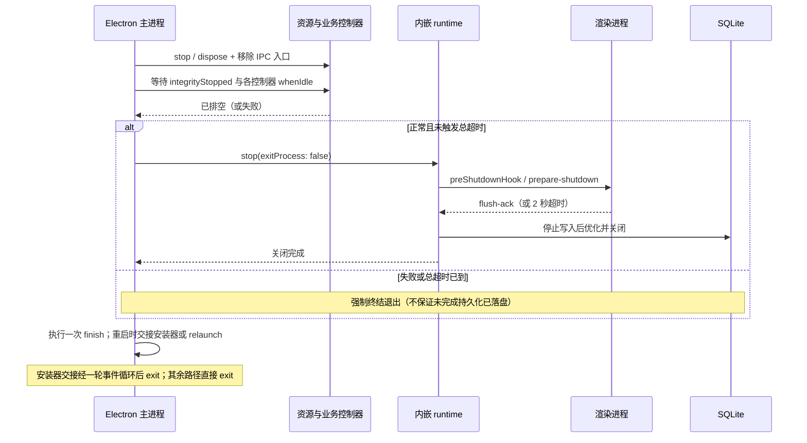

# 桌面壳主进程：窗口、协议与生命周期

> 涉及文件：[src/electron/main.js](../../../src/electron/main.js)、[src/electron/desktop-user-data.js](../../../src/electron/desktop-user-data.js)、[src/electron/cloud-sync-controller.js](../../../src/electron/cloud-sync-controller.js)、[src/electron/remote-gift-controller.js](../../../src/electron/remote-gift-controller.js)、[src/electron/desktop-auth-controller.js](../../../src/electron/desktop-auth-controller.js)、[src/electron/desktop-update-controller.js](../../../src/electron/desktop-update-controller.js)、[src/electron/desktop-logger.js](../../../src/electron/desktop-logger.js)、[src/electron/media-request-headers.js](../../../src/electron/media-request-headers.js)、[src/electron/license/license-manager.js](../../../src/electron/license/license-manager.js)、[src/electron/license/license-runtime-policy.js](../../../src/electron/license/license-runtime-policy.js)、[src/electron/desktop-lifecycle.js](../../../src/electron/desktop-lifecycle.js)、[src/electron/desktop-main-window.js](../../../src/electron/desktop-main-window.js)、[src/electron/desktop-permissions.js](../../../src/electron/desktop-permissions.js)、[src/electron/playback-flush.js](../../../src/electron/playback-flush.js)、[src/electron/terminal-log.js](../../../src/electron/terminal-log.js)、[src/electron/local-media-access.js](../../../src/electron/local-media-access.js)、[package.json](../../../package.json)

本文档是 Electron 桌面主进程的**单一事实来源**，集中维护进程入口、启动序列、主窗口规格、`local-media://` 协议、请求头规则、关闭排空时序、日志体系与主进程专项控制器。IPC 通道全量注册表见 [preload.md](preload.md)，登录会话见 [auth.md](auth.md)，辅助窗口见 [windows.md](windows.md)，自动更新运行时见 [update.md](update.md)，后端服务生命周期见 [../backend/server-core.md](../backend/server-core.md)，数据目录树见 [../backend/storage.md](../backend/storage.md)。

**主进程模块边界**：

- `main.js`：唯一 Electron 组合根，仅持有模块装配引用和只读路径配置，负责应用、窗口、协议与 IPC 接线，通过最小回调接口协作，不再共享跨模块的全局可变状态对象。
- `desktop-lifecycle.js`：维护关闭任务、确认任务与总超时，统筹受控关闭与重启流程。
- `desktop-main-window.js`：维护主窗口实例与服务 URL。
- `desktop-readiness-controller.js`：负责授权与礼物目录就绪后的页面导航、路由代次与启动恢复协调。
- `cloud-sync-controller.js`：协调设置、歌库、B 站凭据三个云端作用域的修订号、待同步标记（dirty）、SSE 失效通知、低频兜底与应用。
- `remote-gift-controller.js`：负责服务端权威礼物的 DeviceBearer SSE、最终游标对账、断线重连和本地投影（由本地 `gift-sync-store` 在 SQLite 事务中按来源隔离保存恢复状态）。
- `desktop-auth-controller.js`：管理平台登录窗口、认证队列串行化与加密快照。
- `desktop-update-controller.js`：管理更新状态推送与启动检查定时器；更新状态唯一存放于 `update-manager.js`。
- `desktop-logger.js`：维护运行标识（`runId`）与日志序号，执行有序写入与单条/单文件限流。
- `media-request-headers.js` 与 `desktop-request-auth.js`：前者注册唯一的请求头监听，组合媒体规则与后者的本地管理主框架认证；后者负责精确 frame/`session` 校验、重定向凭据剥离与主窗口导航监听。
- `license-manager.js` 与 `license-runtime-policy.js`：前者维护设备身份、会话和授权生命周期状态，后者定义授权状态枚举、重新认证条件与维护计时常量。

所有辅助模块均通过显式回调访问窗口和路径，不反向读取 `main.js` 的全局变量。

## 1. 进程形态与入口

| 项目 | 事实 | 出处 |
| --- | --- | --- |
| 入口 | `package.json` 的 `main` 指向 `src/electron/entry.js`，由其加载组合根 `main.js` | [package.json](../../../package.json) |
| 运行形态 | `npm run desktop` → `electron .`；后端 HTTP 服务与 Electron 主进程**同进程**运行（通过运行时适配器加载 `../server`，见 §2） | [package.json](../../../package.json)、[server-core.md](../backend/server-core.md) §1 |
| 应用名 | `app.setName('LIRA')`；持久化目录使用固定 `appId` 名称，不依赖产品展示名派生 | [main.js](../../../src/electron/main.js) |

[entry.js](../../../src/electron/entry.js) 先获取 Electron 的 `app` / `dialog`，再加载组合根；若捕获到组合根及其依赖的同步加载异常（如缺失生产依赖），尽力加载本地路径解析与日志模块保存启动诊断，随后弹窗显示「LIRA 启动失败」与原始错误并建议覆盖安装，关闭弹窗后调用 `app.exit(1)` 退出（即使弹窗自身抛错也保证退出，避免残留无窗口进程阻塞后续安装）。验证见 [原生启动回归](../../../test/desktop/electron-startup.test.js)。

`whenReady` 后的异步启动失败由 `main.js` 记录并提示，再调用 `desktopLifecycle.requestShutdown({ exitCode: 1 })` 清理已创建资源（弹窗抛错同样不跳过关闭）。验证见 [electron-startup-data.test.js](../../../test/desktop/electron-startup-data.test.js)。

**单实例锁**：`app.requestSingleInstanceLock()` 获取失败时立即 `app.quit()`；触发 `second-instance` 事件时还原并聚焦主窗口；锁在退出流程末尾释放（§7）。非 macOS 平台在 `window-all-closed` 时直接 `app.quit()`。

## 2. 启动序列 `startDesktopApp`

模块初始化阶段先由 `desktop-user-data.js` 解析稳定数据目录。若需一次性迁移旧版 AppData 数据，先在来源业务数据根申请旧版单实例锁，确认来源实例已停止并完成复制发布后再释放来源锁；随后在安装目录业务数据根申请运行期单实例锁，迁移浏览器目录并设置 Electron `userData` 与 `sessionData`（迁移失败时保留源数据并停止启动，避免空配置运行）。`app.whenReady()` 之后按以下顺序启动：

1. `configureDesktopEnvironment()` — 配置迁移后的数据/日志目录、环境变量、终端日志与 `local-media` 访问控制；创建播放输出、电音助手与外观适配器并注册对应 IPC（§3 / §5 / §8）。
2. `migrateLegacyPartitions({ app, writeLog })` — 将旧 `%APPDATA%` 登录分区完整复制后原子发布（Windows 短暂占用返回 `EPERM` / `EBUSY` 时仅重试重命名，最多 5 次、间隔 50/100/150/200ms，不重复复制；目标已存在或重试耗尽时抛错并中止启动，详见 §3.2）。
3. `configureMenu()` — 调用 `Menu.setApplicationMenu(null)`。
4. `configureLocalMediaProtocol()` — 注册 `local-media` 协议处理器（§5）。
5. `registerDesktopShellIpc()` / `registerMusicIpc()` / `registerBilibiliIpc()` — 注册桌面外壳（[desktop-shell-ipc.js](../../../src/electron/ipc/desktop-shell-ipc.js)）、音乐与 B 站 IPC 处理器（清单见 [preload.md](preload.md) §2）。
6. 创建本地请求授权适配器，并执行 `configureMediaRequestHeaders()` 与 `configureAudioMediaCors()`（§6）。
7. `configureAutoUpdater()` — 接入由 [createDesktopUpdateController](../../../src/electron/desktop-update-controller.js) 创建的自动更新控制器（见 [update.md](update.md) §3）。
8. `await restoreMusicCookieSnapshots()` → `await restoreBilibiliCookieSnapshot()` — **先于内嵌服务启动**恢复平台会话（见 [auth.md](auth.md) §8）。
9. 初始化豆包账号会话，再调用 `createDesktopRuntime(serverRuntimeModule, options)` 创建并保存 `runtime`（注册 `setPreShutdownHook(requestPlaybackFlush)`，注入数据目录、`safeStorage`、模型会话与授权适配器）。
10. `await runtime.start(serverOptions)` — 启动内嵌 HTTP 服务（注入契约见 [auth.md](auth.md) §11、[server-core.md](../backend/server-core.md) §6.1）。
11. 创建 `licenseManager`、注册授权 IPC 并执行 `await licenseManager.bootstrap()`（此时本地服务通过动态 `licenseGate` 拦截未授权的 Admin、业务 API 与 WebSocket）。
12. 创建 `cloudSyncController`（注入授权管理器、本地运行时与仅主进程可访问的 B 站 Cookie 适配器）和 `remoteGiftController`（注入 SQLite 礼物同步存储）；场景云订阅、粉丝档案等控制器在各自授权约束下完成接线。
13. 通过 `license/license-resume.js` 的 `createLicenseResumeHandler` 注册 `powerMonitor` 的 `resume` 监听：系统唤醒时主进程立即调用 `licenseManager.resume()` 重新确认设备会话，成功后触发云端同步与远端礼物游标恢复。
14. `registerLocalFontPermissionHandler(...)` — 将本机字体权限限制为内嵌服务的精确源，并经原生对话框征得用户同意（§4）。
15. 创建 `desktop-readiness-controller.js` 实例，按其 `initialRoute` 创建主窗口并调用 `start()`：未授权或首次礼物目录未完成时加载 `/license`（通过受限 IPC 展示进度，完成后跳转 `/admin?desktop=1`）；已就绪的授权启动直接进入 Admin。每次启动发起一次带 ETag 的目录条件请求，运行中每 12 小时增量检查补图（无变化时静默）。
16. 授权与目录就绪后的导航和恢复由 [desktop-readiness-controller.js](../../../src/electron/desktop-readiness-controller.js) 统筹：已授权启动先调用 `remoteGiftController.start()` 建立来源隔离，再调用 `cloudSyncController.start()`；云同步完成且授权与恢复代次仍有效时恢复本地 B 站工作。授权恢复绑定稳定的 `getAuthorizationGeneration()`，同主体正常令牌续期不取消等待中的恢复；撤销、切换授权或 `dispose` 后旧恢复与旧导航失效。离开 `AUTHORIZED` 时停止远端礼物流。`CHECKING` 和 `AUTHORIZING` 期间保留当前页面。确认失权后，主进程先向可能仍在运行的电音助手发出 `stop`，随即暂停授权业务并切回 `/license`。

`createDesktopRuntime` 定义于 [desktop-runtime.js](../../../src/electron/desktop-runtime.js)：若传入模块已具备 `start` / `stop` / `setPreShutdownHook` 则直接返回；若暴露 `createServerRuntime(options)` 则调用工厂创建。开发模式（未打包）在窗口就绪后将更新状态设为 `dev-disabled`（见 [update.md](update.md) §2）。

### 2.1 设备授权生命周期

三个硬件标识均读取成功后，主进程在本次运行内复用它们的 SHA-256。部分读取失败时下次重采。激活签名使用发送激活请求前计算的原始归档摘要。远端回执到达并写入设备身份后，认证重新并行采集指纹与完整归档 SHA-256，再用本次 challenge 签名。续期和 challenge 重试各自重新采集证明。

- **远程传输与协议拆分**：[license/license-transport.js](../../../src/electron/license/license-transport.js) 负责远程 HTTP/SSE 通信，统一处理认证头、超时、取消、响应大小上限和错误转换；公共错误码定义在 `remote-license-error.js`。`gift-protocol.js`、`song-protocol.js`、`display-settings-protocol.js`、`cloud-account-protocol.js` 各自维护领域固定端点、专用容量上限/请求头、响应校验与授权操作；`remote-license-client.js` 与 `license-operations.js` 仅做工厂装配。HTTPS 根源校验复用 `shared/remote-url-policy.js`。
- **设备认证与状态维护**：[license/device-authentication.js](../../../src/electron/license/device-authentication.js) 负责设备激活/认证端点、指纹与构建证明采集、签名及 challenge/verify（含一次 challenge 重试）。`license-manager.js` 维护设备身份、内存访问令牌、续期、心跳、生命周期代次与操作互斥；持久化文件仅保存公开设备资料，私钥由 `safeStorage` 加密，访问令牌不落盘也不进入 preload 或渲染进程。
- **操作互斥与构建摘要**：`bootstrap` 与 `activate` 共用互斥的在途操作（在启动或唤醒检查期间提交激活会等待检查结束后再校验激活入参，已有激活在途时合并重复请求）。`license/build-integrity.js` 使用 Electron `original-fs` 异步读取原始 `app.asar`（复用单个 64 KiB 缓冲区逐块计算 SHA-256，不缓存结果），避免阻塞主线程；摘要完成后再次核对生命周期，已失效操作不再发起请求或暂存密钥。
- **响应体大小上限**：`license-transport.js` 普通 JSON 响应默认上限为 1 MiB（按 UTF-8 字节计）。公共礼物目录采用独立的 32 MiB 上限（按解码流累计字节，按 2026-09-25 实测目录约 1.61 MiB 估算预留近 20 倍余量；未来超出时需显式调整配置上限）：超限时中止读取并返回 `RESPONSE_TOO_LARGE`，保留上一份完整内存/磁盘目录与 ETag（测试见 [remote-catalog-cache.test.js](../../../test/gifts/remote-catalog-cache.test.js)）。
- **状态流转与维护策略**：
  - 状态枚举：`CHECKING` / `NEEDS_ACTIVATION` / `NEEDS_CONNECTION` / `AUTHORIZING` / `AUTHORIZED` / `BLOCKED`，仅 `AUTHORIZED` 放开本地业务门禁。
  - 令牌续期复用同一个在途 Promise（并发复用），其余受保护请求与心跳必须等待其完成，避免旧 `token_jti` 与新令牌并发冲突。
  - `getProfile()` 仅合并同一授权生命周期内的在途读取，完成或失败后清除；切换账号、重新授权或退出不复用旧请求。仅展示初始账号/URL 的界面使用安全的 `getState()` 快照与订阅，完整设备资料和显式刷新仍请求远端。
  - 默认 10 分钟令牌在到期前 90 秒续期，心跳每 150 秒执行一次。
  - 令牌仍有效时的续期失败按 `license/retry-policy.js` 做有界指数退避（基础 5 秒倍增、封顶 60 秒、抖动系数 `[0.5, 1.5)`，并受令牌剩余有效期钳制）；连续 10 次失败进入 `NEEDS_CONNECTION`，成功或状态切换时重置。
  - 令牌已失效时遇到 HTTP 408/429/5xx、DNS 或超时进入 `NEEDS_CONNECTION`（不删除设备身份）；令牌有效期间的单次网络失败保持 `AUTHORIZED`。
  - Device / License / Streamer 撤销或会话拒绝立即清空内存令牌、停止维护定时器并进入 `BLOCKED`，主进程暂停授权业务并切回 `/license`。
  - 系统唤醒时立即发送心跳；若此前处于 `NEEDS_CONNECTION`，则重新执行 challenge/verify。

### 2.2 云端同步生命周期

当前账号完成过完整对账且 SSE 已打开时，纯本地上传收到有效修订号、所有待传变更均已确认后，可省去紧随上传的 `GET cloud-state`。原定的十分钟核对照常到期。首次同步、重新连流、其他作用域的新修订和显式同步均继续核对权威状态。礼物互动仅在开关、文案、回复、保存状态或错误变化时通知页面。歌单上传以同一份 UTF-8 JSON 校验 5 MiB 上限并发送。

- **账号边界与房间/歌库隔离**：
  - 同步归属由 `licenseManager.getCloudSyncIdentity()` 返回的 `accountName`、`streamerId` 与认证服务器源共同构成（仅供主进程内部使用）。首轮同步及身份变化前，先通过 `prepareCloudRoomAccount` 完成 [房间归属事务](../backend/storage.md#8-云端-scope-的本地落盘)，无有效身份或事务失败不发请求；账号边界尚未建立前，本地设置修改不会记入待上传变更。
  - 磁盘歌库另以私有 `cloudSongAccountKey` 记录归属：切换账号后在待传恢复或云端拉取完成前返回 `CLOUD_SONGS_NOT_READY`；同账号同内容替换保留原歌曲 ID 与队列关联；仅在云端明确未初始化时才将本地库作为首次播种。
- **协调架构与生命周期代次**：
  - `cloud-sync-controller.js` 在主进程内统筹同步（不持久化云端修订号）：授权成功后立即同步并建立一条 DeviceBearer SSE（15 秒连接超时、60 秒空闲超时，服务端每 25 秒发注释心跳，断线按 1–60 秒退避重连，支持超长 `Retry-After` 分段等待）；SSE 通知合并各作用域的最高修订号，已覆盖的旧修订号不重复触发 GET；另设可 `unref()` 的 10 分钟兜底定时器，系统唤醒后主动调用 `syncNow()`。每轮同步捕获生命周期代次与取消信号，停止或 `dispose()` 后递增代次并中止在途 HTTP/SSE，与礼物控制器共用 [cancellable-delay.js](../../../src/shared/cancellable-delay.js)。
  - [cloud-settings-sync-controller.js](../../../src/electron/cloud-settings-sync-controller.js) 负责设置快照的待传读取、当前菜单投影、上传确认、失效盲盒身份修复（遇到 `INVALID_GIFT_BLIND_BOX_CONFIG` 时按服务器有效列表移除失效 `customId` 并重试一次）以及拉取应用（菜单上传签名随父控制器停止而重置）。
  - [cloud-bilibili-sync-controller.js](../../../src/electron/cloud-bilibili-sync-controller.js) 负责凭据上传与拉取应用，复用本地认证模块的会话代次校验；具体凭据清洗、退出意图持久化与防反向同步规则见 [auth.md §13](auth.md#13-云端-bilibili-凭据同步边界)。
  - [cloud-song-sync-controller.js](../../../src/electron/cloud-song-sync-controller.js) 负责歌曲恢复、上传与拉取（摘要的 `revision` 或 `updatedAt` 任一变化即重新拉取完整快照，覆盖服务端回档；本机待传编辑优先于远端替换）。
  - [gift-interaction-controller.js](../../../src/electron/gift-interaction-controller.js) 维护自动感谢、数据查询开关与四组礼物答谢文案的提交状态，共用父控制器的账号代次与串行队列（文案字段与错误码见 [preload.md](preload.md) §2.4）。
- **待传快照与歌库手动同步**：
  - 三个作用域各自跟踪修订号、待同步标记（dirty）与本地修改代次：本地修改先递增代次、持久化待传快照并立即串行上传，仅在完成时代次未变且匹配 `mutationId` 时清除待同步标记（存储格式见 [../backend/storage.md](../backend/storage.md#8-云端-scope-的本地落盘)）。
  - 手动歌库同步先核对归属并返回完整数量与确认代次，确认后进入同一串行队列并在执行时读取最新快照（界面筛选不参与上传；字段 UTF-16 上限与零基 `index` 错误见 [preload.md](preload.md) §2.4）。若旧版服务端曾截短上传字段，恢复时比对本机原稿与截短结果一致后会将其重新保留为待传快照。`song-protocol.js` 校验服务端回执 `ok === true` 且 `count` 与提交快照长度一致，不匹配返回 `INVALID_RESPONSE` 且不清除待同步标记。

### 2.3 服务端权威礼物接收生命周期

- **状态机、来源隔离与防护校验**：依据 [ADR-0011](../../architecture/adr/0011-source-partitioned-gift-ledger-projection.md)，同步进度存储在 SQLite `gift_sync_state` 表中（替代旧 JSON 游标文件）。`remote-gift-controller.js` 仅在 `AUTHORIZED` 时运行，维护 `SOURCE_SWITCHING` / `BOOTSTRAPPING` / `CATCHING_UP` / `LIVE` / `OFFLINE` / `LEGACY_PARTIAL` / `ERROR` 状态与取消逻辑；来源标识、历史分页与错误分类纯规则分由 [remote-gift-recovery-rules.js](../../../src/electron/remote-gift-recovery-rules.js) 和 [remote-gift-history.js](../../../src/electron/remote-gift-history.js) 提供。每个异步任务在 `await` 前后和写入事务前均核对四字段防护校验（`{sourceId, authorizationEpoch, controllerGeneration, projectionGeneration}`），拦截过期写入。切换授权主体时，主进程先冻结本地礼物 API、递增控制器代次、中止 HTTP/SSE 并等待 `whenIdle()`，再解析并开放新来源分区；清库复用同一静默排空流程，并在 SQLite 事务内递增投影代次（完整时序见 [gift-ledger-projection-sync_design.md](../../../specs/gift-ledger-projection-sync_design.md)）。
- **历史恢复、即时投影与 10 秒补拉**：
  - 启动先探测远端历史能力与同步纪元（`sync epoch`）：不支持历史接口的旧服务端明确进入 `LEGACY_PARTIAL`（不把基线数据当作完整历史）；支持历史接口时先完成历史分页或游标追平，再建立主进程 SSE 并追平窗口内事件。可重试错误按有界指数退避恢复，同批通知合并为一次游标追平。
  - 礼物 SSE 原始 JSON 仅在 `license/gift-protocol.js` 中经 `normalizeProcessedGiftEvent` 做传输字段白名单校验并生成含整数分金额的标准事件对象；`remote-gift-controller.js` 调用 `canonicalizeProcessedGiftEvent` 处理内部对象，不能再套用原始接口白名单拦截派生字段。
  - 实时进度（`progress`）仅在 `LIVE` 状态直接投影；在干净 `LIVE`、历史初始化已完成、SSE 纪元已校验且游标连续时，最终记录（`final`）经 `commitGiftCatchUpPage` 原子提交记录与游标并执行下游调用方，无需逐条补拉；乱序、断线、初始化中或纪元未校验时统一以 HTTP 拉取为准。
  - 进入 `LIVE` 或 `LEGACY_PARTIAL` 后，控制器每 **10 秒**经串行队列补拉一次最终游标以覆盖 SSE 静默丢通知场景（结束后重新计时，不叠加慢请求；SSE 提交不刷新 `syncedAt` 或重置该 10 秒定时器）。SSE 断开按 1–60 秒退避重连，停止时取消 HTTP、SSE 与定时器。设备令牌、来源摘要输入、引导令牌和远端句柄仅留主进程，日志不输出分页令牌或完整礼物响应。
- **礼物特效帧**：礼物 SSE 声明 `X-Lira-Gift-Effects: 1`，接收独立 `gift-effect` 帧。`gift-protocol.js` 校验代码并移除传入媒体后交给 `remote-gift-controller.onEffect`，调用 `runtime.publishGiftEffect`（复用 `domainServices.gifts.resolveEffect`），异步解析前后均复核本地开关与防护校验；该临时展示事件不进入账本或游标恢复（见 [弹幕礼物特效规格](../../../specs/gift-effect-danmaku.md)）。
- **礼物保留快照同步**：[remote-gift-retention.js](../../../src/electron/remote-gift-retention.js) 由 `remote-gift-controller` 调用，沿用主进程持有的 DeviceBearer、来源与授权代次。探测 `giftRetentionVersion=1` 后，首次或游标失效时拉取完整汇总与近期明细，正常运行每 10 分钟检查变化日，激活后交回增量补拉与 SSE 并唤醒本地清理模块。桌面启动传 `deferMaintenance: true`，主窗口就绪后调用 `startBackgroundMaintenance()`（合并启动、激活与每小时维护请求，批间让出 25ms，数据库关闭前先停止定时器）。授权切换、清库与停机沿用原有防护校验与 `AbortController`；远端同步纪元（`epoch`）变化走投影重建，同纪元过期游标保留已收到的年内明细（若跳过未处理游标，旧日期完整性证明失效并标为「部分明细」）。存储事务见 [storage.md](../backend/storage.md)。

十分钟增量摘要查询沿用当前礼物流。需要恢复暂存或提交摘要时，控制器取消已排队的重连、关闭流并进入 `BOOTSTRAPPING`。激活后按原来源的重连截止时间恢复 SSE，并通过 HTTP 补拉其间的事件。首次对账及 UTC 日期变化时请求本地留存维护，清理截止仍以服务器水位为准。现代协议的 HTTP 终页即使为空也提交核对时间 `syncedAt`。

### 2.4 云弹幕订阅与展示缓冲

`scene-cloud-controller.js` 的云弹幕连接由 `scene-runtime` 的共享展示需求驱动：读取弹幕投影或默认外观，以及含弹幕的本机通知流成功发送 `ready` / `change` / 心跳时续期；最后一次活动 15 秒后自动停止，再次使用时在授权有效下恢复。多个本机来源共用一条连接；展示归属绑定 `getAuthorizationGeneration()`，普通令牌续期不重连或清空，退出、失效、重新授权及账号/服务器变化时终止旧上下文（`license-overlay-ipc.js` 校验设置读取/保存结果后，按请求前捕获的作用域与代次回填场景外观缓存，无需常开云 SSE 即可保存样式）。

云弹幕订阅携带 `superchatDelete=1`，`scene-cloud-controller.js` 校验 `superchat-delete`（1–128 个唯一小写 64 位十六进制 ID，初始化前或格式错误关闭连接，他场撤回忽略），同场撤回作为增量事件进入 `cloud-display-buffer.js`，后续快照与样式重建不会复活已撤回 SC，且不进入本地结算或点歌。

主进程将连接状态（`connecting` / `connected` / `stopped`，主动停止区分 `DISPLAY_IDLE`、`OWNER_CHANGED`、`AUTHORIZATION_UNAVAILABLE`、`APP_STOPPED`）记入 `desktop.log`，异常以 `scene-cloud-error` 记入 `errors/desktop.log`（仅含分类、数字 HTTP 状态与重试等待，不记 URL、正文或凭据）。首次状态超时 15 秒、已初始化流静默超时 45 秒、重连退避 1–30 秒。

## 3. 数据目录决策

### 3.1 业务数据与浏览器持久化路径

| 项目 | 路径与规则 | 出处 |
| --- | --- | --- |
| 打包版业务目录 | `<安装目录>/data`；首次安装有 D 盘默认 `D:\LIRA`，无 D 盘沿用 builder 默认；升级沿用原安装目录 | [desktop-user-data.js](../../../src/electron/desktop-user-data.js)、[installer.nsh](../../../build/installer.nsh) |
| 开发版业务目录 | `ROOT_DIR/data`（仓库根目录） | [desktop-user-data.js](../../../src/electron/desktop-user-data.js) |
| 日志目录 | `path.dirname(dataDir)/logs`（打包版为 `<安装目录>/logs`） | [main.js](../../../src/electron/main.js) |
| 会话与崩溃记录 | `sessionData = userData = data/browser`；业务 `dataDir` 仍为 `data`，`crashDumps = data/browser/Crashpad` | [main.js](../../../src/electron/main.js) |
| 更新缓存 | `<安装目录>/updates/lira-updater`（不再使用系统默认 AppData 更新缓存） | [update-manager.js](../../../src/electron/update-manager.js) |
| 环境变量 | `SONG_PLUGIN_DATA_DIR = dataDir`、`ELECTRON_DESKTOP = '1'`、`HOST` 缺省 `127.0.0.1` | [main.js](../../../src/electron/main.js) |

完整数据目录树见 [../backend/storage.md](../backend/storage.md) §2。单实例锁先使用原业务数据根申请再切换 Chromium 配置目录，保证新旧版本共享锁身份；`.browser-layout-v1.json` 与 `.cache-layout-v1.json` 在 `ready` 前记录并续跑目录布局迁移（决策见 [ADR-0016](../../architecture/adr/0016-separated-client-data-lifecycles.md)）。

### 3.2 升级迁移

- **NSIS 安装与卸载侧**：NSIS 在替换程序前先确认目标目录的 LIRA 及音频进程已退出；同目录更新核实旧卸载器 SHA-256 能力记录匹配时直接原地保留 `data/`，其余兼容场景经 `robocopy` 备份至同级 `.lira-data-backup` 并在替换后恢复；普通卸载默认保留 `data/`，仅二次确认后删除（完整条件与脚本实现见 [build.md §6](../engineering/build.md#6-nsis-安装脚本buildinstallernsh)）。
- **Electron 启动期防空库与旧数据迁回**：
  - 若启动时检测到未完成恢复的同级备份目录，拒绝启动后端以避免生成空库。仅有备份时提示重跑安装包，同时发现原数据和备份时显示两处路径并请用户联系安装包提供者。
  - 仅在本地 `data/` 不存在时，`desktop-user-data.js` 才会以 `%APPDATA%/com.aurorawhisperer.lira/data` 为兼容来源迁移：复制前先持有来源目录旧版单实例锁并校验 `.server-runtime.json`，确认旧实例已退出后复制到暂存目录再原子发布（对 `EPERM` / `EBUSY` 最多重试 5 次、间隔 50/100/150/200ms，不重复复制；目标已存在或失败时停止并清理暂存目录，释放来源锁后再申请运行期锁）。授权私钥继续使用 `safeStorage`，目录变更不改变 DPAPI 加密边界（决策见 [ADR-0015](../../architecture/adr/0015-install-local-desktop-data.md)）。
  - 更早期的 `%APPDATA%/LIRA/Partitions/` 仅在当前配置目录不存在 `Partitions/` 时兼容迁移（复制到同级 `.Partitions.migration-*` 后原子发布，失败清理暂存并中止启动，不覆盖已有目标）。测试见 [desktop-user-data.test.js](../../../test/desktop/desktop-user-data.test.js)、[electron-startup-data.test.js](../../../test/desktop/electron-startup-data.test.js) 与 [desktop-user-data-electron.test.js](../../../test/desktop/desktop-user-data-electron.test.js)。

## 4. 主窗口

[desktop-main-window.js](../../../src/electron/desktop-main-window.js) 的 `create(baseUrl, authorized)` 创建主窗口并绑定请求鉴权，随后由 [desktop-readiness-controller.js](../../../src/electron/desktop-readiness-controller.js) 发起首次导航并监听授权与目录状态切换路由（加载失败按导航代次处理并释放目标以便重试）。

| 项目 | 规格 | 出处 |
| --- | --- | --- |
| 尺寸 | **1260×820**，`minWidth: 1024`，`minHeight: 680` | [desktop-main-window.js](../../../src/electron/desktop-main-window.js) |
| 窗口形态 | `frame: false`（自绘标题栏）、`backgroundColor` 跟随本机客户端外观（登录页固定 `#f7f3ef`）、`show: false` 待 `ready-to-show` 显示 | [desktop-main-window.js](../../../src/electron/desktop-main-window.js) |
| 加载 URL | 已授权且礼物目录已初始化时 `{baseUrl}/admin?desktop=1`，否则 `{baseUrl}/license`。文档加载完毕后主窗口推送当前最大化状态 | [desktop-readiness-controller.js](../../../src/electron/desktop-readiness-controller.js) |
| `webPreferences` | `preload: preload.js`、`contextIsolation: true`、`nodeIntegration: false`、`sandbox: true` | [desktop-main-window.js](../../../src/electron/desktop-main-window.js) |
| 图标 | 附加与关于页共享的 `public/img/shared/lira-app-icon.png` | [desktop-main-window.js](../../../src/electron/desktop-main-window.js) |

主窗口启用 `sandbox: true`，[preload.js](../../../src/electron/preload.js) 仅通过沙箱支持的 `require('electron')` 暴露固定方法，页面无 Node 集成（IPC 来源模型见 [preload.md](preload.md#1-安全模型)，Electron 版本与打包工具版本见 [build.md](../engineering/build.md) §2）。

导航与管理认证由 [desktop-request-auth.js](../../../src/electron/desktop-request-auth.js) 在 `loadURL` 前绑定：`setWindowOpenHandler` 拒绝新建窗口，仅对白名单外链调用 `shell.openExternal`；`will-navigate` 与 `will-redirect` 仅放行精确服务源的管理页面别名、`/license` 和管理页发起的 `/api/*` 下载，拒绝跳入展示页或未授权外域（管理 Bearer 附头契约见 [auth.md](auth.md) §11.1）。

窗口 `maximize` / `unmaximize` 事件通过 `desktop:window-maximized` 推送给渲染进程并在窗口关闭时移除监听（见 [preload.md](preload.md#3-消息订阅与播放持久化)）。`ready-to-show` 后显示窗口、推送当前更新状态，并在打包版且开启自动更新时延迟 1 秒执行首查（见 [update.md](update.md) §1）。

**本机字体权限**：[desktop-permissions.js](../../../src/electron/desktop-permissions.js) 仅响应精确本地源的 `localFonts` 请求，经原生对话框征得用户明确同意后放行（仅读字体名，不读字体文件或路径）；管理页通过 `shared/local-font-library.js` 复用一次 `window.queryLocalFonts()` 查询，无需额外 IPC。

### 礼物 PNG 导出

`gift-export-controller.js` 从运行时获取冻结记录、配置与目录（默认保存至系统图片目录 `LIRA/礼物导出/日期/时间-随机标识`，更改根目录仅走原生对话框），任务目录独占创建，PNG 以 `wx` 防覆盖。隐藏沙箱窗口固定加载 `/gift-export`（无 Node/preload，拒绝导航与新窗口），保存时将冻结的配置、礼物目录和预览中的舰队人数一次传给渲染窗口，建立图片索引，再按预览顺序 `capturePage` 输出 2× PNG（单行基础 `428×72` / 2× `856×144`，默认间隔 `16px`，双条合图可调至 `0–32px`，合图每张最多 39 条，支持透明/白色背景及合图/逐条）。取消、来源失效、导航或关闭均销毁窗口并保留已落盘文件（IPC 与合并配置见 [preload.md](preload.md#6-礼物导出任务与取消)）。

### 周表 PNG 导出

[weekly-schedule-export-controller.js](../../../src/electron/weekly-schedule-export-controller.js) 通过受限 IPC 桥接收主窗口模板数据（字段与图片限额见 [preload.md](preload.md#25-dailybotsfanprofiles-与-giftexport)），与编辑器共用 [renderer.js](../../../public/js/admin/weekly-schedule/renderer.js)。系统保存对话框默认建议当前可执行文件同级的 `周表/主播或模板名_周一日期.png`。若无法创建该目录，对话框仍使用同一文件名，由用户选择保存位置。取消即结束本次导出。

两类导出通过注入的 `nativeImage` 将截图缩放到目标像素尺寸，末尾编码一次 PNG。仅有高分屏表示且逻辑尺寸正好等于目标时，从原始位图恢复物理尺寸。行宽有歧义时由 Chromium 缩放整幅原图。写盘前，各控制器检查至少 24 字节的 Buffer、PNG 签名及目标宽高，失败时返回本项导出的尺寸错误。周表最终文件固定为 `1920×1080` 像素。各自的任务、取消、保存对话框和文件写入策略仍由各控制器负责。 [编码与尺寸检查](../../../src/electron/png-size.js)

隐藏导出窗口画布固定 `1920×1080`，启用沙箱、上下文隔离与 `webSecurity`，无 Node/preload，运行在非持久化内存分区 `lira-weekly-schedule-export` 中，拒绝权限、导航、重定向与新窗口，仅允许固定导出页、同源静态资源与本机 data/blob 图片（首次 `loadURL` 经请求头携带本次管理凭据，不改动主 `session`）。加载后调用 `setContentSize` 恢复 `1920×1080` 内容区，待字体、图片解码与两次动画帧完成且校验视口完整、文字无溢出后执行 `capturePage` 并核验 PNG 头像素尺寸（仅对 Chromium `UnknownVizError` 在下一帧重试一次）。同一控制器仅允许一项任务，主 frame 导航、窗口销毁或释放时取消任务并销毁隐藏窗口，落盘采用同目录独占临时文件原子重命名。验证见 [weekly-schedule-export.test.js](../../../test/desktop/weekly-schedule-export.test.js) 与 [weekly-schedule-electron.test.js](../../../test/desktop/weekly-schedule-electron.test.js)。

## 5. `local-media://` 协议

用途：让前端 `<audio>` 播放用户授权的本地音频文件，同时隔离未授权磁盘路径。启动前通过 `protocol.registerSchemesAsPrivileged` 注册 `standard` / `secure` / `supportFetchAPI` / `stream` / `bypassCSP` 特权；URL 格式为 `local-media://media/<base64url 编码的绝对路径>`（由 `music:resolve-local-media-urls` 生成，见 [preload.md](preload.md) §2.2）。

**处理器流程（[local-media-protocol.js](../../../src/electron/local-media-protocol.js)）**：

1. 解析并 base64url 解码文件路径；非法返回 400。
2. 每个请求（含每个 Range）独立执行一次 `fs.promises.realpath` 解析真实路径。找不到文件返回 404。
3. 用 `localMediaAccess.isCanonicalAllowed(canonicalPath)` 检查允许清单与音频扩展名，未通过返回 403。协议再核对扩展名并对同一真实路径异步 `stat`，只读取普通文件。
4. 按扩展名设置 MIME（`audio/mpeg`、`audio/flac`、`audio/wav`、`audio/aac`、`audio/ogg`、`audio/mp4`、`audio/x-ms-wma`）。
5. 请求单个有效的字节区间时返回 206。范围不可满足时（包括 `bytes=N-` 的起点等于或超过文件大小）返回 416，正文为空，并带 `Content-Range: bytes */<文件大小>`。省略 `Range` 或范围格式无效（包括显式结束位置小于起点）时返回完整文件（200）。200 和 206 均带 `Accept-Ranges: bytes` 与 `Cache-Control: no-store`。

扩展名与 MIME 对照由 [local-audio-formats.js](../../../src/electron/local-audio-formats.js) 统一提供，文件选择器、允许路径存储与协议处理器共同使用；路径授权与协议请求仍分别执行自己的来源、真实路径及允许清单校验。

**访问控制（[local-media-access.js](../../../src/electron/local-media-access.js)）**：允许清单持久化到 `dataDir/local-media-access.json`（新增路径落盘成功后才更新内存集合，写盘失败保留旧授权）。

**安全约束**：

- **仅允许清单内路径**：不隐式开放 `dataDir` 子树，防止渲染进程读取数据库、会话令牌或配置文件。
- **双重扩展名白名单**：`allowPaths` 授权与 `isAllowed` 校验均检查音频扩展名。
- **符号链接规范化**：选择文件、IPC 生成 URL 和协议读取各自解析真实路径。先前授权的 URL 不能替代当前请求对真实路径的校验。
- **IPC 来源校验**：`music:resolve-local-media-urls` 校验请求来自精确可信本地源；`music:select-local-files` 对话框限定音频扩展名并规范化写入清单。

## 6. 请求头伪装

Chromium `session.defaultSession.webRequest.onBeforeSendHeaders` 由 [media-request-headers.js](../../../src/electron/media-request-headers.js) 的 `configureMediaRequestHeaders` 注册唯一合并监听器，为音乐与 B 站媒体/API 请求补齐 `Referer` / `Origin`（**仅在缺失时注入，不覆盖既有值**；host 转小写后匹配域名本身或点分隔子域）：

| 匹配 URL 模式 | host 判定 | 注入请求头 |
| --- | --- | --- |
| `*://*.music.163.com/*`、`*://*.music.126.net/*` | 以 `music.163.com` / `music.126.net` 结尾 | `Referer: https://music.163.com/` |
| `*://*.qqmusic.qq.com/*`、`*://*.gtimg.cn/*`、`*://*.y.qq.com/*` | 以 `qqmusic.qq.com` / `gtimg.cn` / `y.qq.com` 结尾 | `Referer: https://y.qq.com/` + `Origin: https://y.qq.com` |
| `*://*.bilibili.com/*`、`*://*.hdslb.com/*` | 以 `bilibili.com` / `hdslb.com` 结尾 | `Referer: https://www.bilibili.com/` + `Origin: https://www.bilibili.com` |

监听器按 `session` 幂等安装，在关闭终结阶段移除。管理认证与媒体规则共享解析后的目标 URL，普通静态请求可复用原请求头。所有目的地址仍检查并清理重定向残留的管理凭据，附加管理头仍要求精确主框架与目标白名单。

## 7. 关闭序列与播放状态冲刷

主窗口关闭（含 `desktop:close-window` 与原生关闭，不因本机浏览器源连接弹出确认框）、`before-quit`、`before-quit-for-update`、`desktop:restart` 及异步启动失败共用 [desktop-lifecycle.js](../../../src/electron/desktop-lifecycle.js) 的 `requestShutdown({ restart = false, exitCode = 0 } = {})`。该模块内部维护关闭状态，主进程注入排空、停服与最终清理等最小回调。窗口 `close` 先阻止默认销毁以保留渲染进程完成播放冲刷，最终由 `app.exit(exitCode)` 退出（正常 `0`，启动失败 `1`），重复请求复用同一任务且不刷新超时：

1. 每个受控 `before-quit` 均先 `event.preventDefault()` 再委托同一关闭任务（尚无后端且无受控任务时保留默认退出）。更新器启动安装发出的 `before-quit-for-update` 同样直接调用 `requestShutdown()`；仅下载完成不会把普通关窗改为安装或重启。
2. 首个请求保存共享 Promise 并启动唯一 **5 秒总兜底定时器**，后续请求复用任务，不刷新期限也不改变首次退出/重启意图。
3. 保存 `resourceIntegrity.stop()` 返回的 `integrityStopped`，取消更新启动检查定时器，`dispose` 就绪控制器并置空，注销系统唤醒监听；依次调用抽奖授权、礼物互动、礼物导出、粉丝档案、每日机器人 IPC 的 `disposer`，阻断新入口。
4. `dispose` 动态抽奖授权及 `remoteGift`、`cloudSync`、`fanProfile`、`desktopAuth`、豆包会话等控制器并清理主进程引用（取消与代次失效阻止过期结果提交）。
5. `await Promise.all([integrityStopped, dynamicLotteryAuth.whenIdle(), ...controllersToDrain.map(c => c.whenIdle())])`。此阶段运行时与 SQLite 保持可用；排空完成且未触发 5 秒终结才进入停服。
6. `stopRuntime()` 调用 `runtime.stop({ exitProcess: false })`（见 [server-core.md](../backend/server-core.md) §6.2），先执行 `preShutdownHook`（`requestPlaybackFlush`）再关闭后端资源与数据库。
7. 正常完成、失败或超时均汇入唯一 `finish` 收尾：清除定时器，依次注销媒体请求监听、管理请求认证与 `licenseManager`，释放单实例锁并退出（重启交接见下文；日志记录 `QUIT_DONE` / `QUIT_TIMEOUT` / `shutdown-error`）。

| 资源与模块 | 取消入口 / 排空 | 数据依赖与过期写入保护 |
| --- | --- | --- |
| [desktop-resource-integrity.js](../../../src/electron/desktop-resource-integrity.js) | 开始关闭时 `stop()` 并等待返回 Promise | 只读打包资源，不访问业务 SQLite；中止扫描并等待文件句柄释放 |
| [desktop-readiness-controller.js](../../../src/electron/desktop-readiness-controller.js) | `dispose()`（无单独 `whenIdle`） | 移除就绪订阅，阻止过期导航 |
| `license-resume` 唤醒监听 | `unregister()` | 移除 `powerMonitor` 监听 |
| [dynamic-lottery-auth.js](../../../src/electron/dynamic-lottery-auth.js) | 移除 IPC → `dispose()` → `whenIdle()` | 独立 Cookie 分区与快照；后端抽奖任务由 `runtime.stop` 排空 |
| [remote-gift-controller.js](../../../src/electron/remote-gift-controller.js) | `dispose()` + `whenIdle()` | SQLite 礼物投影；中止 HTTP/SSE 与定时器，四字段防护校验拦截过期提交 |
| [cloud-sync-controller.js](../../../src/electron/cloud-sync-controller.js) | `dispose()` + `whenIdle()` | 本地设置/歌库与 B 站认证；保留待传快照，授权/修改代次隔离过期结果 |
| [fan-profile-controller.js](../../../src/electron/fan-profile-controller.js) | 移除 IPC → `dispose()` + `whenIdle()` | `songDb` 私人档案；停止定时器与请求，作用域/授权代次拒绝过期写入 |
| [desktop-auth-controller.js](../../../src/electron/desktop-auth-controller.js) | `dispose()` + `whenIdle()` | 平台分区与快照，等待账号操作队列与交互登录结束 |
| [gift-export-ipc.js](../../../src/electron/ipc/gift-export-ipc.js) / 导出控制器 | `disposer` 解绑、取消任务并移除 IPC（无单独 `whenIdle`） | 任务代次与 `viewRevision` 阻止失效任务继续 |
| [daily-bot-ipc.js](../../../src/electron/ipc/daily-bot-ipc.js) / 每日机器人控制器 | `disposer` 移除 IPC 并 `dispose()`（无单独 `whenIdle`） | 清空上下文、草稿与内存词库缓存，`await` 后复核上下文 |



同步排空失败直接进入失败终结，超时后的迟到完成不再进入停服；启动中的 Cookie 恢复、`runtime.start` 与授权 `bootstrap` 在每次 `await` 后检查关闭状态，防止关闭已开始后继续初始化后续资源。

**播放状态冲刷握手（[playback-flush.js](../../../src/electron/playback-flush.js)）**：

```text
Main: requestPlaybackFlush(mainWindow, 2000)
  ├─ mainWindow.webContents.send('app:prepare-shutdown')                   [playback-flush.js:22]
  ├─ Renderer: 保存成功或无待存内容 → invoke('playback:flush-ack')           [ipc/music-ipc.js]
  ├─ ack → finish('ack')
  └─ 2s 超时 → finish('timeout') 兜底                                      [playback-flush.js:20]
```

`requestPlaybackFlush`（[playback-flush.js:5-27](../../../src/electron/playback-flush.js#L5-L27)）采用并发复用机制：已有进行中的冲刷任务时，新请求直接返回；主窗口已销毁或当前已加载本机 `/license` 时返回 `{status:'skipped'}`；`acknowledgePlaybackFlush` 由 `playback:flush-ack` 处理器调用（渲染进程侧逻辑见 [preload.md](preload.md) §3）。

**重启与更新安装交接**：`desktop:restart` 委托 `requestRestart()` 进入受控关闭。排空结束后若有可安装更新，交由 `update-manager.installUpdate()` 启动安装器并经一轮 `setImmediate` 后退出；若无可用安装包或启动失败，则释放单实例锁并调用 `app.relaunch()` 重启当前版本（显式「安装并重启」的排空与锁处理见 [update.md §4](update.md#4-ipc-与-ui-同步)）。验证见 [electron-shutdown.test.js](../../../test/desktop/electron-shutdown.test.js) 与 [resource-lifecycle-electron.test.js](../../../test/desktop/resource-lifecycle-electron.test.js)。

## 8. 日志

| 文件 | 位置 | 写入来源 |
| --- | --- | --- |
| `logs/terminal.log` | `logDir = path.dirname(dataDir)/logs` | `installTerminalLog` 保存 `[Bilibili][Diagnostic] ` 前缀 `info`；普通 `info` 不落盘，`log` / `debug` 保持原通道 |
| `logs/desktop.log` | 同目录 | 生命周期、窗口、IPC 与播放状态等正常记录 |
| `logs/errors/terminal.log` | `logs/errors/` | `console.warn` / `console.error` |
| `logs/errors/desktop.log` | 同上 | `Error` 对象、`warn`/`warning`/`error`/`failed`/`failure`/`fatal` 作用域、页面错误、进程异常与启动失败 |

出处：`main.js` 的 `configureDesktopEnvironment` 与 [desktop-logger.js](../../../src/electron/desktop-logger.js)（日志模块内部维护运行标识 `runId` 和序号，主进程注入 `nextSequence` 供终端日志共享顺序）。

条目/文件大小、保留时长及 `runtime` / `errors` 目录名由 [log-size-limit.js](../../../src/shared/log-size-limit.js) 统一提供，桌面、终端、AI logger 与清理器复用；各自分类、限流、队列和摘要职责独立。桌面/终端的自定义正常文件预算仍按 3 倍计算错误文件预算；AI 的旧 `filePath` 兼容模式仍写同一文件并默认使用 3 MiB，不因常量共用改变路径或容量。

- **格式、轮转与维护**：行格式由 [terminal-log.js](../../../src/electron/terminal-log.js) 的 `formatLogLine` 生成（含时间、`runId`、序号、PID、进程类型与来源，消息换行转义；普通记录 UTF-8 上限 2 KiB，错误上限 16 KiB）。正常日志单文件 1 MiB、错误日志 3 MiB，各保留活动文件及 `.1` / `.2` 两份归档（含 AI 在内的六组受管理日志合计上限 36 MiB；拒绝符号链接与非普通文件目标）。[log-maintenance.js](../../../src/electron/log-maintenance.js) 在启动与每小时执行清理（正常最多 3 天，错误最多 14 天，时间与容量上限先到者生效；旧混合日志与旧 `ai.log` 按剩余空间安全提取错误核心；轮转前先做同名改名检查以兼容 Windows 文件锁）。追加器复用本次成功维护的时间，混合日志在错误分流完成后才标记成功。
- **限流与异常捕获**：桌面日志与终端日志的普通记录和错误记录各自独立限流（每分钟各最多 120 条，同一消息最多 5 条，下个窗口输出抑制计数；主进程致命错误不受普通限流阻挡）。[desktop-diagnostics.js](../../../src/electron/desktop-diagnostics.js) 监听 `uncaughtExceptionMonitor` 及精确本地源页面的 `console` 警告/错误、预加载与加载失败（远程登录窗口仅记进程退出原因/退出码，不采集页面内容）。测试见 [desktop-diagnostics-electron.test.js](../../../test/desktop/desktop-diagnostics-electron.test.js)。
- **统一脱敏**：已接入日志经 `src/shared/log-redaction.js` 的 `redactCredentials` 在调用原 `console` 与写盘前脱敏，覆盖 `password` / `passwd` / `activationcode` / `pairingcode` / `fingerprint` / `hardwareid`、`*apikey` / `*secret` / `*token` / `*signature`、含 `privatekey` 的键、`authorization` / `cookie` 头及 URL 查询参数与 userinfo；循环引用替换为 `[Circular]`，超过 32 层替换为 `[Truncated]`。未封装的 `log`/`debug` 或独立 Node 脚本日志，需由各自模块在输出前自行脱敏；HTTP 错误仅记解析后的 `pathname`。

## 9. 主进程专项服务与业务控制器

### 粉丝档案后台同步

粉丝事实接口正常时每 15 秒继续读取已提交游标。未授权、首次设置未完成或旧服返回 404 时停止自动轮询。配置、备份恢复、授权主体变化及系统唤醒可重新探测，手动档案操作独立可用。大航海每日更新关闭时，页面直接读取当前通知。开启后按北京时间 00:10 定时，启动或唤醒补查本日、当前房间的执行记录。[粉丝档案控制器](../../../src/electron/fan-profile-controller.js)

### 电音助手生命周期

授权后的组件准备在后台执行。先核对全目录的清单、类型与大小，再对每个清单文件复核真实路径并以最多 4 路、256 KiB 分块计算完整 SHA-256。同尺寸的损坏文件也会触发修复。已有安装、旧版迁移和下载后的发布共用完整性要求。

实时进程采集（含 LIRA 内置播放）最低支持 Windows 10 2004（Build 19041，由 `ProcessCapture.SupportsWindowsVersion` 定义并在改动设备路由前检查；本地文件不经过该检查）。

本地文件变速播放到结尾时，`DspSource.ReadAudio` 继续读取 DSP 中的剩余样本，直到填满本次请求或排空尾音。WaveOut 的合成音频检查测量的是交给 NAudio 的样本数。[AudioEngine.cs](../../../native/audio-assistant/AudioEngine.cs)

- **启动与组件准备**　`main.js` 装配 `audio-assistant.js` 与受限 IPC，仅在打开电音助手设置面板（百宝箱激活且面板未隐藏）或启用入口时惰性启动单个原生工作程序，经标准输入/输出通信，不开放网络端口。无窗口 C# 工作程序负责音频人声分离、升降调、WASAPI 采集输出及路由守护，渲染进程只接收统一会话状态。主窗口首帧已显示且已授权时才自动准备组件。助手或播放输出按需启动新进程时，经 `getExecutable()` 加入进行中的准备任务，或在交付路径前重新校验。助手在收到 `start` 及工作程序就绪后分别确认授权。等待期间收到 `stop` 会取消这次启动，重新授权后须再次启动。完整的本地安装无需下载。内置清单固定包路径、大小与 SHA-256，下载连续 5 分钟没有写入新字节才超时，解包逐项校验 ZIP 条目（禁止多余或重复文件、符号链接与路径穿越）后才原子发布版本目录。下载失败可手动重试，关闭时取消准备任务。 [音频组件文件](../backend/storage.md#音频组件文件) · [CDN 指南](../../guides/cdn-resources.md#音频组件独立交付)
- **设备采集与路由约束**：`AudioDevices` 枚举活跃播放与录音端点，`input` 走 WASAPI 共享录音、`loopback` 走播放端点回送（[DeviceCapture.cs](../../../native/audio-assistant/DeviceCapture.cs) 统一转为 48 kHz 双声道浮点）；不支持采集 ASIO 独占模式或驱动未暴露的硬件内部混音。设备来源不启动播放器路由守护、静音端点或切歌监测，禁止回送端点与最终输出相同；硬件回送的内部混音需在声卡侧自行排除最终输出，不能仅凭端点 ID 不同就认为不会产生回声反馈。
- **停止、空闲轮询与维护退出**：主开关关闭或播放器模式切歌/换播放器/设备冲突时自动停止处理（用播放器 PID 与启动时间识别正常退出）。正常桌面退出关闭工作程序 `stdin` 并纳入 §7 排空；故障退出由独立路由守护负责还原（通道静音归还后，已退出播放器的路由撤销记录保留至下次自然启动自动还原，详见 [preload.md](preload.md#电音助手)）。原生宿主每 500ms 检查安装退出事件，空闲且无待恢复任务时 `AudioSession.Tick()` 直接返回；安装/卸载期间由安装器核实路径后通知 `Local\LiraAudioAssistant-Install-<PID>` 事件安全退出，不强杀（构建见 [build.md](../engineering/build.md#电音助手原生资源)）。

### 内置播放原生输出

`playback-output.js` 惰性启动同一已打包音频组件的 `--playback-output` 模式（不加载分离模型、不开放端口），与电音助手分进程运行以便进程采集区分原声与处理后输出（主进程将可采集 worker PID 传给助手；ASIO 绕过 Windows 混音，不支持进程回送）。

`PlaybackOutputs` 负责真实接口枚举与输出创建（DirectSound 按端点 GUID，WaveOut 每次由 `waveOutMessage` 重查索引，ASIO 仅列已安装驱动并校验声道/采样率；DirectSound 停止前先锁住并脱离数据源再释放资源）。`PlaybackOutputContext` 从标准包的 UTF-8 Base64 直接解码到复用的 PCM 缓冲区。携带 JSON 转义的包先反转义，再执行相同的帧长与采样校验。输出等待设备首次读取确认打开，PCM 缓冲上限 500ms，两端有界排队并校验流代次与序号；普通命令最多排队 4 条，队列满仍保留额外 1 条停止槽位（同代次重复 `stop` 合并，新 `open` 切换代次后独立排队）。超时、设备失联、溢出、页面重载、主 frame 导航、崩溃或退出均停止输出（数据目录 `<dataDir>/playback-output`，不落盘 PCM）。Windows 启动启用 `disable-renderer-backgrounding` 且主窗口设 `backgroundThrottling: false` 以保证隐藏窗口的 PCM 时钟稳定。

为使媒体元素接入 Web Audio，`audio-media-cors.js` 仅对主窗口主 frame、精确本地源、已知音乐 CDN 的 `GET` 媒体响应补 CORS 头；`local-media` 开启标准 CORS 支持但仍逐文件验证允许列表，不关闭 `webSecurity`。IPC 载荷见 [preload.md](preload.md#内置播放输出)。

### 共享字体初始化

[desktop-readiness-controller.js](../../../src/electron/desktop-readiness-controller.js) 在首次授权与已授权启动时调用 `runtime.initializeFontLibrary()` 与礼物目录并行检查公共资源（每个运行时仅自动查一次 CDN 清单，显式重试可再查）。启动补齐共享完整字体与世界地图（两份标题裁剪字体随安装包提供；三张航海旗帜仅保留旧缓存兼容，当前从导入 ZIP 读取）。零下载静默，失败不阻塞桌面就绪，仅向终端日志记录阶段、受限错误码与资源 ID（不记 URL、路径或原始异常）。

公共资源归属 [resource-library.js](../../../src/resources/resource-library.js)（由 `src/server.js` 装配，主进程注入基于 `net.fetch` 的 `resourceFetch`）：可信 CDN 源无凭据、禁重定向、清单 15 秒超时、资源包 5 分钟超时、2 路并发且限速每秒 8 次。更新清单 v2 按本机批准归组计算下载地址，字体包整体验证后解包并原子发布缓存索引（支持进程中断后从已校验暂存继续），关闭时在 HTTP 排空前取消并收尾写入（存储见 [字体说明](../../../public/fonts/README.md)，桥字段见 [preload.md](preload.md) §2.4）。

本机请求可立即读取已校验的缓存。缺少目标文件时，普通地址等待该路径，带 `?v=<摘要>` 的地址等待可能发布同一缓存对象的包。目标可用即返回文件，确认无法提供该版本即返回 404，无关包可以继续下载。

### 本机客户端外观

[client-appearance.js](../../../src/electron/client-appearance.js) 在创建运行时与主窗口前读取 `dataDir/client-appearance.json`。自选字体时保存 `fontId`。系统默认 `system` 省略此字段，沿用 `{ themeId }` 记录。旧字体组合取有效的 `fonts.han` 作为整个界面的字族，在下次成功保存外观时写入新格式。合法配色由 [client-theme.js](../../../src/shared/client-theme.js) 统一定义，默认 `terracotta` 暖陶。两项分别校验，读取时遇到无效值就使用该项默认值。保存串行调用 [atomic-file.js](../../../src/electron/atomic-file.js) 的 `writeAtomicFileAsync`，以队列中已提交的另一项合成新记录，采用同目录独占临时文件、刷盘后原子替换（`EPERM` / `EBUSY` 按 50/100/150/200ms 最多重试 4 次），关停前移除写入 IPC 并等待已接受写入完成。外观独立于账号、云同步与浏览器缓存。运行时获得只读 `getClientTheme()` 和 `getClientFont()`。主窗口原生底色取统一配色目录对应页面底（与 `desktop/palettes.css` 一致，梅雾和紫岚按浅色、深色分别保存主题 ID，原生底色取对应页面渐变的起色），主 frame 导航时重新选择，登录页固定 `#f7f3ef`，不修改 `nativeTheme`。

### 本机系统通知

[desktop-notifications.js](../../../src/electron/desktop-notifications.js) 启动时读取 `dataDir/desktop-notifications.json`（独立于云设置的日程通知开关、礼物通知开关与人民币门槛，修改串行调用 `atomic-file.js` 的异步原子替换与文件锁重试；字段默认值与受限桥见 [preload.md](preload.md#25-dailybotsfanprofiles-与-giftexport)）。

日程定时与通知归属 [planner-reminder-controller.js](../../../src/electron/planner-reminder-controller.js)（关闭开关取消定时器与通知但保留日程，重开仅恢复未来日程）。Windows 日程横幅超时后仍可从通知中心撤回；按日程容量保留最近 1000 个超时句柄，先撤回最早的一条再释放超额句柄。大额礼物通知复用 `src/server.js` 结算后的 `onGiftFlushed` 回调（仅在当前授权有效时触发，单次 `final` 的 `total_price` 按整数分严格大于门槛才通知，以 `updated_at` 排除启动/重开前旧礼物）。

Windows 启动由 `configureNotificationIdentity` 设置应用身份（安装版 `com.aurorawhisperer.lira`，开发版追加 `.development`），并在检测到开发快捷方式 `Electron.lnk` 与生产身份冲突时仅修正该快捷方式的 AUMID。两类提醒均使用 Electron `Notification`，各自通过 [system-notifications.js](../../../src/electron/system-notifications.js) 管理独立通知集合及清理：点击恢复并聚焦主窗口，关闭开关或退出时释放通知；失败仅记固定错误码，不记正文也不重试。日程与礼物触发规则仍分别归各控制器，设置写入纳入退出排空。

### 豆包账号会话

豆包账号会话在 `createDesktopRuntime` 前由主进程创建并初始化，经运行时配置注入 AI 域；退出时与其他认证控制器一并执行 `dispose()` + `whenIdle()` 终止请求与窗口（持久化与登录边界见 [auth.md](auth.md#17-豆包个人账号)）。

主进程另将 `shell.openExternal` 以 `openAiLoginBrowser` 注入 AI 运行时，用于固定官方 ChatGPT OAuth 地址在系统浏览器完成授权（账号、加密存储、本地回调与关闭归属 AI 域，无新增渲染进程 IPC，见 [AI 订阅契约](../backend/ai.md#45-chatgpt-订阅与-kimi-api)）。

### 服务器固定回复设置

固定文案回复中，签到与抽签全天可用，其余项（含点赞、分享、关注感谢）仅在确认直播中生效（下播保留设置并取消未发任务，下次开播不补发旧消息）。云端统一走本场直播回复通道，桌面点歌与关键词回复共用该发送入口（见 [弹幕客户端参考](../backend/bilibili/danmaku.md)）。

自定义回复、定时/随机弹幕与互动感谢均由服务器配置、匹配与发送；桌面经 `getFixedReplySettings()` / `updateFixedReplySettings(patch)` 读写 `/api/device/cloud-state` 与 `/api/device/cloud-settings`（省略字段保留云端原值，沿用授权代次保护，旧服务器缺字段不降级本地发送；字段校验与上限见 [preload.md](preload.md) §2.4）。

桌面仅在 `custom-reply-service` 内存中维护已确认的精确触发词、开关与云端修订号（不持久化，不加入默认云同步上传键）：云同步与固定回复 IPC 成功后即时更新投影（旧修订号不覆盖新结果，授权停止或换号清空）。签到、抽签与点歌命令优先，其余消息完整 `trim` 后命中「菜单」或精确触发词时返回 `cloud-owned`，阻止本地关键词与 AI 重复回复（网络不可用时不离线重放写入）。测试见 [fixed-reply-settings-ipc.test.js](../../../test/bots/fixed-reply-settings-ipc.test.js)、[custom-reply-service.test.js](../../../test/bots/custom-reply-service.test.js) 与 [cloud-fixed-reply-projection.test.js](../../../test/cloud-sync/cloud-fixed-reply-projection.test.js)。

### 服务器进场欢迎设置

进场欢迎开关、各类词库与发送资格均由服务端维护与执行，客户端不新增本地发送器（V1/V2 通道、全部扩展字段校验规则及错误码见 [preload.md](preload.md) §2.4）。

- **主进程代理与兼容回退**：V1 桥（`/api/device/welcome-settings`）保留兼容；新界面使用 V2（`/api/device/welcome-settings/v2`），仅在 `GET` 明确返回 HTTP 404 时回退 V1 并禁用新增能力（网络、鉴权、畸形响应及写入均不自动回退）。旧 V2 缺少某项增量扩展（个人欢迎词、多天未到、时段欢迎、粉丝牌筛选、开播连接提示、黑白名单）时仅禁用对应控件，半缺失或类型错误直接拒绝。
- **服务端发送优先级与独立开关**：首次欢迎满足参数与黑白名单条件（黑名单最高优，白名单豁免首次荣耀门槛与本房间粉丝牌筛选）后，优先个人欢迎词，其次多天未到欢迎，再按重点关注、时段/普通词库选词；`liveGreetingEnabled`（开播连接提示，默认开启）独立于普通欢迎开关，每场限一次且不因重开补发。
- **并发草稿与账号隔离**：参数、普通/各时段词库、个人欢迎词与黑白名单各自维护独立草稿代次（保存只提交正在保存的字段，时段词库仅提交当前时段由服务端事务合并；开启欢迎阶段且有未保存参数草稿时原子提交并提示「开启并保存参数」，纯关闭仅提交开关）。主进程在异步回包与认证重试前后复核账号归属，切换账号清空所有草稿并丢弃过期响应，失败保留草稿且不离线重放。
- **入口与测试**：管理页通过 `danmaku-fixed-replies.js` 协调弹幕互动单个活动编辑器（`danmaku-welcome.js`、`danmaku-welcome-audience.js`、`danmaku-welcome-custom.js`）。测试见 `welcome-settings-ipc.test.js`、`frontend-welcome.test.js` 与 `scripts/verify-welcome-settings.cjs`。

### PK 播报与欢迎

「PK 播报与欢迎」通过 `license:get-pk-report-settings` / `license:update-pk-report-settings` 读写 `/api/device/pk-report-settings`（字段校验与旧服务器仅返回 `enabled` 的兼容见 [preload.md](preload.md) §2.4）。主进程在异步回包和认证重试前后都会校验当前账号归属；渲染进程无法获取设备凭据，也不能自行指定租户或目标直播间。

总开关 `enabled` 默认关闭（关闭时停止两项功能但保留子配置，退出客户端不关闭云端开关）；`reportEnabled` 默认开启、`visitorWelcomeEnabled` 默认关闭、串门欢迎延时默认 5 秒（服务端提供 8 条默认词库，延时与词库共用独立草稿域，保存期间以代次保护，失败保留草稿且不离线重放）。对阵播报（大航海、对面在线榜与 1 元＝10 贡献值估算档位）与串门欢迎（依据对手在线榜 UID 与粉丝牌推断，独立于普通欢迎门槛）均由服务端实现，客户端不复制取数、统计或发送逻辑。

服务端契约样例通过 `server-contract.lock.json` 与 `readServerFixture` 校验后使用；测试覆盖见 `test/gifts/pk-report-settings-ipc.test.js`、`test/gifts/pk-report-settings-owner.test.js`、`test/gifts/frontend-pk-report.test.js` 与 `scripts/verify-welcome-settings.cjs`。
