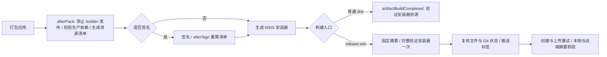

# 构建、打包与发布

> 涉及文件：[package.json](../../../package.json)（`scripts` 与 `build` 配置）、[scripts/create-icon.js](../../../scripts/create-icon.js)、[scripts/publish-release.js](../../../scripts/publish-release.js)、[scripts/check-js.js](../../../scripts/check-js.js)、[scripts/build-local.bat](../../../scripts/build-local.bat)、[scripts/build-debug.bat](../../../scripts/build-debug.bat)、[build/installer.nsh](../../../build/installer.nsh)

本文档是构建、打包与发布的**单一事实来源**，集中维护 npm 脚本、依赖清单、`electron-builder` 配置、图标生成、NSIS 安装脚本、发布流水线、运行模式、版本管理及本地批处理。自动更新的运行时状态机与 UI 同步见 [desktop/update.md](../desktop/update.md)，桌面进程与 `userData` 布局见 [desktop/main.md](../desktop/main.md)，各运行模式的认证能力差异见 [desktop/auth.md](../desktop/auth.md)。

## 1. npm scripts

| 脚本 | 命令 | 说明 |
| --- | --- | --- |
| `export:audio` | `node scripts/export-audio-component.js` | 导出独立压缩音频组件并更新内置清单（不上传或发布） |
| `start` | `node src/server.js` | 本地 Node 调试入口：同进程运行 HTTP/WS 与本地领域服务，管理页仍需有效凭据（见 [backend/server-core.md](../backend/server-core.md)） |
| `desktop` | `electron .` | 桌面模式：Electron 主进程与 HTTP 服务同进程运行 |
| `check` | `node scripts/check-js.js` | 全量 JS 语法检查，按文件缓存复用；支持 `--plan` / `--force`（见 [test.md](test.md) §3） |
| `test` | `node scripts/run-tests.js` | 递归收集业务目录中的测试；默认并发取 `min(8, CPU 数)`，支持依赖组、`--domain` 与 `--file` 筛选（见 [test.md](test.md) §1） |
| `test:admin` | 见 [package.json](../../../package.json) 的 `scripts.test:admin` | 固定管理页组合、外壳、AI、弹幕与加班机回归；显式启用 ESM VM 模块 |
| `verify:docs` | `node --test test/engineering/governance-docs.test.js` | 治理文件、路由表、规格索引和范围内 Markdown 链接检查 |
| `verify:architecture` | `node --experimental-vm-modules --test test/engineering/module-boundaries.test.js test/engineering/esm-module-boundaries.test.js test/engineering/modularity-size.test.js` | 模块依赖、遗留全局/SQL 边界与前端 ESM 检查；文件规模按 ADR-0023 仅作提示，不再执行硬性行数上限 |
| `verify:quick` | `npm run verify:docs && npm run check && npm run verify:architecture` | 日常评审前快速门禁：文档 → 语法 → 架构 |
| `verify:contracts` | `node scripts/verify-server-contract.js` | 核对固定服务器提交和样例 SHA-256；支持 `LIRA_SERVER_ROOT` |
| `verify:roundtrip` | `node scripts/verify-song-roundtrip.cjs` | 固定服务器真实 HTTP 歌库往返；两仓需安装依赖 |
| `verify` | `npm run verify:contracts && npm run check && npm test -- --require-full` | 完整门禁：固定契约输入 → 语法 → 全量测试，拒绝筛选、跳过和不完整结果 |
| `diagnose:wesing` | `node scripts/inspect-wesing-playback.js` | 全民 K 歌播放状态交互诊断（见 [test.md](test.md) §4 与 [backend/music/wesing.md](../backend/music/wesing.md)） |
| `make:icon` | `node scripts/create-icon.js` | 生成 `public/img/shared/lira-app-icon.png` 和 `build/icon.ico`（见 §5） |
| `dist:win` | `npm run make:icon && electron-builder --win nsis --x64 --publish never` | 正式打包：下载 Electron 二进制并构建 NSIS 安装包 |
| `dist:win:local` | `npm run make:icon && set ELECTRON_SKIP_BINARY_DOWNLOAD=1 && electron-builder --win nsis --x64 --publish never --config.electronDist=node_modules/electron/dist` | 本地打包：跳过二进制下载，复用 `node_modules/electron/dist` |
| `release:win` | `node scripts/publish-release.js` | 完整发布流水线（见 §7） |

- 出处：[package.json](../../../package.json) 的 `scripts` 字段。
- `dist:win:local` 使用 Windows 原生 cmd 语法（`set VAR=1 && …`），未引入跨平台环境变量注入工具。
- `test` 的 `--test-concurrency` 替换默认并发值并保留进程隔离；`--experimental-vm-modules` 为必需参数，用于 VM 加载前端 ESM 模块（详见 [test.md](test.md) §1）。

### 本地发布验证

发布前在 Windows 和 Node.js 24 环境按 [发布指南](../../../RELEASE_GUIDE.md#0-选择发布流程与审查范围) 选择日常增量或大版本／高风险流程（审查范围与验证要求由该指南统一维护；两种流程均保留发布脚本内置的构建和安装包完整性校验）。

用于构建的工作区（含独立 Git worktree）必须各自通过 `npm ci` 安装独立的 `node_modules`；可以共用 npm 全局下载缓存，但不要用目录联接（junction）或符号链接共享其他工作区的 `node_modules`。已复现 `electron-builder` 26.15.3 在共享依赖目录时仅收集 6 个包，遗漏 `pako`、`pend` 和更新器依赖，且其 `cannot find path for dependency` 警告不会自行终止打包。出现该警告时必须修复依赖并重建，不能接受残缺的 EXE，也不应把间接依赖提升到应用顶层掩盖问题。

Windows 发布验证要求使用 Node.js 24 LTS 最新补丁版（至少 `24.16.0`）：`24.15.0` 及更早 24.x 的 TCP 连接存在可能无 JavaScript 错误输出的原生崩溃（修复见 [Node #62561](https://github.com/nodejs/node/pull/62561) 与 [24.16.0 发布记录](https://nodejs.org/en/blog/release/v24.16.0)）。可在 `tmp/` 使用经官方 SHA-256 校验的便携运行时并仅为当前命令设置 `PATH`，无需修改系统 Node，也不影响桌面内置的 Electron 版本。

`npm run verify` 按序执行契约锁校验（[server-contract.lock.json](../../../server-contract.lock.json)）、语法检查和 `npm test -- --require-full`（已含文档与架构测试），完整模式下拒绝筛选、跳过、待办、取消或结果缺失。验证期间不要重装或修改依赖；进度输出、日志位置、服务端检出目录解析顺序与真实 HTTP 往返说明见 [失败文件重跑与诊断记录](test.md#失败文件重跑与诊断记录) 和 [固定服务器契约输入](test.md#固定服务器契约输入)。

原生安装器集成测试会自动查找本机 `electron-builder` 缓存中的 NSIS 编译器及插件，也支持通过 `LIRA_TEST_MAKENSIS` / `LIRA_TEST_NSIS_PLUGINS` 显式覆盖；完整验收拒绝因缺少工具而跳过场景，工具发现与检查命令见 [Windows 安装器集成测试](test.md#windows-安装器集成测试)。

其他辅助脚本（键名与 `package.json` 一致）：

| npm script | 用途与环境边界 |
| --- | --- |
| `verify:modularity` | 运行 `scripts/check-modularity.js` 的源码规模报告；只读，不修改源码 |
| `test:offline` / `test:browser` / `test:desktop` / `test:installer` / `test:contracts` | 按运行依赖分组执行测试；分组与环境要求见 [test.md](test.md) §1 |
| `refresh:gifts` | `scripts/refresh-bilibili-gift-sale.js` 读取指定 `dataDir` 的当前房间和盲盒配置，联网拉取 B 站在售礼物并写入本地缓存（支持 `--room-id` / `--data-dir`） |
| `sync:gifts` | `scripts/initialize-gift-catalog.js` 从 LIRA Server 下载公开礼物目录与图片并写入数据目录缓存（目录取首个位置参数、`LIRA_DATA_DIR` 或默认 `data`），不读写用户授权凭据 |

## 2. 依赖清单

### 电音助手原生资源

模型资源统一使用 `vendor/lira.onnx`。构建只复制运行所需文件，不打包开发转换记录或本机路径，并清理旧构建残留记录与旧模型文件名。

`npm run build:audio-assistant -- <vendor目录>` 使用仓库根 `global.json` 固定的 .NET `10.0.404` SDK 发布 `native/audio-assistant/AudioAssistant.csproj`（目标框架 `net10.0-windows10.0.19041.0`），生成自包含 .NET 10 运行库的 Windows x64 工作程序；未传目录时复用本机 `tmp/audio-assistant-demo/vendor`。原生项目依赖 NAudio `2.2.1`、ONNX Runtime `1.26.0`，复用 Rubber Band `3.3.0` DLL 与已校验模型。两个项目均声明 `win-x64` 还原目标以保留各自 `packages.lock.json` 中的 Windows 依赖；命令行构建在 `tmp/` 生成中间产物并排除项目内 `obj/`，先执行 `dotnet restore -r win-x64 --locked-mode` 再 `--no-restore` 发布，保证传递依赖可复核。终端用户无需安装 Node、Python 或 .NET。

编译输出位于忽略目录 `build/audio-assistant/`，构建脚本的中间产物位于 `tmp/audio-assistant-build/`。直接从 IDE 或 `dotnet build` 构建两个原生项目时，[Directory.Build.props](../../../Directory.Build.props) 将各项目的 `obj` 和 `bin` 分开写入 `tmp/dotnet/`。客户端安装包不再通过 `extraResources` 携带音频目录；`npm run export:audio` 将已有构建输出打成压缩 ZIP（排除 PDB）并更新内置清单 `src/electron/audio-component-manifest.json`（音频代码未变时无需重编）。导出产物、上传顺序和缓存规则见 [CDN 音频组件交付](../../guides/cdn-resources.md#音频组件独立交付)，核心职责见 [原生核心说明](../../../native/audio-assistant/README.md)。

原生定向验证：构建完成后运行 `npm run test:audio-native`，脚本将测试工程输出到 `tmp/`，验证合成信号的 DSP、歌曲检测，以及真实工作程序的中文管道通信、参数保存、失败停止与 EOF 退出，不播放用户歌曲或改动声卡路由。

| 类型 | 包 | 版本 | 用途 |
| --- | --- | --- | --- |
| `dependencies` | `@clamber_l/crypto` | `0.1.12` | QQ 音乐加密音频解码 |
| `dependencies` | `@jixun/qmweb-sign` | `2.0.3` | QQ 音乐 `zzcSign` 请求签名 |
| `dependencies` | `jose` | `6.2.13` | ChatGPT 订阅登录的 OIDC/JWT 签名与声明校验（见 [AI 账号接入](../backend/ai.md#45-chatgpt-订阅与-kimi-api)） |
| `dependencies` | `qrc-decoder` | `1.0.2` | QQ 音乐 QRC 歌词 3DES 解密 |
| `dependencies` | `yauzl` | `3.4.0` | 有限体积、逐项读取本机素材 ZIP（精确锁定） |
| `dependencies` | `electron-updater` | `^6.8.4` | 应用内自动更新（运行时见 [desktop/update.md](../desktop/update.md)） |
| `devDependencies` | `electron` | `43.8.3` | Electron 运行时（精确锁定） |
| `devDependencies` | `electron-builder` | `^26.18.0` | 打包器 |
| `devDependencies` | `app-builder-lib` | `26.18.0` | 打包配置/NSIS 测试直接引用的 builder 实现；固定版本以避免 `out/*` 内部路径变动导致测试失效 |
| `devDependencies` | `builder-util` | `26.16.0` | 构建脚本与测试使用的架构枚举及日志工具 |
| `devDependencies` | `@electron/asar` | `3.4.1` | 打包依赖校验、资源完整性和 ASAR 测试使用 |
| `devDependencies` | `playwright` | `^1.62.1` | 开发期浏览器自动化工具（含 `playwright-core`，不随正式应用打包） |

**engines：`node >=24`**（以 [package.json](../../../package.json) 为准）。`app-builder-lib/out/*` 属于 builder 内部路径，当前打包/安装器/字体测试有意直接依赖；升级 builder 时必须运行这些定向测试。

**npm overrides**（[package.json](../../../package.json)）：
- `js-yaml` 强制 `^4.3.2`（[package-lock.json](../../../package-lock.json) 解析为 `4.3.2`），约束 `electron-updater` 与 `electron-builder` 的传递依赖。
- `minimatch@>=7 <11.0.1` 固定为 `11.0.1`，用于修复 [GHSA-g3hv-75wg-m249](https://github.com/isaacs/minimatch/security/advisories/GHSA-g3hv-75wg-m249)（限定区间以保留旧工具的 callable API；上游依赖纳入修复后再移除）。

## 3. `electron-builder` 配置

全部配置内联在 [package.json](../../../package.json) 的 `build` 字段中，无独立配置文件：

| 配置项 | 值 | 出处 | 说明 |
| --- | --- | --- | --- |
| `appId` | `com.aurorawhisperer.lira` | [package.json](../../../package.json) | 应用标识 |
| `productName` | `LIRA` | [package.json](../../../package.json) | 安装/卸载显示名 |
| `artifactName` | `lira-setup-${version}.${ext}` | [package.json](../../../package.json) | 安装包命名（在 `build` 与 `build.nsis` 各声明一次，发布脚本按 `build.nsis.artifactName` 计算文件名） |
| `directories.output` | `release` | [package.json](../../../package.json) | 产物目录（见 §4） |
| `files` | `src/**/*`、`public/**/*`、`package.json` 及排除规则 | [package.json](../../../package.json) | 桌面窗口与关于页共享同一份公开 PNG；构建资源、外置套装、共享大资源及旧资源按规则排除（详见 §4） |
| `asar` | `true` | [package.json](../../../package.json) | 源码打包为 `app.asar` 归档 |
| `npmRebuild` | `false` | [package.json](../../../package.json) | 无原生 Node 模块，跳过重编译 |
| `afterPack` | `scripts/after-pack.js` | [after-pack.js](../../../scripts/after-pack.js) | 禁止 builder 直接发布、移除 `default_app.asar`、校验生产依赖并生成资源完整性清单（时序见 §7） |
| `afterSign` | `scripts/after-sign.js` | [after-sign.js](../../../scripts/after-sign.js) | 签名可能改动 unpacked 文件，签名后重算资源清单；无签名构建不依赖该钩子 |
| `artifactBuildCompleted` | `scripts/verify-client-installer.js` | [verify-client-installer.js](../../../scripts/verify-client-installer.js) | 普通构建对 NSIS EXE 校验最终嵌入资源，失败即阻断；`release:win` 通过专用配置接管同校验（见 §7） |
| `win.icon` | `build/icon.ico` | [package.json](../../../package.json) | 由 `make:icon` 生成 |
| `win.target` | `nsis` / `x64` | [package.json](../../../package.json) | 仅支持 Windows x64 |
| `nsis.oneClick` | `false` | [package.json](../../../package.json) | 标准安装向导，非一键安装 |
| `nsis.perMachine` | `false` | [package.json](../../../package.json) | 按当前用户安装，无需管理员权限 |
| `nsis.allowElevation` | `false` | [package.json](../../../package.json) | 不主动请求提权，允许手动以管理员启动但仍限当前用户模式 |
| `nsis.allowToChangeInstallationDirectory` | `true` | [package.json](../../../package.json) | 允许自定义安装目录 |
| `nsis.shortcutName` / `uninstallDisplayName` | `LIRA` | [package.json](../../../package.json) | 快捷方式与卸载显示名 |
| `nsis.createDesktopShortcut` / `createStartMenuShortcut` | `true` | [package.json](../../../package.json) | 创建桌面与开始菜单快捷方式 |
| `nsis.include` | `build/installer.nsh` | [package.json](../../../package.json) | 自定义 NSIS 宏与安装策略（见 §6） |
| `publish` | 首个 generic 为 `https://assets.lirahub.cn/downloads/`；GitHub `AuroraWhisperer/LIRA`（`releaseType: release`） | [package.json](../../../package.json) | generic 供 `electron-updater` 读取；发布脚本显式上传至 GitHub |

## 4. 打包过滤与产物（`release/`）

### 4.1 打包排除与资源外置规则

正式应用不包含开发依赖 `playwright` / `playwright-core` 或 Electron 默认示例程序（`afterPack` 删除输出中的 `default_app.asar`，不改动开发环境依赖目录；离线覆盖见 `test/engineering/packaging-scope.test.js`）。以下资产按类别排除出 `app.asar`：

- **公共共享字体与大图**：`public/fonts/` 下完整字库（WOFF2/TTF/OTF）及世界地图 8K PNG 均不打入安装包；包内保留 `clock-moon-serif-400.woff2` 和 `guard-thanks-serif-400.woff2` 两份标题裁剪字体（共 6,524 字节）、周计划专用的 `weekly-schedule/zcool-xiaowei.woff2`、字体目录、资源路径清单与 OFL 许可。运行时按本机就绪字体生成 `/css/shared/display-fonts.css`，开发宿主使用的同名静态副本排除出包。`npm run export:resources` 按 `resource-packages.js` 显式声明更新 `src/resources/catalog.json` 并生成上传包（缺失必需文件时失败）；准入、清单与上传操作见 [CDN 资源分发](../../guides/cdn-resources.md)，运行期下载与缓存见 [desktop/main.md](../desktop/main.md#共享字体初始化)。
- **外置样式套装**：本机导入素材存于 `dataDir/component-library/`（位于打包白名单外）；以下外置套装源码保留，其图片/WebM/缩略图从 `build.files` 排除，仅保留客户端可信播放器与样式 CSS：
  - 月渡花汀：导出脚本 `node scripts/package-moonlit-suite.js`（见 [套装指南](../../guides/component-style-packages.md)）。
  - 林间花信：排除 `public/img/overlays/gift-frame/woodland-bloom/` 与 `gift-frame-default.webp`，导出脚本 `node scripts/package-woodland-gift-frame.js`（见 [素材包指南](../../guides/component-style-packages.md#林间花信--全屏礼物感谢)）。
  - 窗映四时：排除 `public/img/overlays/backgrounds/windowlight/`，导出脚本 `node scripts/package-windowlight-background.js`（见 [背景样式指南](../../guides/background-style-packages.md#窗映四时分层背景)）。
- **旧礼物图库与开播素材**：旧 `public/img/bilibili-gifts/`、`public/img/bilibili-gifts.json` 及相关维护文档/脚本已移除分发（首次授权后从 LIRA Server 同步到 `data/cache/overtime-gift-images/`）。开播音乐与人物图移至白名单外的 `test/fixtures/opening/`，`public/img/overlays/opening/` 显式排除。
- **静态图压缩与保留规则**：弹幕装饰源码保留 PNG，安装包仅打包对应 WebP；队列底图（第 3–6 套）、弹幕示意头像、辉光纹章、唱片机底盘与队列空状态插画使用高质量 WebP（质量 90，透明通道无损）；礼物占位图为 512×512 RGBA PNG（保留原 URL）。琉璃与杏花白统一使用 B 站原图（缺失留空不回退旧插画）；当前 `crane-*` 装饰、组件缩略图、千舰徽章/头像框及兼容字体入口保留分发。打包验收以实际生成的 `app.asar` 为准。
- **元数据、诊断页与生产依赖精简**：
  - 排除 `AGENTS.md`、`.map`、图片目录的 `README.md` / `SOURCES.md` / `generated.md` / `provenance.json` / `.webp.json` / `sources.json` / `*-sources.json` / `*.sources.json`、字体目录 `README.md` 与 `src/shared/danmaku-source-manifest.json`（运行依赖、字体 OFL 与播放器 LICENSE 保留）。
  - 排除旧诊断页 `public/pages/gift-audit.html`、`public/css/gift-audit.css`、`public/js/gift-audit/`（边界见 [app.md](../frontend/app.md#9-子页面gift-audithtml)）及仅供历史报告引用的截图。
  - 生产依赖排除未使用的源码、测试、类型声明和浏览器构建副本（`@jixun/qmweb-sign/src/`、`tsconfig.json`、`dist/web.{cjs,mjs}`、`pend/test.js`、`.d.cts` / `.d.mts`、`semver/range.bnf`、semver 与 js-yaml 的 CLI、`js-yaml/lib/index_vite_proxy.tmp.mjs`、`@clamber_l/crypto/Readme.MD`、`dist/loader-inline.js`、`pako/dist/*.js`、`js-yaml/dist/*.js`）；保留 Node CJS/ESM 入口、解密 WASM 与许可文件（注意 `pako/lib/zlib/README` 含 zlib 许可，不可按普通 README 排除）。

### 4.2 输出产物

仓库根目录下，`data/` 保存开发版的本机数据，`tmp/` 存放测试、审计等中间文件，`output/` 专放用户制作的可导入资源。这三个目录均排除在安装包之外。分发时从 `release/` 取安装包，正式安装时选择源码树以外的专用目录。

| 产物 | 说明 |
| --- | --- |
| `lira-setup-{version}.exe` | NSIS 安装包，发布主产物 |
| `lira-setup-{version}.exe.blockmap` | 增量更新块映射 |
| `latest.yml` | 更新清单（`electron-updater` 的版本比对与 SHA-512 校验依据） |
| `win-unpacked/` | 未打包目录（本地运行与调试） |

构建只在 `release/` 生成一份 `latest.yml`（GitHub 配置设置 `publishAutoUpdate: false`，不再生成 `release/github/latest.yml`）；发布脚本将外层 `latest.yml` 与安装包、块映射一并上传 GitHub，CDN 同步也复用同一份清单。

## 5. 图标生成（`scripts/create-icon.js`）

**零第三方依赖**的纯 Node 实现（仅使用 `node:zlib`，不依赖 `node-canvas` 或系统图形库）：

- 若 `build/icon-source.png` 存在（[create-icon.js:15-25](../../../scripts/create-icon.js#L15-L25)）：使用内置 PNG 解码器读取 → 居中裁切为正方形 → 暗色边缘背景泛洪去除 → 最近邻缩放到 `256×256`。
- 否则程序化绘制应用图标（圆角渐变底 + 麦克风/音符图元）。
- 输出 `public/img/shared/lira-app-icon.png` 与 `build/icon.ico`（ICO 为 PNG 压缩的单尺寸 `256×256`，宽度字段 `0` 表示 `256`）。

`npm run make:icon` 是 `dist:win` / `dist:win:local` / `release:win` 的前置步骤，`electron-builder` 读取 `build/icon.ico`。

## 6. NSIS 安装脚本(build/installer.nsh)

安装器与卸载器分两次编译；`liraRemoveApplicationFile` 仅在 `BUILD_UNINSTALLER` 阶段生成，安装器复用 `liraRemoveTree` 清理迁移备份，避免未引用函数警告。脚本通过 `nsis.include` 接入标准 NSIS 流程，按职责拆分如下：

### 6.1 安装范围、权限与目录校验

- **仅当前用户模式（[installer-per-user.nsh](../../../build/installer-per-user.nsh)）**：允许普通或管理员权限启动，但始终只安装给当前用户，不展示全用户选项，拒绝 `/allusers` 及旧全用户安装的自动更新模式。校验通过后统一重置 builder 的 per-user/per-machine 内存标记，避免 HKCU/HKLM 同时存在历史安装项时静默安装触发提权（不删除另一上下文的注册表记录）。
- **重解析点与写权限探测**：选定目录后拒绝安装根目录重解析点，并递归检查 `resources/`、`locales/` 及所有后代目录（发现链接或无法读取即停止）。在退出旧程序、备份或卸载前，按当前进程权限实际探测安装根与既有 `data/`、`logs/`、`updates/` 的写权限（静默 `/D` 和更新均不跳过；探测仅创建并删除自身临时文件，不修改 ACL；管理员下可写不代表日常普通账号可写）。
- **非空目录归属校验**：非空目录必须与当前上下文注册的 `InstallLocation` 一致，或包含 `lira-installation.ini` 中 `installation.appId=com.aurorawhisperer.lira` 标记（默认路径、文件夹名或仅存在 `data/` 均不能证明归属）。校验失败非零退出并保留旧数据；旧全用户安装须先备份并在卸载时保留数据，再以当前用户模式安装到可写目录。验证见 [installer-directory.test.js](../../../test/engineering/installer-directory.test.js)。

### 6.2 向导界面、协议页与更新模式

- **DPI 与窗口排版（[installer-ui.nsh](../../../build/installer-ui.nsh)）**：启用 `ManifestDPIAware true`。协议、安装范围、目录与进度页外框为 `600×380` 逻辑像素，完成页收紧为 `420×260` 并保持居中；统一使用微软雅黑 UI（正文与按钮 9pt，普通页标题 10pt 加粗，协议段落额外 +2 逻辑像素，完成页标题 15pt 半粗且仅保留「完成」按钮）。`customInstallMode` 仅在 `installer-ui.nsh` 定义（实际 include 图由 [installer-update.test.js](../../../test/engineering/installer-update.test.js) 预处理校验）。
- **默认目录与卸载项清理（`customInit` / [installer-directory.nsh](../../../build/installer-directory.nsh)）**：首次安装存在 D 盘时默认 `D:\LIRA`，无 D 盘时沿用 builder 默认目录；升级沿用已有路径（`/D` 参数和用户显式选择优先）。同时检查当前上下文的本应用卸载注册项，仅在卸载程序路径明确不存在时清理。
- **协议确认页（`licensePage`）**：占用 builder 许可页宏，用原生 `SysLink` 链接 `https://lirahub.cn/legal/terms`《用户协议》与 `https://lirahub.cn/legal/privacy`《隐私政策》，默认选中「不同意」，同意后才启用下一步。不要设置 `nsis.license` 或在 `build/` 放置 `license*` / `eula*` 文件，以免生成重复宏（检查见 [installer-static.test.js](../../../test/engineering/installer-static.test.js)）。客户端「百宝箱 → 设置 → 系统与关于」提供两份随包正文阅读入口（[user-agreement.txt](../../../public/pages/admin/toolbox/user-agreement.txt)、[privacy-policy.txt](../../../public/pages/admin/toolbox/privacy-policy.txt)），官网同源导出脚本为 [export-user-agreement.js](../../../scripts/export-user-agreement.js)。
- **可见自动更新（`--updated`）**：`liraInitUpdateProgress` 将 `--updated /S` 切为可见自动安装进度页（跳过选择、协议与目录页，显示等待退出、备份、安装和恢复阶段）。成功后自动关闭，仅带 `--force-run` 时以普通用户身份启动新版；普通退出自动安装后保持关闭。独立 `/S`（不带 `--updated`）保持静默。验证见 [installer-update.test.js](../../../test/engineering/installer-update.test.js)。

### 6.3 进程退出检查

- [installer-process.nsh](../../../build/installer-process.nsh) 提供安装与卸载共用的 `customCheckAppRunning`，按可执行文件完整路径核对旧安装目录与所选目录（忽略其他目录的同名程序；无法核实路径时停止）。
- 交互模式先征求关闭确认，再发送正常关闭请求；等待约 10 秒未退出时提示可能有后台残留并允许重试或取消；静默模式仅等待主程序退出，超时中止。
- 主程序退出后，均会检查旧 `resources/audio-assistant/LiraAudioAssistant.exe` 与 `data/components/audio/<版本>/LiraAudioAssistant.exe`，遍历并通知全部已核实 PID 后启动共用的 10 秒退出期限（不因后续轮询重置，不强杀），等待音频进程释放文件和恢复记录。维护退出语义见 [desktop/main.md](../desktop/main.md#电音助手生命周期)。

### 6.4 数据原地保留、备份恢复与本地模板

- **同目录原地保留（[installer-data.nsh](../../../build/installer-data.nsh)）**：安装成功后写入归属标记 `lira-installation.ini`，并用 `StdUtils` 计算新卸载器 SHA-256 写入 `uninstall-data-preservation.ini`（`preserve-data.sha256`）。仅当新旧目录一致、来源为原 `data`、当前上下文注册的卸载器路径与本目录 `${UNINSTALL_FILENAME}` 匹配、实际摘要一致且无遗留 `resources/audio-assistant` 时，跳过完整备份与恢复（快路径不提供数据库迁移回滚快照；能力记录缺失/失效只影响提速，不按版本号猜测）。
- **兼容备份与恢复**：未知旧版、换目录、旧 AppData 或遗留音频路径使用系统 `robocopy` 将数据完整复制到 `<新安装目录>.lira-data-backup.partial`（返回码 0–7 视为成功），再以不覆盖目标的 `MoveFileW` 发布为 `<新安装目录>.lira-data-backup`（对 Win32 错误 5/32/33 最多重试 5 次，间隔 50/100/150/200ms）。程序替换完成后恢复 `data/`；复制或发布失败保留源数据与暂存路径并中止，恢复失败保留备份并禁止启动空库。升级时 `customRemoveFiles` 保留 `data/`、`logs/`、`updates/`。启动期旧数据迁回与策略背景见 [desktop/main.md](../desktop/main.md) §3 和 [ADR-0015](../../architecture/adr/0015-install-local-desktop-data.md)。
- **受控本地模板（[build/nsis/installUtil.nsh](../../../build/nsis/installUtil.nsh)）**：基于 `electron-builder 26.18.0` 定制，直接定义安全的 `uninstallOldVersion` 宏（不再编译可能误删数据的旧卸载调用）。运行时提取本次构建生成的 `${UNINSTALLER_OUT_FILE}` 至临时目录，核对旧安装位置与当前用户范围后静默清理旧程序（注册项变化或失败即中止）。升级 `app-builder-lib` 时须同步核对模板接口，并以 `/WX` 严格编译回归验证（[installer-update.test.js](../../../test/engineering/installer-update.test.js)）。

### 6.5 普通卸载与安装诊断

- **卸载清理（[installer-uninstall.nsh](../../../build/installer-uninstall.nsh)）**：仅删除明确列出的 Electron 根文件、语言包和 LIRA 资源文件（逐级校验父目录以防重解析点，不递归删除 `resources/` 或无关文件）。普通卸载自动清理 `logs/` 与 `updates/`，默认保留 `data/` 和 `lira-installation.ini`；勾选「同时删除用户数据」后须二次确认（默认「否」），确认后才清理归属标记、本目录数据及 `%APPDATA%/com.aurorawhisperer.lira`、`%APPDATA%/lira`。静默卸载不删数据，`--updated` 升级保留全部运行目录。删除前拒绝空路径、磁盘根与安装目录链接（验证见 [installer-uninstall.test.js](../../../test/engineering/installer-uninstall.test.js)）。
  删除主程序或卸载器遇到 Windows 共享冲突（错误码 32）时，依次等待 50、100、150、200 毫秒，每次重新校验安装目录后再试。持续占用时退出码为 `2`，保留卸载器供关闭占用程序后重试。
  构建卸载器时，electron-builder 先加载项目的 `installer.nsh`，再由 `common.nsh` 定义主程序和卸载器的文件名。使用这两个名称的清理函数在 `customHeader` 中展开。
- **失败报告与诊断收集**：交互安装迁移失败时将详细输出以 UTF-16 保存至 `%TEMP%/LIRA-install-error.txt` 并弹窗提示。[collect-install-diagnostics.cmd](../../../scripts/collect-install-diagnostics.cmd) 调用同目录 [collect-install-diagnostics.ps1](../../../scripts/collect-install-diagnostics.ps1) 生成只读诊断文本（限于系统版本、同目录安装包摘要/签名、相关进程、近期迁移报告与崩溃事件，不读取业务数据库或上传）。

## 7. 发布流程(scripts/publish-release.js)

`dist:win`、`dist:win:local` 和发布脚本内命令均显式指定 `--publish never`（`afterPack` 也会拦截直接启用 builder 发布的调用，防止在最终校验前上传）。正式发布必须执行 `npm run release:win`：

1. 拒绝存在未提交或未跟踪修改的工作区，解析 `GH_TOKEN` 或 `gh` CLI 登录态，只读核对本地标签及远端标签实际指向的提交与当前 `HEAD` 一致（保留代理探测与凭据脱敏）。
2. 生成图标后再次核验工作区与 `HEAD`。
3. 构建一次安装包：`electron-builder --win nsis --x64 --publish never --config scripts/release-builder-config.js --config.electronDist=node_modules/electron/dist`（专用配置继承 `package.json` 的 `build`，仅将 `artifactBuildCompleted` 置空，由发布入口接管最终资源验证）。
4. 钩子执行：`afterPack` 移除 `default_app.asar`、校验生产依赖并生成资源完整性清单；若启用代码签名，`afterSign` 重算最终清单（无签名构建不依赖 `afterSign`）。
5. 发布入口记录 `exe`、`exe.blockmap`、`latest.yml` 的 SHA-256，完整校验最终 NSIS EXE 一次，再复核全部文件摘要确保产物未被改动。
6. 再次核验工作区、`HEAD` 与标签，确认一致后创建并推送标签，进入最多三轮的 GitHub Release 创建/复用与上传恢复流程（正文截取自 `UPDATE.md` 对应版本小节）。
7. 首次上传前及每轮上传后核对远端附件名称、字节数和 SHA-256（远端无摘要时下载到独立临时目录校验后清理），并复核本地文件未变更。
8. `gh release upload --clobber` 仅补传缺失或未确认一致的附件（重试不重新构建）；等待期间每 15 秒输出耗时和待确认文件，完成或失败均清理定时器并保持输出脱敏。

**核心校验契约**：

- **最终安装器资源验证（`scripts/verify-client-installer.js`）**：使用 Windows 自带 `tar.exe`（非 Windows 需兼容 `bsdtar`）从 NSIS EXE 读取嵌入归档；若前置安全卸载器导致 `tar` 扫描失败，则复用 builder 的 7-Zip 定位 `Type=7z` 归档区间并流式提取校验，不运行安装器也不读取本地数据。要求清单与实际应用资源集合及字节完全一致，并复核归档内生产依赖；任一失败直接阻断构建/发布。
- **生产依赖验证（[verify-packaged-dependencies.js](../../../scripts/verify-packaged-dependencies.js)）**：由 `afterPack` 与最终安装器校验共用，从归档内 `package.json` 的生产依赖出发按 Node 解析路径递归检查（未安装的可选依赖可省略，已安装可选依赖的必需子依赖必须完整，不借用开发机或父目录模块）。
- **资源完整性清单**：`resources/client-integrity-manifest.json`（上限 4 MiB / 10000 项，仅含 `app.asar` 与 `app.asar.unpacked/` 普通文件，稳定排序），构建生成器与运行时共用 `resource-integrity-files.js` 规则；运行期检查语义见 [desktop/update.md](../desktop/update.md)。
- **凭据与测试**：Git/`gh` 直接启动（不将密钥放入命令行参数），仅 Windows `npm`/`npx` 使用 shell。测试覆盖见 `test/engineering/publish-release.test.js`、`test/engineering/packaging-scope.test.js`、`test/engineering/client-installer-integrity.test.js`。

## 8. 运行模式对比

| 模式 | 入口 | `ELECTRON_DESKTOP` | 进程形态 | 认证与功能 |
| --- | --- | --- | --- | --- |
| Node 调试 | `npm start` | 未设 | Node HTTP/WS 与本地领域服务同进程 | 管理 HTML/API 仍需有效管理凭据；无 preload、`safeStorage`、Cookie 注入和主进程远端代理，不能作为免认证的完整 Web 管理端使用（见 [pages.md](../frontend/pages.md) §2） |
| 桌面 | `npm run desktop` | `'1'` | Electron 主进程 + Server 同进程 | 完整功能：分区登录、Cookie 注入、自动更新 |
| 开发桌面 | `electron .`（直接运行） | `'1'` | 同上 | 同上；未打包环境下调试桌面功能 |

`ELECTRON_DESKTOP` 由 Electron 主进程启动早期写为 `'1'`，`/api/health` 的 `desktop` 字段据此上报；环境变量（`HOST` / `PORT` / `SONG_PLUGIN_DATA_DIR` / `AUTO_OPEN_ADMIN`）见 [backend/server-core.md](../backend/server-core.md) §3。

## 9. 版本管理

- 版本号唯一来源：[package.json](../../../package.json) 的 `version` 字段。
- 变更记录：[UPDATE.md](../../../UPDATE.md) 按 `## v{version} 变更` 小节组织；发布脚本自动截取当前版本小节作为 GitHub Release 正文。
- Git 标签：每次发布创建附注标签 `v{version}` 并推送至 `origin`。
- 发布前须确认 `package.json` 与 `UPDATE.md` 版本号一致（不匹配时 Release 正文会退回占位文本）。

## 10. 本地构建批处理

| 脚本 | 内容 | 用途 |
| --- | --- | --- |
| [build-local.bat](../../../scripts/build-local.bat) | `ELECTRON_BUILDER_CACHE=%USERPROFILE%\.cache\electron-builder` → `npm run dist:win:local` | 复用本地 Electron 打包且不发布；失败返回非零，成功后列出 `release\*.exe` |
| [build-debug.bat](../../../scripts/build-debug.bat) | `set DEBUG=electron-builder` + `DEBUG_COLORS=true` → `npx electron-builder --win nsis --x64 --publish never %*` | 在本机生成调试包，输出 `electron-builder` 调试日志并透传额外参数 |

两个批处理均不改变 `app.asar` 打包行为，也不依赖全局安装的 CLI。

## 11. 自动更新对接

运行时依赖 `electron-updater`（^6.8.4），通过 `package.json` 的首个 generic provider 生成 `resources/app-update.yml` 指向 CDN 更新源（`useMultipleRangeRequest: false`）。构建产物 `lira-setup-{version}.exe`、`.blockmap` 与 `latest.yml` 由 `release:win` 上传至 GitHub；CDN 同步顺序、旧块映射保留与官网入口跳转见 [CDN 分发指南](../../guides/cdn-resources.md#客户端安装包与自动更新)，增量下载回退策略、状态机与安装交接见 [desktop/update.md](../desktop/update.md)。

## 12. Windows 代码签名

签名与独立验证脚本已实现，但 `build.win` 与发布入口尚未接入正式签名流程。当前状态、输入参数与限制见 [code-signing.md](code-signing.md)。
