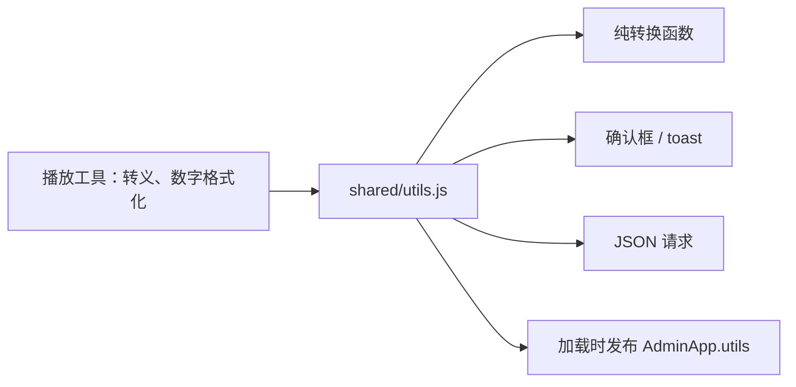

# LIRA 模块化与公共能力复用审计

日期：2026-10-22。基线：`35f822fb8ccfa73f8f4cfd33de760a88fceb4481` 加当时工作树。配套[审计提示词](2026-10-22-modularity-reuse-audit-prompt.md)。本报告只提出建议，没有实施重构，也不将建议标为 Accepted 或写入已接受的 ADR。

后续：用户已授权 M1–M5 全部实施，结果见[整改记录](2026-10-22-modularity-reuse-remediation.md)。以下证据和优先级保留为审计时点快照；已移动或删除文件使用基线路径标识。

## 结论

现有分层可以继续使用，没有证据支持再增加框架、服务或通用管理器。值得做的是收拢已有契约、缩小公共工具的依赖，以及完成已登记的存储边界迁移。

本轮确认三项 P2 维护问题、两项 P3 整理机会。未证实需要立即处理的 P1 运行故障。以下优先级表示本次审计的维护价值，不代表产品故障严重度。

| 编号 | 优先级 / 状态 | 问题与建议 | 实施风险 |
| --- | --- | --- | --- |
| M1 | P2 / 已确认重复定义 | 时钟已有公共契约，仍重复维护样式、文案和字段映射；优先直接复用已有定义 | 低至中；保留校验、回退和旧设置语义 |
| M2 | P2 / 已确认依赖副作用 | 前端 `utils` 混合纯函数、界面、请求及旧全局发布；按主题逐步拆开调用入口 | 中；旧全局与加载顺序需要兼容 |
| M3 | P2 / 已确认多职责及存储债务 | AI 配置模块同时管理密钥配置、角色、日志、黑名单、会话和缓存；先分离持久化实现 | 高；涉及密钥、事务、上下文隔离 |
| M4 | P3 / 已确认遗留装配 | 加班机已有 store 接口，但生产装配仍传数据库；收拢存储归属和装配即可 | 中至高；涉及礼物结算原子性与恢复 |
| M5 | P3 / 建议清理候选 | 两份大航海感谢实现同名 API、不同事件格式；旧实现未找到消费者 | 低至中；删除前需确认动态加载和兼容范围 |

推荐顺序是 M1 → M2；M3、M4 分别在对应领域下一次实质变更时推进。M5 可独立核验清理。不要把五项捆成一次跨领域重构。

## 范围与证据强度

- 本次审计客户端仓库 `D:/Work/Live`。没有审计相邻 `lira-server` 的当前实现，不能将本结论外推为两仓契约已完全一致。
- 对 `src/`、`public/js/` 的 **904 个 JavaScript 文件**做了字面量依赖和相同文本片段扫描；这不是完整 AST 分析，也不是逐行人工审计。深查范围为共享模块、时钟、AI 配置、加班机、礼物感谢、相关装配与消费者，另抽查场景、Bilibili 身份转换、IPC 和本地 JSON 通信的候选重复。
- 入口和归属按[事实地图](../reference/README.md)、[变更路由表](../architecture/engineering/ai-workflow.md)、[模块化规范](../architecture/engineering/modularity-standard.md)及[遗留登记](../architecture/engineering/legacy-boundaries.md)核对。历史报告只帮助定位，没有直接当作当前缺陷。
- 扫描得到 `public/js/shared/utils.js` 的 65 个、`src/shared/utils.js` 的 63 个字面量直接消费者。这是维护影响面指标；高引用数本身不是缺陷，也不证明性能问题。
- 起始工作树已有世界时钟相关的 9 个修改/未跟踪文件。本次未改其内容；审计产物之外不修改源码、测试或当前契约说明。
- 检查使用合成输入、VM 模块环境及内存/隔离数据库，没有实际 UI、在线账号、正式安装器或线上服务验收。本次不对 CPU、启动速度或内存收益作量化承诺。

## M1：时钟元数据应直接复用现有公共契约

**证据与消费者。** [clock-settings.js](../../public/js/shared/clock-settings.js) 第 3、7、11 行已有 `CLOCK_STYLE_LABELS`、`FLIP_PALETTES`、`CLOCK_APPEARANCE_KEYS`。[clock-contract.js](../../src/server/clock-contract.js) 第 4 行已经依赖该公共模块，却在第 6、19、34 行另写样式集合、翻页颜色和默认文案；[overlays/clock.js](../../public/js/overlays/clock.js) 第 7 行也已依赖它，却在第 11、23、35 行再写一份。[scene-components.js](../../src/server/scene-components.js) 第 21 行又单独维护时钟字段到设置键的映射。

这是同一时钟功能在设置校验、实际展示、场景保存三个入口上的重复事实。增加一种样式、修改默认文案或增加外观字段时，需要同步多处。隔离检查确认当前 10 种样式及后端/公共默认文案一致；不是已经发生的显示错误。现有测试也保护部分一致性，但仍保留了人工同步负担。

**最小调整。** 扩展现有 `clock-settings.js` 的纯元数据出口，后端和 overlay 从中派生样式集合、默认文案及颜色；场景映射用 `style: 'clockStyle'` 加已有 `CLOCK_APPEARANCE_KEYS`。`clock-preview.js` 已用 `Object.keys(CLOCK_STYLE_LABELS)` 派生集合，可沿用其模式。无需新建通用组件注册框架。

**边界与取舍。** 只共享元数据。后端严格校验、前端读取旧数据时的回退、overlay 的实际几何尺寸和 DOM 更新继续各自拥有；不要为了合并代码改变非法输入、空文案或旧 URL 参数的行为。存储默认值也不能通过引入浏览器模块来绕开 storage 依赖规则。

**完成标准。** 增加样式元数据只改一个 owner；后端/预览/overlay/场景 round trip 仍一致；保留 `clockStyleOptions`、旧设置以及 URL 参数覆盖顺序。沿用 [clock-overlay.test.js](../../test/overlays/clock-overlay.test.js)、[component-style-parameters.test.js](../../test/scenes/component-style-parameters.test.js)，并在现有覆盖中补齐字段映射一致性。若以后实施，更新 [overlays.md](../reference/frontend/overlays.md) 的归属说明；行为不变时无需改用户操作指南。

## M2：前端纯工具调用不应携带 Admin 兼容发布

**证据与消费者。** [shared/utils.js](../../public/js/shared/utils.js) 第 5–7 行导入确认框、toast 和 JSON 响应处理，同文件提供 HTML 转义、格式化、DOM 取值、剪贴板和认证 POST；第 198 行在加载时发布 `window.AdminApp.utils`。[playback/utils.js](../../public/js/playback/utils.js) 第 5 行只需要转义和数字格式化，却因此加载整个依赖链。管理页的多个视图同样从该聚合模块取纯函数。



隔离 VM 中仅导入 `playback/utils.js`，没有 DOM、没有网络调用，空的 `window` 已出现 `AdminApp.utils`，证明依赖副作用真实存在。没有证据证明其目前造成重复弹窗或重复请求，也没有测得性能故障。

**最小调整。** 先按实际使用面建立小而纯的 HTML 转义/数字格式化出口，让播放工具和需要它们的视图直接导入。已有 `toast.js`、`confirmation-dialog.js`、`json-response.js` 继续各自拥有界面和传输行为；不要再包装一个万能 helper。旧 `utils` 可以暂时转发并维持原兼容发布；只有旧消费者迁完才删除该发布，并保留结构回归保护迁移边界。

**边界与取舍。** [confirmation-dialog.js](../../public/js/shared/confirmation-dialog.js) 的转义使用 `value ?? ''`，旧 `utils` 和 [overlay-utils.js](../../public/js/overlays/overlay-utils.js) 使用 `value || ''`，对 `0`、`false` 的结果不同。不能简单替换三处函数；若共享字符串转义原语，应由原调用边界保留输入转换语义。classic overlay 入口也不应在本任务顺带整批迁移。

**完成标准。** 导入纯 helper 不注册全局、不需要 DOM；迁移范围内的调用直接依赖对应主题模块；旧 Admin 入口、错误 toast 次数及 overlay 兼容行为不变。现有 [frontend-json-response.test.js](../../test/transport/frontend-json-response.test.js)、[overlay-shared-helpers.test.js](../../test/overlays/overlay-shared-helpers.test.js) 和 [module-boundaries.test.js](../../test/engineering/module-boundaries.test.js)可继续使用；纯导入无副作用是实施时应补的实际覆盖。同步 [app.md](../reference/frontend/app.md)、[legacy-boundaries.md](../architecture/engineering/legacy-boundaries.md)；无需变更用户步骤。

## M3：AI 配置模块的持久化与业务职责值得分离

**证据与消费者。** [config-store.js](../../src/ai/config-store.js) 的 `createAiConfigStore` 除配置读写和密钥编解码外，还拥有公开投影（第 51 行）、角色变更（第 135 行起）、请求日志（184）、黑名单（206）、会话上下文（232）、查询缓存（259）和到期清理（281）。同一模块直接操作这些不同表。

[ai-runtime.js](../../src/server/ai-runtime.js) 第 17 行用数据库和 secret codec 创建此对象，并在第 29 行将完整对象注入 assistant。配置/角色管理由 [api-context.js](../../src/server/api-context.js) 第 151 行起消费；[ai-assistant-service.js](../../src/ai/ai-assistant-service.js) 则调用日志、黑名单、会话和缓存方法。角色设置、记忆 TTL、日志留存本来具有不同的变更原因，却聚在名为 config-store 的入口。

这是已登记的 domain SQL 遗留债务，不是本轮发现的泄密或事务故障。[架构门禁](../../test/engineering/module-boundaries.test.js)为该文件保留 SQL 额度；通过门禁只证明没有扩大被冻结的债务。

**最小调整。** 首先把 SQL 和事务收拢到 `src/storage/` 的 AI 持久化适配器，参考已有 [ai-api-usage-store.js](../../src/storage/ai-api-usage-store.js) 的存储归属。配置归一化、角色规则、密钥 codec、公开脱敏与配置缓存仍由 AI 领域 owner 协调。会话和回复缓存调用可再以明确的窄接口注入，不需要按每张表创建一个服务，更不需要通用业务仓储。

**边界与取舍。** 配置与 provider 角色选择必须保持同一事务；提交成功后才更新缓存。上下文的 persona scope、缓存键散列、TTL、时钟回退处理，以及退出时的清理定时器仍须保持。不要把密钥原文移入 renderer、普通存储返回值或日志。该项应独立计划，不能顺手机械搬文件后宣称完成。

**完成标准。** SQL 仅由 storage adapter 拥有；配置、角色与公开投影职责清楚；assistant 无需数据库接口；现有配置回滚、密钥脱敏、上下文隔离和过期清理测试保持。当前已运行 [ai-config-store.test.js](../../test/ai/ai-config-store.test.js)、[ai-conversation-context.test.js](../../test/ai/ai-conversation-context.test.js)作为行为基线；实施还应覆盖 assistant 与 runtime 生命周期。需同步 [ai.md](../reference/backend/ai.md)、[storage.md](../reference/backend/storage.md)和 owner 路由，用户可见契约保持不变。

## M4：加班机已有接口，后续应完成存储装配归位

**证据。** [overtime-service.js](../../src/overtime/overtime-service.js) 第 55 行已经支持 `options.store`，但生产 [domain-services.js](../../src/server/domain-services.js) 第 110–111 行仍传 `giftDb`，由领域服务调用 `createOvertimeStore`。`src/overtime/overtime-store.js`（基线位置）在领域目录直接拥有 SQL，第 387 行起拥有 `BEGIN IMMEDIATE` 事务。它和 M3 是当前 SQL 债务门禁中明确列出的两个文件；这是已知遗留，而非新发生的架构倒退。

**最小调整。** 不再发明 store 抽象。先让组合处创建并注入现有 store，再将适配器归到 `src/storage/`；检查所有旧构造与 [overtime/index.js](../../src/overtime/index.js) 导出消费者后，再按兼容需要收敛 `giftDb` 回退。仅迁目录、继续让领域服务隐式创建数据库适配器，不能算依赖边界完成。

**边界与取舍。** service 的倒计时、随机结算、重试、取消及 dispose 保持单一 owner；store 的多表结算仍在同一礼物数据库事务内。不要拆数据库、拆状态对象或改变历史结算规则。当前已可注入假 store，不应把本项描述成“现有服务无法单测”。

**完成标准。** 生产领域服务只接收 store；事务、幂等、失败恢复和清库后的 reload 语义保持。已有 [overtime-service.test.js](../../test/overtime/overtime-service.test.js)通过；实际实施还需运行礼物导入/结算组合覆盖并收紧架构债务额度。同步 [overtime.md](../reference/backend/overtime.md)、存储归属与调用地图，用户指南不变。

## M5：旧大航海感谢实现应核验后清理，不应再抽公共生成器

**证据。** `src/bilibili/gift/guard-thanks.js`（基线位置） 第 28、46 行和 [guard-thanks-config.js](../../src/bilibili/gift/guard-thanks-config.js) 第 50、84 行都导出 `buildGuardThanksEvent`、`buildGuardThanksPreviewEvent`，但前者输出 `gift:guard` / `guardLevel` / `num`，后者输出 `gift:guard-thanks` / `tier` / `months`。

生产 [runtime-transport.js](../../src/server/runtime-transport.js)、[gift-routes.js](../../src/server/routes/gift-routes.js)、[settings-contract.js](../../src/server/settings-contract.js)及 [guard-thanks.test.js](../../test/gifts/guard-thanks.test.js)均指向后者。当前扫描和 `src/`、`public/js/`、`test/`、`scripts/` 显式引用搜索未找到旧实现消费者；合成输入实测也确认两者事件格式不同。

**建议。** 这是“确认废弃后移除”的候选，而不是复用机会。重新核对动态加载和打包引用，若没有兼容用途，移除旧文件并保留当前事件测试；若有真实旧消费者，应明确其兼容 owner、使用范围及退出条件。不要把两套事件协议合成一个带模式参数的生成器，也不要因函数同名而替换调用。

本轮仅记录，未删除。技术参考中的当前大航海感谢契约不变；无需新增用户入口或操作说明。

## 已检查但暂不调整

| 候选 | 保留原因 |
| --- | --- |
| Node / browser 的弹幕样式、布局、效果参数镜像 | [danmaku-style-options.test.js](../../test/danmaku/danmaku-style-options.test.js)核对样式表与主要函数；[danmaku-layout.test.js](../../test/danmaku/danmaku-layout.test.js)核对转换后的源码与分辨率预设；效果参数测试核对表和样例。镜像确有维护成本，但本次未发现漂移。不为消除副本引入新的前端构建步骤。效果参数样例校验也不等于所有输入的等价证明。 |
| 不同 IPC 的来源验证 | `main-window-ipc` 含 Admin 路径限制，dynamic-lottery/gift-interaction、daily-bot、license 的路径/权限条件不同。不能仅因 main frame 和 origin 检查相似就直接替换为同一 registrar。 |
| Bilibili 图片 URL 处理 | 远程礼物目录策略拒绝用户信息、fragment、非标准端口；销售目录与弹幕解析还有各自的输入/协议转换行为。合并前须先确定信任边界。本次没有足够证据将差异定性为漏洞。 |
| 本地请求入口 | 已共用 `json-response.js`；场景、资源上传、预览重试仍有不同 body、错误提示、取消和幂等职责。当前测试证明选定调用方每次操作仅发一个请求，无须增加统一请求管理器。 |
| Bilibili 历史/榜单 identity hint | 外层 UID 和名字来源不同；共有字段少且已有身份合并 facade。可在字段实际变更时局部复用，不必为当前十余行结构追加抽象。 |
| schema 与历史 migration 的相似 SQL | 新建库与升级路径职责不同；修改已发布迁移以消除文本重复可能改变旧数据升级语义。 |
| 入口、同步和计时状态工厂 | 文件/函数长度不是拆分依据。当前统一启停、代次、取消、重试和事务所有权应保留；本轮没有证明需再次拆散这些状态 owner。 |
| 后端 `shared/utils.js` | 虽有 63 个字面量消费者，但高扇入不是单独整改理由。已有按主题抽取规则；等具体 helper 需要变化时再迁，避免一次更改大量无关模块。 |

## 实际验证与同步结论

运行环境：Node `v24.21.0`。以下为现有代码的基线验证，不能理解为建议方案已实现并通过测试。

| 已执行检查 | 结果 / 覆盖范围 |
| --- | --- |
| `npm run verify:architecture` | 27/27 通过；覆盖既有边界、债务额度、ESM 标识符和规模报告规则，不证明全部语义边界正确 |
| 八个定向套件，见下方命令 | 57/57 通过；时钟、弹幕镜像、效果参数、加班机、感谢事件、公共 overlay helper、JSON 调用 |
| AI 配置与上下文两个套件 | 19/19 通过；配置事务、密钥投影、TTL/清理、上下文行为 |
| 隔离模块证据脚本 | 通过：播放纯工具导入产生 Admin 全局；时钟元数据当前一致；旧/现感谢事件格式不同 |
| `npm run verify:docs` | 10/10 通过；新报告和提示词另核对 46 个本地链接，均存在 |
| 最终差异与原工作树保护 | `git diff --check` 通过；起始 9 个改动文件的 SHA-256 均未变化；本任务只有两个新文档和一条报告索引 |

```powershell
npm run verify:architecture
node --experimental-vm-modules --test test/overtime/overtime-service.test.js test/gifts/guard-thanks.test.js test/danmaku/danmaku-layout.test.js test/danmaku/danmaku-style-options.test.js test/scenes/component-style-parameters.test.js test/overlays/clock-overlay.test.js test/overlays/overlay-shared-helpers.test.js test/transport/frontend-json-response.test.js
node --test test/ai/ai-config-store.test.js test/ai/ai-conversation-context.test.js
npm run verify:docs
git diff --check
```

中间扫描、证据与日志位于未提交的 `tmp/modularity-reuse-audit/`；使用文件数据库的定向运行把 TEMP/TMP 指向该目录下的隔离测试目录。没有运行全量套件或启动 Electron，原因是本轮未改变运行行为。

测试源码、当前技术契约和用户指南均保持原样：本次只有调查结论，不改变行为、接口、模块路径或使用步骤。若后续实施，上文分别列出了应同步的 owner 文档和验证条件。本次仅新增本报告、提示词及报告索引入口。
