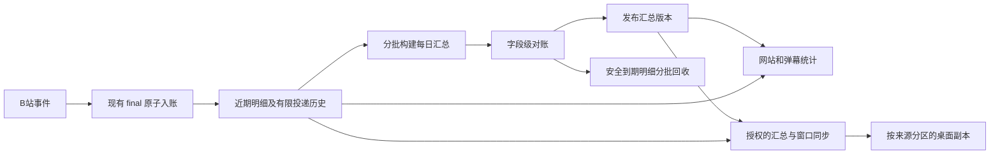

# 礼物明细保留与长期统计实施计划

Status: Awaiting Verification

日期：2026-10-12。用户已确认按本计划实施（“你确定没有问题就可以修改了”）。按里程碑修改及验证；不操作真实用户数据库。

后续范围确认：用户明确允许修改存储，禁止修改现有服务器 B 站礼物读取。
保留读取、解析、识别、连击、final 时机及估值实现；存储兼容层处理归档凭证，
现有统计公式和分类为验收基线。已撤回本轮对 `gift-detector.js` 和
`gift-detector-input.js` 的修改，不重构实时业务流程。

**Goal:** 将服务器与客户端逐笔付费礼物明细改为约 90 天保留，同时保持网站、桌面和弹幕的历史统计、日期与名称筛选、金额口径、租户隔离和正常实时功能。

**Architecture:** 沿用每主播 SQLite、客户端来源分区及有界查询 worker。服务器维护按北京时间自然日及原查询维度形成的汇总，查询组合汇总与未覆盖明细；新增汇总同步和明确的明细窗口，最后启用分批物理回收。

**Tech Stack:** 现有 Node.js、better-sqlite3、客户端 SQLite、Electron、Vanilla JavaScript；不增加依赖、服务或构建步骤。

遵循 [PLANS.md](../../PLANS.md)，跨仓库只在本文件维护实施步骤。当前聊天逐项推进，不自动提交、推送、部署或操作真实用户数据库。

## 1. 需求解释及评审边界

1. 90 天前不再提供逐笔流水与逐笔导出，但过去日期的统计不能变零、缩水或被默认为缺失。
2. 保持现有统计意味着长期保留礼物身份、日期和观众维度的**合计**。如果连礼物种类也不保留，就不能同时保留现有礼物名称筛选、贡献排行和盲盒构成。
3. 同一付费账本包括直送、盲盒和大航海；SC、粉丝事实、签到与舰队到期记录仍归原数据域，不随礼物清理删除。
4. 一笔仍按原事件计算，连击数量另算件数；汇总行数不能当笔数。
5. 保持滚动 90×24 小时和自然日期查询原语义。明细逻辑边界向下取北京时间零点，实际可见窗口为 90 至不足 91 天，保障滚动区间首日精度。
6. 活跃快照、最近才 final 的旧日期事件和未完成结算可延迟物理回收；不能承诺第 90 天立即删除每一行。界面使用已发布的实际明细边界。
7. 每日汇总及最小去重凭证长期保留，仍会增长。最坏情况下细分汇总行数可接近原事件行数，不能承诺固定压缩率或整个数据库恒定大小。
8. 用户要求先确定计划再修改，并已确认本计划。下述目标按里程碑实施；未通过验收的条目不代表现行行为。

## 2. 当前证据与所有权

基线为 2026-10-12 当前工作区。两仓有其他未提交修改，计划编写期间也有变化；实施前重新核对相关 diff，保留其他任务内容。客户端计划索引已出现回复词库及指定年月礼物查询的新任务，实施必须对照其最终查询语法，不能只覆盖旧时间词。

服务器根目录 `D:/Work/lira-server`：

| owner | 当前行为与本次影响 |
| --- | --- |
| `src/modules/bilibili/gift-detector.js`、`src/storage/gift-detection-store.js` | final/delivery 原子提交，平台及跨命令去重依赖旧事件 |
| `src/storage/gift-ledger-migrations.js`、`gift-ledger-integrity.js` | outbox 外键级联删除，完整性检查依赖每个非 legacy final 有投递行 |
| `src/modules/bilibili/gift-event-service.js`、`gift-history-service.js` | cursor 连续校验，bootstrap 签名 token 引用原始事件锚点 |
| `src/storage/gift-ledger-queries.js`、`src/modules/streamer/gift-statistics.js`、`gift-composition.js` | 明细逐条统计；日期、昵称、礼物身份、排序和未知成本须保持 |
| `src/modules/streamer/gift-query-worker.js`、`gift-query-executor.js` | 已有有界 worker、租户维护串行入口及取消/释放边界 |
| `src/modules/danmaku/gift-chat-service.js`、`src/storage/gift-chat-queries.js` | 可信 UID、房间、请求高水位与已有 progress 收尾，不能换为粗粒度全房统计 |
| `src/modules/streamer/gift-overview.js`、`src/modules/admin/history.js`、`streamer-read-model.js` | 概览统计及最近活动消费，旧明细窗口须准确表达 |
| `src/modules/device/gift-history-clear.js`、`src/storage/gift-ledger-clear.js` | 清空需要覆盖汇总、凭证、staging，继续隔离租户并轮换 epoch |

客户端根目录 `D:/Work/Live`：

| owner | 当前行为与本次影响 |
| --- | --- |
| `src/electron/remote-gift-controller.js`、`remote-gift-recovery-rules.js`、`license/remote-gift-reads.js` | 来源/授权/generation 隔离，HTTP/SSE 补偿和 capability 协商 |
| `src/storage/gift-sync-store.js`、`gift-projection-store.js` | 明细与 cursor 原子提交；历史导入不产生实时副作用 |
| `src/storage/gift-query-store.js`、`src/bilibili/gift/query-service.js` | 历史、统计、来源版本和勾选导出，需支持汇总与明细窗口 |
| `src/bilibili/gift/blind-box-analysis.js` | 本地盲盒按用户/盒型/明细分析，使用本机统计资格，与服务器全量账本不同 |
| `src/storage/gift-statistics-store.js`、`gift-maintenance-store.js` | 冲刺按旧行 counted_in_sprint 求和，保留期不能减少本轮已收金额 |
| `src/overtime/` 及 gift final 消费者 | pending 不可被清理丢弃；归档不能重触发加班、感谢、许愿 |
| `public/js/admin/gifts/history.js`、`blindbox-analysis.js` 与导出控制器 | 过期明细、可用统计、混合区间和过期选择分别处理 |

规范入口：客户端 [投影规格](../gift-ledger-projection-sync_design.md)、[存储契约](../../docs/reference/backend/storage.md)、[礼物契约](../../docs/reference/backend/bilibili/gift.md)；服务器 `docs/protocol/client-server-api.md`、`management-api.md`、`gift-interaction.md`、`docs/architecture/data-boundaries.md` 和 ADR-0011/0029/0031/0043/0059/0079。

## 3. 功能保留矩阵

| 功能 | 90 天内 | 更早日期 |
| --- | --- | --- |
| 笔数、件数、总价值、平均每笔价值 | 保持 | 精确计数及整数分合计计算，保持 |
| 日期筛选、日/月趋势、指定年月与全年统计 | 保持原边界 | 完整自然日汇总可精确相加 |
| 礼物/盒名和历史昵称筛选 | 保持 | 保存事件时冻结名称，不能替换成当前目录名/昵称 |
| 贡献排行、普通/大航海/盲盒分类、盒型与产物构成 | 保持 | 先合并全部匹配分组再排名，不只存每日 Top N |
| 盲盒成本、产出与盈亏 | 保持 | 已知/未知金额、笔数及件数分别保存 |
| 观众/房主年度、累计、指定礼物等弹幕查询 | 保持 | 按可信 UID、来源房间与礼物身份汇总，保持重名拒绝 |
| 本地盲盒按用户/盒型统计、去重人数、最后开盒时间 | 保持原资格 | 使用同口径本地归档，不能替换成服务器全部账本 |
| 逐笔时间、流水排序、逐笔导出 | 保持 | 提示明细已过期；不伪造汇总为一笔记录 |
| 图表下钻、跨保留窗口查询 | 保持 | 统计完整，明细只显示可用区间并说明差别 |
| 冲刺、加班、许愿、感谢、滚动礼物 | 保持 | 归档及历史同步不重放实时消费者 |

统计覆盖与明细覆盖必须分别表达。不能以一个 `partial=false` 暗示旧逐笔记录仍可获取，也不能因为明细过期将完整统计标为缺失。

## 4. 拟采用的架构决策

评审通过后两仓各新增 ADR，说明对旧永久保留规则的替代范围；不原地改写旧 Accepted ADR 的历史结论。



### 4.1 汇总维度与指标

服务器汇总放在原租户 `streamer.db`。key 包含北京时间日期、来源房间（保留 NULL 语义）、UID、事件时昵称、冻结礼物身份/ID/名称/单价、币种与盲盒标记、冻结盒子身份/ID/名称/单价。未知身份保持未知，不按当前目录补猜。编码区分 NULL、空字符串和 0。

指标覆盖三个现有用途：

- 网页：eventCount、itemCount、totalPriceCents、guardEventCount、guardValueCents、blindBoxEventCount、blindBoxUnknownCostEventCount、blindBoxPriceCents、blindBoxValueCents、blindProfitCents。
- 构成：knownCostEventCount、knownCostValueCents、unknownCostEventCount、unknownCostValueCents；保存完整身份分组，查询后才应用现有排名和余项限制。
- 弹幕：blindItemCount、unknownCostItemCount；其他回复字段由上述合计形成，不用未知成本“笔数”冒充“盒数”。

每笔先转安全整数分再相加，不先 SUM 浮点再四舍五入。平均值为总金额/总笔数，不平均每日平均值。相加保留现有溢出检查。当前分组 hash、同名不同身份、价格版本与排序规则保持。

服务器内部 UID 支持个人弹幕查询。Device 只取得按客户端原可见维度合并的投影，不新增 UID、内部房间/主播 ID、平台流水 ID、原始报文暴露。

### 4.2 已结束日期走汇总，边界与新增记录走明细

每日低优先级任务处理已结束的北京时间日期；今日和版本发布后到达的 final 继续走明细。无需在每次收礼时维护另一套全房实时计数。

每个版本固定 `revision`、`summarizedBefore`、`coveredEventId`、`coveredFinalCursor`、`publishedAt`。最终字段定义归新协议/OpenAPI，不能只藏在计划中。

```text
结果 = 区间内完整自然日的固定版本汇总
     + 尚未被该版本覆盖的 final 明细
     + 首尾非完整自然日的明细
```

三部分互斥。rolling 7/30/90 天的首日通常不完整，使用该日仍保留的明细；自定义日期、月/年查询的旧完整日从汇总相加。当前日期截断到 asOf，筛选在完整维度上进行。

发布后迟到的旧日期 final 立即作为未覆盖明细可见，下次只归入一次，不能直接拒收或漏算。progress 的收尾和等待规则不变。

拟新增的窄接口由各 owner 持有：

```js
// server storage/gift-summary-store.js
readGiftSummaryVersion(db, revision);
iterateGiftSummaryCells(db, { version, filter });
// server lib/gift-summary-contract.js
projectGiftSummaryContribution(row);
mergeGiftSummaryContribution(target, contribution);
```

汇总贡献有自己的 shape；不得伪装为一条普通 gift，导致 eventCount 或身份判定错误。

### 4.3 构建、快照和失败原子性

1. 构建捕获 epoch、事件和 final 上界，仅处理这些上界内不可变 final。新收礼继续运行。
2. 按事件 ID 分批构建 staging，每批贡献和检查点一起提交，重启不重复加数。
3. 完整指标及分组对账成功后用短事务发布；失败保留原版本和原始数据，绝不先删后补。
4. 只版本化发生变化的日期。被替代版本保留到最后可能引用它的网页/Device token（现行最长 24 小时）及已接受弹幕查询过期；不每天强迫所有用户刷新。
5. 网页签名 snapshot 加汇总版本，仍固定筛选、epoch、事件及 final 上界。旧 token 在兼容期按原读取路径完成，新事件不进入旧网页快照。
6. 弹幕在现有捕获位置同时固定汇总版本和事件高水位；请求前 progress 完成后纳入，请求后的新组排除。
7. clear/restore/删除租户继续取消旧 generation；旧 staging 不可在清库后发布。

### 4.4 准确去重、投递前缀与物理回收

删除旧事件和付费通知关联会破坏现有去重。拟保留压缩凭证，仅包含原幂等规则需要的身份键、冻结身份、时间/数量/金额指纹及终态标记；不保留头像、原包或另一份可导出流水。可哈希的键规范化后哈希，但不能省略现有回退匹配语义，不能用概率过滤器替代准确去重。凭证与归档提交绑定，未保存成功不删原行。

- 在现有 final 事务里将稳定 delivery cursor 保存到事件；迁移为已有事件回填，legacy final 显式标记。快照不再依赖 outbox 永久存在。
- 持久化最新已分配 cursor 和已裁剪前缀，空投递表不得导致水位回退。
- outbox 只删除投递满 90 天、无活跃恢复快照引用的连续前缀，不按礼物发生日期挖洞。
- 明细回收要求：早于窗口、可靠汇总已覆盖、凭证已保存、对应 outbox 已可回收、final 保留及快照保护期已过、无业务消费保护。
- 最近才 final 的旧日期事件额外保留以供离线追赶；合法迟到事件不改计价或收尾语义。
- 终态过期关联记录和空批次同时清理，pending 不作为垃圾删除。
- 常规清理不轮换 epoch、不重置 sequence；落后设备执行“近期明细＋完整汇总”bootstrap。

凭证仍按事件小幅增长，是保留原准确去重的明确代价，不宣称彻底没有长期逐事件元数据。

### 4.5 同步、离线和本地业务保护

新增可协商 `giftRetentionVersion=1` 和 Device 授权的汇总清单/分页读取，携带明细边界、汇总版本、覆盖水位及投递前缀。旧协议不能无提示把“完整历史”改成近 90 天。

- 首次升级将汇总下载到 staging，近期明细及汇总均校验完成后按来源原子发布；过程中保留原可用副本。
- 日常只下载 revision 变化日期的完整替换值，不重复累加累计值，不每天重拉全部近期明细。页绑定版本、认证租户与来源，不混合不同版本。
- 发布本地汇总前追赶对应 coverage cursor；同事务切换汇总、已覆盖明细标记和窗口，不能半新半旧。
- 沿用原控制器序列化和 source/auth/generation fence 处理 SSE/HTTP/归档并发。
- 离线读最后完整副本并显示原离线状态；未取得并校验新汇总，不按本机时钟擅自删除旧明细。
- 多账号独立；不将 `source_id=NULL` 或无法证明归属的旧 v1 来源自动归到当前用户。这些历史来源仍由原维护政策处理，不扩大本次删除。
- 汇总与新增历史导入不重放实时消费者。离线前已经接收的 progress，在快照激活时通过原 final 导入路径收尾，保留原资格与提交后通知。

冲刺与本地盲盒依赖本机 `gift_stats_eligible` / `counted_in_sprint`，服务器没有这些资格。删除前保存本地同口径日合计、必要用户/盒型分组及本轮冲刺结转；resetSprint 同时清明细标记及结转。pending 加班保留所需原行直至终态，不能因服务器过期就忽略。不同职责的数据不能为了复用而合并。

### 4.6 调度和磁盘

复用进程生命周期和租户维护串行入口，一次只运行一个租户的一个写批次，批次间让出事件循环，关停可取消并续跑。初始批次上限 500 行，依据正确性测试中的事务时长调整，不将该数当生产性能保证。

启动只恢复检查点，不在启动关键路径整库扫描删除。SQLite 空闲页可被复用，文件不一定立即缩小；不在直播时执行全库 VACUUM。日志仅保存阶段、计数和错误码，不输出 UID、原包或令牌。

## 5. 实施里程碑

以下为最终实施范围；代码与隔离回归已完成，正式固定提交契约验证和部署启用仍待发布阶段完成。

### M1 契约与固定验收案例

- [x] 客户端规格及 ADR-0024、服务端 ADR-0100、保留协议、Device/Management OpenAPI、相关 requirement/acceptance/traceability 同步。
- [x] 服务器 `docs/protocol/fixtures/gift-retention.json` 保存 16 条可人工复核案例：跨年、90 天边界、50 连、重名、改名、零/未知成本与盲盒等；补充边界由所属测试覆盖。
- [x] 原逐笔统计函数作为 oracle，比较原明细与汇总后的字段、筛选及构成；不将两个新聚合实现互相比对作为唯一证据。

### M2 服务端日汇总与对账

- [x] `gift-summary-migrations/store/queries/cleanup` 分别拥有迁移、扫描复读对账与发布、互斥查询和过期版本回收；`gift-summary-contract` 维护计数及整数分指标。
- [x] 原统计、构成、概览、弹幕及查询 worker 消费日贡献；保留原公式，快照固定水位与汇总版本。
- [x] 对账失败不发布；文件数据库关闭后重开可续跑；迟到 final 替换变化日，保护期内旧快照不漂移。

### M3 去重与有界同步

- [x] 稳定 final cursor、单调水位、最小凭证和有凭证的投递前缀共同保护回收；无凭证缺口继续拒绝。
- [x] `gift-retention-sync-service.js` 提供授权汇总分页及匹配近期明细；原 B 站 reader/detector 保持原样，由 storage 兼容已删除记录。
- [x] 清空、epoch 恢复及租户删除覆盖新状态；旧客户端在物理回收后明确要求升级，不能静默丢失统计。

### M4 客户端副本与本地业务

- [x] gift_db v17 的 `gift-retention-store.js` 暂存校验、变化日替换、近期明细成员和快照原子激活；中断、限流及重开数据库可续跑。
- [x] `remote-gift-retention.js` 复用原来源/授权/generation 边界；相同 epoch 恢复保留旧完整副本，epoch 变化仍走原重建入口。
- [x] `gift-retention-queries.js` 合并全部分组后排名；`gift-local-retention.js` 保留本机盲盒资格、冲刺结转和 pending 结算原行。
- [x] 既有 progress 在激活时由原 final importer 收尾；新增历史不重放实时效果。`gift-retention-cleanup.js` 按批删除废弃成员、暂存 final、快照与旧日版本。

### M5 网站、桌面与说明

- [x] 网站和桌面保留日期/名称筛选；过期逐笔记录明确提示，统计、笔数、件数、金额和盲盒合计保留。
- [x] 明细列表、下钻及导出不把汇总伪造为单笔；混合区间只显示实际可用明细。
- [x] 更新 storage/gift/API/main/preload owner、规格和应用内礼物指南。未改变入口及操作步骤，导航教程和截图无须更新。
- [x] 网站四个相关完整浏览器文件共 70 项通过；桌面 renderer、导出控制器、授权来源及主进程同步使用已有隔离测试。

验证方式调整：本轮未启动完整 Electron。没有新增 IPC、preload 权限或桌面特权入口，
改用真实 SQLite、主进程控制器、既有导出/来源边界及 renderer 单元测试验证改动。
网站浏览器检查只证明网站行为，不作为 Electron 特权能力的证明。

### M6 回收闭环与交付边界

- [x] 隔离库完成实际物理回收；原明细、发布、部分/完整回收及重开数据库均有直接测试。
- [x] 服务端维护复用租户维护串行队列及生命周期；两端清理有批次上限，暂停下载和未完成本地消费受保护。
- [x] 两仓当前代码的 16 条固定案例完成汇总分页、近期明细同步和实际删除，四组筛选值与原逐笔结果一致，未产生历史实时副作用。
- [x] 删除默认关闭；本次不提交、上线或操作真实用户数据库。
- [ ] 发布前更新正式固定提交契约锁并执行完整 `verify:contracts`，取得一致性备份并确认客户端已升级后，才可启用服务器删除开关。

## 6. 必测不变量

| 场景 | 必须证明 |
| --- | --- |
| 非零点 90 天边界、月末、闰日、跨年、指定年月 | 与原日期筛选完全一致，边界日仍读明细 |
| 两笔同款与单笔 50 连 | 笔数、件数独立，不被汇总行数改变 |
| 同名 UID、改名、不同 variant/单价 | 个人范围、名称筛选、分组、排序保持 |
| 已知/未知/零成本 | 未知笔数/件数、已知价值和盈亏正确 |
| 每日榜外礼物进入年度榜 | 不丢分组，年度 Top N 正确 |
| 汇总中 final、重启重放、重复页 | 一次贡献，无金额缺口或副作用重放 |
| 请求前 progress、请求后新组 | 弹幕前者含最终值，后者排除 |
| 旧 snapshot 跨发布 | 有效期内结果不漂移，不提前删锚点 |
| clear/restore/租户删除与 staging 竞争 | 旧数据不复活，其他租户不受影响 |
| outbox 空表、合法前缀、非法中间洞 | 水位不回退，真缺口仍拒绝 |
| 清理后旧平台/通知重放 | 不重复记账或答谢，真新礼物仍能入账 |
| 客户端离线 120 天再连接 | 恢复近期明细和长期汇总，无反复全量重建 |
| 冲刺跨清理、pending 加班、盲盒本地资格 | 原业务值保持，待结算不丢 |
| 下载/提交半途失败、账号切换晚到 | 原副本仍可用，不部分发布或串号 |
| 跨期限检索及旧日期下钻 | 统计完整，过期明细不显示为未收礼 |

不制作 20 万条模拟负载，不访问真实用户数据。少量确定性回归只证明正确性；性能以查询计划、读取范围和批次上界作为本次证据，不冒充目标服务器压测。

## 7. 验证命令与契约同步

计划阶段只执行客户端 `npm run verify:docs` 和 touched diff 检查。代码阶段按最终 owner 分组，运行测试时不编辑被测文件。

服务器每组先查看同范围计划，再执行：

```powershell
npm run verify -- --node test/gift-retention.test.js --node test/gift-statistics.test.js --node test/gift-composition.test.js --node test/gift-chat-storage.test.js --browser none --plan
npm run verify -- --node test/gift-retention.test.js --node test/gift-statistics.test.js --node test/gift-composition.test.js --node test/gift-chat-storage.test.js --browser none
npm run verify -- --node none --browser e2e/streamer-gift-history-filters.spec.js --browser e2e/gift-composition.spec.js --browser e2e/streamer-gift-analytics.spec.js --browser e2e/gift-history-pagination.spec.js --plan
npm run verify -- --node none --browser e2e/streamer-gift-history-filters.spec.js --browser e2e/gift-composition.spec.js --browser e2e/streamer-gift-analytics.spec.js --browser e2e/gift-history-pagination.spec.js
npm run docs:check
```

M3 同步/去重/维护测试同样以重复 `--node` 选择完整文件。本次涉及存储、共享 worker 和授权同步，最终需覆盖这些消费者的完整 Node 文件组；集中处理已知失败，不盲目重复全套。

客户端：

```powershell
npm test -- --file=test/gifts/gift-retention.test.js --file=test/gifts/gift-sync-store.test.js --file=test/gifts/gift-statistics-service.test.js --file=test/gifts/gift-analysis-service.test.js --file=test/gifts/gift-maintenance.test.js
npm test -- --file=test/gifts/remote-gift-controller-commit.test.js --file=test/gifts/remote-gift-controller-reconciliation.test.js --file=test/gifts/remote-gift-owner-isolation.test.js --file=test/overtime/overtime-settlement.test.js
npm run test:browser -- "--file=test/gifts/frontend-gift-history*.test.js" --file=test/gifts/frontend-gift-sprint.test.js
npm run verify:docs
npm run verify:architecture
npm run check
git diff --check
git status --short
```

现有 `server-contract.lock.json` 要求固定服务器提交与干净运行时输入；两仓目前有其他未提交工作且本任务无提交授权。不得伪造 revision 或绕过门禁。代码阶段添加两仓当前实现的聚焦 fixture/同步回归并报告范围；正式锁更新与固定提交 `verify:contracts` 在授权的提交/发布阶段完成，未完成时如实列限制。

实现同时同步客户端 storage/gift/API/preload owner、投影规格、用户指南和服务器 protocol/OpenAPI/requirements/acceptance/ADR，不延后到提交准备。

## 8. 失败、发布与回滚

- 汇总未对账：不发布、不删明细，仅重试本任务 staging。
- 下载或校验失败：保留原本地完整副本与同步状态，失败不伪装空结果。
- 物理回收失败：已发布汇总及覆盖标记继续避免重复，之后从检查点恢复。
- 首次删除前按现行运维规范取得一致性备份，包含账本、汇总、凭证、水位和版本元数据；本计划不自动触发线上备份或上线。
- 删除之前可关闭新路径回到完整旧明细；删除之后不能直接降级为只读旧表的二进制。优先停止清理并保留新查询，仅在确有损坏时按停写流程恢复完整一致备份。
- 恢复沿用 epoch 规则，不能只恢复事件、outbox 或汇总其中一个。

## 9. 代码阶段与发布阶段

- [x] 用户已确认期限、长期统计维度及去重凭证，并明确禁止修改 B 站读取。
- [x] 查询、同步、恢复、清空、本地消费者保护和实际回收均已实现并经过聚焦验证。
- [x] 已结束日期实际使用汇总，不依赖永久逐笔明细维持统计；长期凭证仍会增长，未承诺固定数据库大小。
- [x] 测试、技术文档和用户指南同步；保护条件、性能证据范围及发布顺序写明。
- [x] 代码阶段最后的文档门禁、差异和状态检查；两仓 `git diff --check` 通过，未将临时验证产物加入变更。
- [ ] 发布阶段：固定服务器提交、更新客户端契约锁、正式双端契约验收及备份/升级/启用。此项未授权自动执行，计划保持 Awaiting Verification，不冒充已上线。

## 10. 验证记录（2026-10-12）

- 服务端原 detector/估值/交互相关 56 项通过；读取文件 `gift-detector.js`、`gift-detector-input.js` 与 HEAD 无差异。
- 服务端统计、构成、概览、弹幕、快照、维护、迁移、清空及 Device 回归 17 文件中 145 项通过；一项旧测试将手动破坏的前缀误当正常过期，按显式凭证契约修正后该完整文件通过。Device/epoch 10 项、去重/合法前缀/旧客户端升级 4 项均通过。
- 新增服务端保留、重启、清理与汇总 HTTP/鉴权测试通过；最后一组 Device 与规范检查 40 项通过。报告在服务器 `tmp/verification/runs/`，不纳入正式文件。
- 网站历史筛选 16 项通过（14:26 UTC 报告）；构成、统计及分页三个完整文件另 54 项通过（14:38 UTC 报告）。
- 客户端最后一组 11 文件 93 项通过；同步控制器 5 文件 45 项、renderer/筛选/恢复相关 6 文件 42 项通过。补充中断下载的暂存 final 有界清理后，保留套件 10 项重新通过（`run-EbXMXb`）。这些分组有重叠，不合并成不重复用例数。
- 当前两仓端到端存储对照使用临时脚本 `tmp/gift-retention-roundtrip.cjs`：16 条固定案例、3 页汇总、4 组筛选，真实删除后结果一致，历史实时效果为 0。该检查不是网络/Electron 端到端测试，也不是 20 万条压测。
- 原有固定契约 fixture 用既有干净匹配 checkout `tmp/guard-accompany-contract` 验证通过；未伪造当前脏工作区的契约提交号。新协议正式锁更新仍属于发布阶段。
- 服务端使用已有兼容运行时 `tmp/runtime/node-v24.15.0/node.exe`；未修改版本门禁、系统 Node 或依赖。每次 verify 先查看同范围 --plan。
- 小型确定性案例证明正确性；查询计划和每批上限证明访问/事务边界，不承诺生产服务器的查询耗时、容量或压缩率。
- 最终门禁：客户端文档 10 项及 1500 个 JavaScript 文件语法检查通过；服务端文档、OpenAPI、架构与协议检查 55 项通过。原入口、导航和实时业务操作未变化，未重绘指南截图。
- 并发工作区限制：22:42 后末次客户端文档重跑为 9/10；另一个任务的活动计划 `2026-10-12-retention-followup.md` 被改为 `Status: Complete` 但未归档，触发活动计划状态门禁。本任务文件及其链接通过，未修改该任务内容。前一轮 10/10 结果不能代表这一并发变更后的全局门禁。
