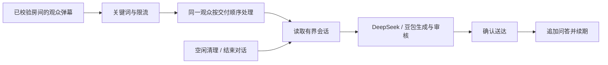

# AI 连续互动与空闲清理实施计划

Status: Awaiting Verification

源码、设置与文档已完成，294 项相关测试、隔离 Electron 和 DeepSeek 真实多轮通过；豆包官网可聊天，但 adapter 仍收到验证拒绝，真实多轮补验待网页接入恢复后进行。

## Goal

每位观众可以间隔 3–5 分钟继续与 AI 聊天、成语接龙或猜谜语，AI 能看到先前的约定及已交付问答。长期没有有效互动则结束会话并清理本机记录。用户已授权参考同类产品、子代理评审计划、实施、子代理模拟使用者验收，以及使用已配置的 DeepSeek 和豆包进行有限验证。

## Requirements / boundaries

- 用户已澄清为各个观众独立互动，不做全直播间共同游戏。
- 沿用触发关键词；无关键词的普通聊天不触发 AI，也不延长记忆。
- 当前范围为已有弹幕入口与会话设置。管理页独立聊天入口尚未确认，先不扩展产品入口；真实模型测试使用隔离测试身份和输出接收器，不向直播间发送测试弹幕。
- 无跨天永久用户画像、向量库、专用游戏裁判或新服务。成语/谜语正确性仍由模型负责；本次提供可靠的历史传递，不承诺无限历史或完整棋谱。
- 保留 API 审核、豆包单次生成、工具边界、弹幕长度、限流、交付确认、认证和取消行为。不提交、发布或改动无关工作区内容。

## Current behavior / evidence

- `ai-assistant-service.js` 仅在送达后写一组 `{ question, answer }`；`buildConversationInput` 只传 `previousExchange`。第三轮起看不到开局要求。
- `ANSWER_QUALITY_POLICY` 明确限制为上一轮省略理解，输出审核只看本次问题，可能把接龙词当知识提问重新改写。
- `async-coordinator.js` 并行生成、全局顺序交付；同一 UID 的第二条可在第一条提交上下文前开始。
- `config-store.js` 已有 `ai_viewer_context` JSON payload、TTL、初始化/读写清理。停止互动但保持运行时不会周期清理。
- 豆包已具备 UID/人格隔离、请求重置上游 section、ACK 校验和空闲 TTL；本次复用其安全边界，不依赖网站历史作为应用记忆。
- 工作区已有未提交豆包隔离、文档等变更；保留这些基线。

## Reference mechanisms and decisions

1. [DeepSeek 多轮对话](https://api-docs.deepseek.com/guides/multi_round_chat)：API 无状态，调用者需传入历史。因此历史归 LIRA 拥有，两个模型使用同一份已确认上下文。
2. [LangGraph memory](https://docs.langchain.com/oss/javascript/concepts/memory)：按 thread 隔离短期状态，同时限制历史大小。采用机制，不引入框架。
3. [Rasa session configuration](https://legacy-docs-oss.rasa.com/docs/rasa/2.x/domain/#session-configuration)：按不活动时间开启新会话。本项目采用滑动空闲期，不把发送冷却或缓存 TTL 当会话寿命。

局部决策记录：仍由 AI service 拥有会话提交、config store 拥有持久化、runtime 拥有清理定时器；无跨域架构所有权变化。代价是输入 token 比单轮增加，用固定历史条数与字符预算限制；不开额外摘要模型调用，避免豆包额外对话与延迟。

## Proposed changes / ownership

### M1: 有界多轮历史和交付顺序

- 新建 `src/ai/conversation-context.js`：规范化旧一问一答与新版记录；构造/追加会话。新版含 `version: 2`、随机 `sessionId`，最多保留 20 组已交付问答（开场一组和最新 19 组，短会话不重复开场）；每组问题和答案各最多 500 个 Unicode 字符，历史总文本预算 12,000 字符。超预算时从最旧的非开场问答整组移除，保留开场和最新完整问答。规范化和追加不修改传入快照，不保存模型思考、审核、工具中间输出或秘密。首问尚未交付时的 sessionId 由任务持有，成功交付后才持久化，重试不能重新分配。
- `buildConversationInput(question, context)` 使用明确标记的会话数据；旧记录可以读入一组历史。所有历史继续作为不可信数据接受安全检查。
- `src/ai/prompt.js`：说明在同一会话内延续已约定活动和最近进度，最新明确更改优先，允许结束/换题；不能以历史覆盖系统规则。历史裁剪后不得编造不在上下文的旧内容。
- `safety.js` 的输出审核接收相同的会话语境，避免把接龙/谜底改成独立问答。
- `async-coordinator.js` 增加可选分组键，从生成到交付结束占用分组；同一房间/UID 串行，不同观众仍可并行，全局交付顺序保留。生成调度取最早的未被占用分组任务；等待同分组的条目留在等待队列，不能占生成并发槽或在 `generate` 内等待前一任务。生成完成即释放生成槽，分组锁必须在 `deliver`/`onError` 的 `finally` 释放，再触发生成调度；生成失败、发送失败、`onError` 抛错、stop 都遵守这一路径。stop 丢弃未启动及已完成未交付任务并等待活动任务退出，不再重新调度。人格可在任务开始时解析，分组键不依赖尚未解析的人格。
- `ai-assistant-service.js` 在任务实际开始时读取历史，在确认送达后追加；重试复用同一历史和 sessionId 快照且只提交一次；失败/拒绝不写入记忆或续期。缓存键继续覆盖可信房间/UID、人格、问题和实际历史内容，不让尚未交付首问的随机 sessionId 破坏现有无历史同输入缓存命中；缓存命中仍须通过送达确认才追加。手动结束后的相同首问可以命中不含旧历史的相同内容缓存，不能携带旧回合。
- `src/server/bilibili-client.js` 从构造参数传可信 roomId。会话按房间/UID/人格隔离；昵称不是身份，缺失可信 roomId 或 UID 时不读写持久记忆，避免同名串线；原有昵称限流和 mention 降级行为保留。豆包 key 还包含本地 sessionId，过期、手动结束后使用新的上游会话；无可靠身份的请求使用请求级作用域，重试仍复用该作用域。
- 旧 payload 的结构兼容与旧 key 的归属兼容分开：在可靠作用域内读到旧 `{ question, answer }` 时兼容转换；旧全局/仅人格键不向任意新房间迁移，按原 expires_at 自然清理，不猜测房间。
- 保留开场与最近记录不等于无限游戏状态：中途新约定若超过 20 轮且不再出现，会被裁剪。提示词应按可见的最新活动和最近一步继续，信息缺失时简短确认，不能声称记得完整历史。本期不新增模型摘要、语义游戏识别或专用状态机。

聚焦证据：超过 20 轮及字符预算裁剪、3/5 分钟续聊、多观众同名、房间/人格隔离、缺失 UID；同观众同时排队、跨观众并行、生成/交付失败与取消。现有 `ai-assistant-delivery.test.js` 的「第二问并行生成」和「第三问不含第一答」断言必须按新需求改写，保留原有 FIFO、重试与未确认不提交的覆盖；不能仅添加新测试而保留旧契约断言。

### M2: 空闲过期、显式结束和设置

- 复用 `contextTtlSeconds`，未显式保存此字段时默认 600 秒，显式已保存配置原值保留（例如旧值 1200 秒）；范围仍 60–86400 秒。每次确认交付续期，超时边界 `expires_at <= now` 即失效。判断点是任务实际开始读取历史时；入队不延长期限，因此长队列中开始处理时已经过期的请求从新会话开始。已读取有效历史的在途请求即使跨过 expires_at，仍可完成并在送达后续期；周期清理不会取消它，失败则不能复活旧会话。更改保留时长影响后续成功交付的续期，不追溯改写既有 expires_at。
- 关键词后的完整指令“结束对话”/“清空对话”在同观众队列内清除当前作用域上下文，返回简短确认，不调用模型、不把确认存成新历史。下一句建立新会话。允许语句末尾标点，不从正常句子中模糊匹配。删除在命令执行时生效，与确认弹幕是否送达无关；确认失败不恢复旧历史，交付重试只重发固定确认，不能进入模型生成。沿用现有准入、黑名单与限流，不新增管理员 HTTP 清空接口。
- `config-store.js` 增加作用域删除；不删配置、黑名单、审计或豆包网站私人聊天。
- `src/server/ai-runtime.js` 每分钟调用已有 `pruneExpired`，定时器 `unref`，`shutdown()` 开始时同步清除再等待 service drain，确保数据库关闭前取消且无人发言仍清理。逻辑过期立即生效，停止互动后的物理删除最多延迟约一个清理周期；清理只涉及本地 context/cache，不删审计。豆包内存映射只有上游 ID，依旧在请求/退出生命周期清理，网站聊天记录不属于本机清理。
- LIRA 的送达 TTL 与豆包 owner 的 ACK TTL 是两个不同时间点：网页收到但未向直播间送达的内容不能成为 LIRA 历史；保留上游每次重置 section、ACK 校验和失去确认后停止复用的规则。LIRA sessionId 失效会换 key，即使旧上游映射尚未过期也不会复用；不要为对齐两个 TTL 另加跨层续期回调。
- 设置页在互动身份下显示空闲保留分钟数与提示，字段映射复用自动保存。`ai-assistant-config-view.js` 负责分钟/秒转换，设置监听继续复用现有 form 冒泡自动保存，不新增第二套事件注册。兼容已有非整分钟秒值（例如 90 秒），避免浏览器步长校验阻止整张表单保存，且刷新或修改无关字段不改变原时长。说明默认 10 分钟时 3–5 分钟可续聊、每次加关键词、手动结束、过期自动忘记；若用户配置为更短时间，提示应以实际设置为准，不添加重复说明区。

聚焦证据：边界、续期、长队列跨过期、在途跨过期、未再次访问记录、定时器关闭、显式结束不会复活旧排队上下文、确认失败也已清空，表单分钟/秒双向转换及保存；明确 600 秒为默认、旧显式 1200 秒及非整分钟配置保留。

### M3: 同步和验收

- 更新 `docs/reference/backend/ai.md`、`storage.md` 的 payload/清理说明；如路由未变化不改 API 表。检查 `docs/reference/desktop/auth.md`、`windows.md` 里有关豆包作用域/TTL 的现有事实，变动则同步。更新 `docs/guides/third-party-api-support.md`、`public/pages/admin/toolbox/usage-guide-ai.html`，检查交互式引导是否受影响。说明有限历史和本地清理范围，不把网站账号记录描述为已删除。
- 利用现有 AI fixture 添加真实 service/store 的多轮模拟；虚拟时钟负责 3/5/超时验证，不能将虚拟时间说成真实等待。
- 子代理评审计划后记录裁决；最终子代理按用户操作思路验证成语接龙、猜谜、插话后继续、另一观众、手动结束、空闲过期、错误恢复。
- 若已配置账号可通过正常受权桌面会话使用，进行少量真实 DS/豆包请求，只使用合成对话，不发送真实弹幕，不打印/保存凭据，不操作私人对话；记录模型、轮数、结果与限制。已发现开发 Electron 与已安装客户端同时运行；使用 `tmp/` 下最小隔离 Electron host，仅借用用户已授权的模型配置/加密登录快照，不启动完整客户端。先验证 userData、应用 dataDir、数据库、日志、临时文件均隔离，发送接收器只写本地测试记录。DS 用现有 adapter，豆包用现有 session/adapter；遇到需人工验证码或账号授权不足即记录真实限制，不以纯浏览器、合成 ACK 或绕过保护代替真通过。

## Verification

- `node --experimental-vm-modules --test test/ai/*.test.js`；涉及 runtime/ingress 的已有 test 文件按 owner 增补。
- `node --test test/desktop/doubao-session-electron.test.js` 检查默认 TTL 和会话边界；只有修改 Electron 代码才扩展对应生命周期测试。
- `node --experimental-vm-modules --test test/admin/frontend-usage-guide.test.js`。
- `npm run verify:docs`、`npm run verify:architecture`；受影响 JS 语法检查和 `git diff --check`。不运行无关全仓套件。
- 按 playwright-interactive 技能在隔离 Electron fixture 检查实际表单和自动保存；普通浏览器不能证明桌面授权。

## Subagent review / decisions

本次子代理只读核对源码、既有测试和契约后修改此计划；未修改业务代码、未运行模型请求，以下是实施约束而非已通过的验收结果。

| 优先级 | 发现与理由 | 裁决 / 验收缺口 |
| --- | --- | --- |
| P1 | 分组串行与全局 FIFO 可以共存，但在 `generate` 内等前一个同 UID 的交付、遗漏异常解锁或只调度队头，会堵住并发或队列。当前协调器只在生成完成时调度，增加锁后需增加交付结束调度。 | 接受：采用等待队列跳过占用分组、交付 finally 解锁。测 `A1,A2,B1,B2`、B 先完成、A 生成失败、交付失败、onError 抛错与 stop；断言 A2 输入已有确认的 A1，B 不必等待 A 的模型返回，最终交付仍按序。 |
| P1 | 当前交付失败会调用 `generateReply` 重生成；直接复用到清空命令会调用模型或错误恢复旧会话。 | 接受：命令单独固定结果，删除与确认送达分离；测 A1 → 清空 → A2 连续排队及清空确认始终失败，A2 不带 A1。 |
| P1 | 本地成功交付与豆包 ACK 续期的时间点不同，清理可能发生在生成/发送中；没有明确边界会出现假过期或错误复活。 | 接受：任务开始读取为边界，在途成功才可续期，失败不延长；豆包 section 重置和 sessionId key 兜住上游残留，保留 ACK 失去确认时的停止策略。 |
| P1 | 昵称降级、未传 roomId、旧 UID 键与随机 sessionId 会影响隔离及缓存。现有合成 fixture 默认不持久化 context，不能证明真实多轮。 | 接受：可信 room/UID 才持久化；结构兼容不猜测旧房间；真实 store fixture 验证，多轮假时钟与实际模型验证分开。保留无历史同输入缓存命中，换 session 后不能带旧文本。 |
| P2 | “开场 + 最近 20”与“20 轮”含义不一致；总预算、旧格式以及中途换游戏后的长历史行为缺少裁剪定义。 | 接受：上限总计 20 组，整组裁剪且不重复开场；测试最长问答、无效 payload、旧单轮、换游戏后最新要求优先。中途活动规则被裁剪后不承诺完整恢复，不增摘要或游戏状态机。 |
| P2 | 前端按分钟展示但后端接受任意整数秒；`step=1` 会让旧 90 秒等值使整张表单无效。默认值修改也不能覆盖显式旧设置。 | 接受：保留精度并双向转换，覆盖 90/600/1200 秒及快速编辑自动保存，提示以实际 TTL 为准。 |
| P2 | 已有文档明示默认 20 分钟、最近一轮，且桌面 fixture TTL 测试硬编码 1200。 | 接受：同步受影响默认值/历史说明及对应测试；保留显式 1200 秒案例。桌面 session 源码不必为本地清理增加额外接口。 |

最终用户模拟至少包含：A 开始接龙 → 间隔 3 分钟接下一词 → B 同名观众开始猜谜 → A 间隔 5 分钟继续；A 换游戏/短暂插话后回到当前游戏；A 清空后追问；空闲恰达 TTL 后追问；一次失败后重试。模型实测负责确认问答连贯，虚拟时钟测试负责时间边界，二者不能互相代替。

## Failure handling / rollback

只回退本次所属行，不 checkout/reset 已修改文件。所有测试数据、脚本与截图放 `tmp/`；隔离数据库不访问真实业务表。失败/取消/送达未确认不推进上下文。旧 payload 有兼容读取路径，新增字段不改表结构；房间作用域升级后无法可靠归属的旧记录自然过期，不猜测归属。

## Verification results / remaining work

- 2026-10-15：`node --experimental-vm-modules --test test/ai/*.test.js test/desktop/doubao-session-electron.test.js test/admin/frontend-usage-guide.test.js`，294/294 通过。覆盖多轮、20 组和字符预算、3/5 分钟与到期边界、排队及在途跨过期、同名/房间/人格隔离、清空确认失败、并发/FIFO/stop、后台清理、旧时长及自动保存。此次执行前后 14 个相关源码/页面 SHA-256 一致。
- 最终只读代码子代理复核无阻断问题，7 个直接相关文件 50/50；独立用户模拟子代理的聚焦和探索检查 10/10（与主套件存在重叠，不累加为独立覆盖数量）。
- DeepSeek `deepseek-flash`：10 个真实模型回合及 1 个本地结束命令，输入审核/生成/输出审核共 30 次真实 API 成功；单回合 1.67–4.34 秒。接龙、同名 B 猜谜、短暂插话后继续、结束后不记得、恰好到期后无历史均符合会话预期。分钟间隔用注入时钟模拟，没有真实等待 3/5/10 分钟。
- 谜语品质限制：模型给出含糊谜面后否定合理候选，输出审核还改写了提示；当时历史完整。已有提示词要求保持游戏进度，不能把再次追加同义规则当作确定修复。本次不引入专用谜底状态/裁判，不承诺模型的猜谜判断必然正确。
- 豆包：第一轮真实生成成功，第二轮返回 `DOUBAO_VERIFICATION_REQUIRED`，随后停止请求，没有绕过验证或向真实直播间发送弹幕。**真实豆包多轮尚未验收**，不将合成 ACK 或 DeepSeek 结果当作豆包成功。
- 用户选择现在验证并反馈“没有出现验证码”后，复用原隔离 profile 打开可见官网窗口：正常 adapter 连接探测在 237 ms 后仍被拒。按正常官网“新对话”发送一条合成验证消息，网页回复“连接成功”，没有显示验证对话框。实际等待 207 秒后，唯一一次正常 adapter 恢复确认仍在 270 ms 后返回 `DOUBAO_VERIFICATION_REQUIRED`；本轮 0 个游戏回合，未清标志、改凭据或绕过限制。官网聊天可用不能证明 LIRA 接入恢复，也不能要求用户反复寻找未显示的验证码。更新了设置提示、指南和技术说明；补测证据见 `tmp/ai-continuity-viewer-qa/report-doubao-retest.md`。9 个相关源码散列一致，隔离 host 正常退出（退出码 0），未关闭正式 LIRA；需要网页接入恢复后再验收真实多轮。
- 隔离 Electron 使用真实 admin 页面、预加载与授权流程、内存库和合成配置，匿名 `/admin` 返回 401。验证 90 秒显示 1.5 分钟、修改 10 分钟保存为 600 秒、刷新恢复、改回 1.5 分钟保存为 90 秒；最终布局及提示可见且无截断。仅关闭测试窗口，没有控制用户运行中的客户端。
- `npm run verify:docs` 10/10，`npm run verify:architecture` 27/27。先前文档门禁因另一任务的计划状态与索引不同步失败；其状态收束后本次复验通过，不修改或掩盖该任务历史。
- 最终提示文案去掉重复的旧 20 分钟说明后，设置/指南 59/59 复验通过；11 个受影响 JS 语法检查及 `git diff --check` 通过。已核对本次相关 diff 和工作区状态，保留原有及并行任务修改，没有暂存或提交；本次新增源码/测试/计划中无运行数据或秘密。
- 技术契约、存储说明、桌面作用域、第三方接入指南和应用内指南已同步。HTTP/IPC 路由未变，API 表不因本次增加内容；交互式引导只有入口导航，现有连接教程截图不受影响，无需更换。
- 本地证据位于 `tmp/ai-continuity-viewer-qa/report.md`、`transcript.json`，设置截图位于 `tmp/ai-continuity-identity.png`；均由 Git 忽略。模型测试服务、session 和 Electron 已关闭。删除该测试目录下六个 profile/data/log 子目录的命令被工具策略拒绝，仅返回 `blocked by policy`；没有换工具重试。没有明文凭据文件，但残留加密账号状态，需手动清理，详见该目录 `cleanup-denial.txt`。未修改用户配置、真实业务数据或安装版。

## Done When

- [x] 计划已由子代理评审，意见逐条裁决。
- [x] 多轮互动、隔离、并发、失败和过期规则已实现并验证。
- [x] 设置与用户文档一致，无凭据或临时产物进入修改。
- [x] 子代理模拟用户验收并核对发现；真实模型结果与未测限制如实记录。
- [x] 最终 diff、状态与必要门禁检查完成。
- [ ] 豆包网页接入恢复后补齐真实多轮验收；因此计划保留 Awaiting Verification，不归档为全部验收通过。
