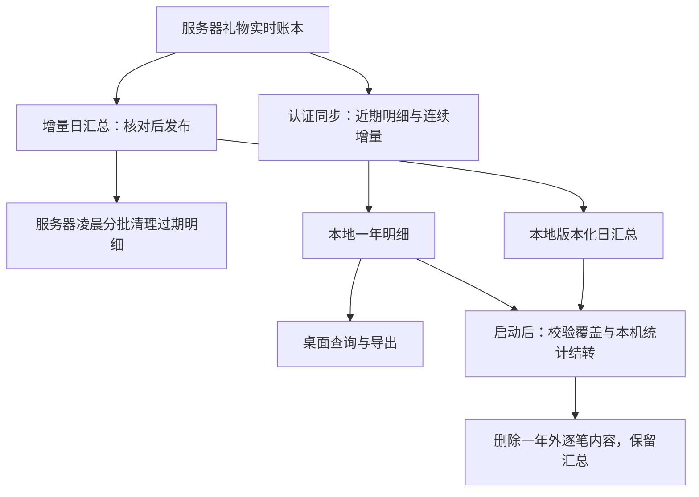

# 礼物服务器 90 天、本地一年与批处理调度实施计划

Status: Awaiting Verification

日期：2026-11-11。新规则已在两仓工作区实现，功能测试及隔离 Electron 查询/导出验证已有证据。百万条场景的 50ms 批次调优目标尚未稳定满足，完整规模周期和实际发布验收未完成；不标记计划完成。本轮未操作真实数据库、提交或部署，未启用生产物理清理。旧阶段验证不替代本阶段证据。

> 执行者：按 [PLANS.md](../../PLANS.md) 和本文件的任务与验收逐项推进。任务使用复选框登记实际结果。执行阶段重新读取两仓适用 AGENTS.md；本计划不要求自动创建分支、提交、派生聊天或安装额外技能。

**Goal:** 服务器保留约 90 天逐笔礼物，本地保留约 365 天已接收逐笔礼物；过期后保留准确的历史汇总，支持月报、年报和已有统计。服务器在北京时间 03:00–04:00 分批清理，本地在软件启动后后台处理，任务互斥、可恢复，不阻塞正常启动或重复入账。

**Architecture:** 沿用服务器每主播 `streamer.db`、本地 `gift-data.db`、现有日汇总及同步协议。服务器拥有权威统计，本地拥有已同步明细的较长保存期及本机消费者结转。两个进程各自只有一个礼物维护调度入口，不增加外部定时删库脚本。

**Tech Stack:** 现有 Electron、Node.js、客户端 `node:sqlite`、服务器 `better-sqlite3`、Vanilla JavaScript 与既有测试工具；不引入服务、框架、数据库或运行依赖。

## 1. 已确认需求与执行默认值

行为及验收的唯一规格为 [gift-retention.md](../gift-retention.md)，决策为 [ADR-0024](../../docs/architecture/adr/0024-gift-retention.md)。本计划负责文件、任务顺序、并发控制及验证步骤。

| 项目 | 目标规则 |
| --- | --- |
| 服务器逐笔明细 | 滚动约 90 天；北京时间日界向下取整，保留滚动查询的完整首日 |
| 本地逐笔明细 | 滚动约 365 天；“一年”采用固定 365 天，不按自然年清零 |
| 长期统计 | 按日和必要业务维度汇总，月/年数据由日数据计算；不只保存每月一个总数 |
| 服务器物理清理 | 北京时间每日 `[03:00, 04:00)`；窗口外不启动新的过期明细删除批次 |
| 本地触发 | 软件启动、数据库迁移完成、界面可用后登记任务；授权来源与可靠汇总就绪后执行；不要求凌晨开机 |
| 本地已有开关 | 默认自动清理沿用 `autoRetentionOnStartup=true`；显式关闭时不自动删除，不新增重复开关 |
| 本地长期运行 | 复用现有低频维护入口，在下一自然日登记一次新周期，不为每次礼物事件登记任务 |
| 数据安全优先 | 汇总未覆盖、校验失败、结算未完成、快照受保护或来源不明时延后删除 |
| 清理粒度 | 本地删除默认每批 25 条、派生状态回收默认每批 100 条，硬上限均为 500；短事务、25ms 续批间隔、持久进度、失败可恢复 |

“90/365 天”是正常保留目标，不承诺每笔刚到期限立即物理消失。窗口停机、保护条件和积压可使实际保存更久；不能跳过核验来满足天数。已被旧策略删除的本地明细不能凭汇总恢复，一年从实际已有及后续收到的数据积累。

本次只覆盖已识别来源的付费礼物账本及其礼物归档。SC、粉丝事实、舰队到期、歌曲和用户导出的图片等保持各自生命周期；来源不明的旧本地礼物不得擅自归入当前账号或删除。`output/` 及既有导出目录不是清理对象。

### 1.1 首次进入新规则的基线

2026-11-11 用户确认没有正式旧版使用者，允许清理不兼容的旧礼物数据，不要求恢复旧版已丢失的成员证明或迁移旧精确归档。首次升级使用一次性迁移重置已识别服务器来源的本地礼物投影、关联结算和派生保留状态，再由正常认证同步建立新基线；不清空服务器权威账本、其他业务库、礼物规则、许愿配置或导出文件。服务器仍可恢复的数据重新同步，不能恢复的旧本机贡献不承诺保留。迁移版本保证后续启动不重复重置；新规则建立后的同 epoch 重建必须保留一年内已发布明细。

gift_db v22 在启动迁移事务中一次性执行上述重置，不承诺对可丢弃的旧基线分批迁移；这是日常后台维护预算之外的一次性例外。旧精确归档、旧 staging 和成员证明不再兼容承接。新规则自身的断线恢复、统计互斥、来源隔离和一年外汇总要求仍适用。迁移与新规则均只在隔离夹具验证。

## 2. 实施前事实与变更依据

| 事实 | 当前 owner | 对本阶段的影响 |
| --- | --- | --- |
| 服务器 `DETAIL_RETENTION_MS=90*DAY_MS`，物理删除默认关闭 | Server `src/lib/gift-summary-contract.js`、`src/config.js` | 保留 90 天常量；新增删除时间窗口，不擅自启用线上开关 |
| 服务器已有汇总→明细清理→旧版本回收轮转，每批让出 | Server `src/modules/bilibili/gift-retention-maintenance.js` | 扩展已有调度，不建立另一套 cron/脚本执行相同删除 |
| 每主播维护在 `runGiftLedgerMaintenance` 中串行 | Server `src/modules/streamer/gift-query-executor.js` | 复用队列；该函数不等于暂停所有查询，不误用为全局读写锁 |
| 本地 `pruneLocalGiftBatch` 按服务器 `detail_start` 删行 | Live `src/storage/gift-local-retention.js` | 改为独立的 365 天边界与本地汇总保障 |
| 明细查询要求属于当前保留快照，并受服务器 90 天限制 | Live `src/storage/gift-retention-queries.js` | 必须同步修改查询、计数、选取和导出；只改删除期限无效 |
| 全量同步会更换快照成员；旧快照成员由清理器回收 | Live `src/storage/gift-retention-store.js`、`gift-retention-cleanup.js` | 同 epoch 重建要保留 91–365 天的已发布本地记录 |
| 本地清理由远端 reconciliation 直接调用 | Live `src/electron/remote-gift-controller.js`、`src/server/gift-sync-runtime.js` | 改为登记到唯一维护调度器，避免与启动任务重复执行 |
| 通用启动维护已经每小时检查、续批处理旧本地礼物 | Live `src/server/startup-retention.js`、`data-maintenance-runtime.js` | 协调同一个 `giftDb` 的写维护，其他库保持原职责 |
| 盲盒本机归档包含 `occurred_at`，分组键含精确时间 | Live `src/storage/gift-local-retention.js` | 超过一年后需要真正合并，不能仅移出 `gift_events` 后仍永久保存逐事件时间 |
| 导出准备阶段已经一次读出最多 10,000 条结果 | Live `src/bilibili/gift/query-service.js`、`src/electron/gift-export-controller.js` | 复用有界内存快照，不为整个图片渲染过程持有数据库事务 |

2026-11-11 本会话用现有本地结构模拟 50 万条半年明细：明细及相关索引约 443 MiB；首次全量流水计数约 1.4 秒，昵称全量搜索约 3.5–3.7 秒。此证据未包含长期日汇总、网络、服务器和 Electron 页面绘制，不是本方案验收。原临时证据位于仓库 `tmp/gift-capacity-500k/`，不作为必须存在的发布输入。

## 3. 数据职责及统计规则



### 3.1 服务器长期统计继续使用已有日汇总

保留历史用户与礼物/盲盒身份、价格及币种维度，保留事件笔数、件数、总价、大航海、盲盒成本/价值/盈亏和未知成本计数。服务器私有 UID 和房间维度继续只留在服务器；客户端收到的维度仍遵守现有公开 DTO。

不新增一套会与日汇总独立漂移的月总账。月报、年报从已发布日汇总及未覆盖明细计算。金额逐笔转整数分，未知成本不能当零，汇总行数不能当礼物笔数。细分汇总和最小去重键仍会增长，不承诺固定压缩率。

### 3.2 本地超过一年时“做汇总”的准确含义

本地同一笔礼物可能已经在服务器同步下来的日汇总中。删除前必须区分：

1. **权威统计已覆盖：** 验证当前 source/epoch、已发布日版本、覆盖 cursor/日期，保留该日汇总；不得再把明细金额加进去。
2. **权威统计尚未覆盖：** 暂不删除，等正常同步取得已核验汇总；不自行生成一个会与未来服务器版本重复的权威汇总。
3. **仅本机业务统计：** 按原 `gift_stats_eligible`、冲刺重置、盲盒统计、许愿边界等口径结转，不能用全量服务器汇总代替本机统计资格。

全量历史统计始终满足：`已发布汇总 + 尚未被该版本覆盖的合格明细`。本地保留 91–365 天明细增加查询和导出能力，不增加另一份统计贡献。

### 3.3 本机归档要真正减少逐笔内容

- `gift_sprint_carry` 已是合计，继续复用；重置冲刺与清理结转在同一来源的事务规则内互斥。
- 超过一年且已消费的合格盲盒明细直接进入 `gift_local_archives` 的日、用户、礼物/盒型、价格、已知/未知成本分组；`occurred_at` 留空，分组键不含事件瞬间，不保留第二份完整事件 JSON。
- 一年内使用原事件的精确时间。超过一年后冻结归档使用的 IANA 时区和日桶；同一时区仍准确合计，切换时区后返回日期精度限制，不声称能精确重分桶。`last_opened_at` 仅保存分组最大值。旧版精确归档和北京时间历史桶均由一次性基线重置清理。
- `gift_wish_boundary_totals` 保存超过一年的已确定许愿首日边界贡献，按 wish/source/epoch/边界段结转数量；仍可变的进行中场次尾日暂缓。对每条许愿，汇总、当前明细、边界结转互斥。旧 `gift_wish_contributions` 随重置清空，新规则不再写逐事件副本。
- 重放防护需要的最小 `platform_id`/身份凭证允许保留，不包含一整份礼物名称、金额和精确时间；不把去重凭证呈现为逐笔记录。

时区精度是舍弃一年外事件时间后的实际边界，必须进入规格、API 提示和用户指导；不得假造时间、均摊到某一天，或继续永久保留精确事件却宣称已完成汇总。

## 4. 本地一年明细与同步重建

### 4.1 延长可见性，复用现有快照成员证明

优先复用 `gift_events`、`gift_retention_members` 和已发布快照，避免复制整份账本或为每个事件维护第二份数据：

- 已成功激活、与当前 source/epoch 相同的快照成员可以证明“本机曾完整接收这条记录”。同 epoch 全量重建不使这份证明失效。
- 本地明细查询使用这些已发布成员的并集，再应用 365 天边界；使用 `EXISTS`，不能 JOIN 后把同一事件返回多次。
- `summaries/history/catchup` 阶段的未激活快照不提供证明，失败/中断下载不能泄露半成品。
- 继续检查付费、final、状态、合法时间及当前来源。现有保留时间升降序索引应继续承担翻页；用执行计划及有界访问验证新条件。
- 旧快照成员若已被当前已发布快照覆盖，可分批去重；独有的 91–365 天成员必须保留。无成员、非 active/staging 引用的旧快照才可删除。
- 保存旧成员证明不意味着固定旧统计版本。统计日版本仍以当前 active revision 为准，旧汇总版本按原保护规则回收。

存储查询目标逻辑：

```sql
-- currentEpoch 来自认证来源及已验证同步状态，不接受页面传入。
EXISTS (
  SELECT 1 FROM gift_retention_members m
  JOIN gift_retention_snapshots s ON s.id = m.snapshot_id
  WHERE m.event_id = g.id AND s.source_id = g.source_id
    AND s.sync_epoch = ? AND s.phase = 'active'
)
```

同 epoch 的普通重连/快照过期重建不得调用会删除本地旧账本的 reset 路径。服务端显式清空、账号删除或已核验 epoch 改变则遵守原失效规则：旧证明与旧汇总不能重新出现在新账本中。切换账号仅切换可见来源，不把 A 的记录归到 B，也不擅自清掉 A 的本地数据。

### 4.2 保存期限不等于实际完整性

首次安装最多从服务器恢复其可用明细；已丢失或从未同步的 91–365 天记录不会凭本方案出现。

新增来源/epoch 隔离的日覆盖区间元数据 `gift_local_detail_coverage`，记录经完整 bootstrap 或连续 cursor 与已发布汇总共同证明的完整自然日区间；合并相邻区间，不逐事件写覆盖日志。区间由同步提交 owner 维护，不能用 `MIN(created_at)` 冒充完整历史。中断下载不发布区间，超过服务器恢复窗的离线缺口不标记完整。

覆盖证明随激活事务更新。连续追赶可延长既有覆盖；全量重建若跨越本机未连续消费的 cursor，撤销旧覆盖证明，仅发布此次 bootstrap 证明的服务器可恢复日期。已有一年内明细继续可查，但旧日期标记为部分明细。不能只把离线期间的日历日期标为缺口：迟到 final 可能改变更早的日期。没有跨越游标缺口的同 epoch 重建保留既有证明；跨 epoch 和显式清空一并撤销证明。

本地 history/selection 共用同一可见性规则。现有本地 `retention.detailStart` 表示本机期限，增加 `serverDetailStart` 区分服务器恢复能力，增加查询范围的 `availability`（`retained` / `partial` / `expired`）。统计完整性与明细完整性分别表达；现有 `partial` 同步状态不得拿来假装一年明细完整。

### 4.3 可靠的本地清理时间

本地时间被误调到未来不能导致整年记录误删。清理周期使用最后成功激活且校验过的服务器 `summarized_before` 作为保守时间基准，向前减 365 天，生成并固定本轮截止点；不直接采用服务器 90 天 `detail_start`，也不只相信电脑墙钟。

离线启动可清理已被该可信边界覆盖的积压；没有可靠汇总时跳过物理删除，界面和已有数据继续可用。恢复联网、汇总成功激活后登记新的周期。迟到 final、未消费统计和 pending 加班结算继续受保护。

## 5. 批处理顺序、互斥和资源预算

### 5.1 谁能启动任务

| 环境 | 唯一调度 owner | 其他入口的职责 |
| --- | --- | --- |
| Server | `gift-retention-maintenance`，接入应用现有启动/关闭生命周期 | 启动与定时唤醒只推进同一任务；管理工具不得另开写连接直接删礼物 |
| Live | `gift-sync-runtime` 持有一个礼物维护 controller，生命周期由 `server.js` / `desktop-runtime` 管理 | 启动维护、同步激活、reconciliation、手动维护只登记请求，合并重复触发 |

客户端调度实现可拆到一个职责明确的 `src/server/gift-retention-maintenance.js`；它不是新的服务、进程或通用任务框架。存储事务仍由 storage owner 持有，调度层只决定何时运行一批。

### 5.2 服务端运行次序

```text
确认主播可用、未停机、未进入显式清空/删除
→ 进入该主播现有维护队列
→ 推进一批汇总构建/独立复读核验/原子发布
→ 若允许删除且北京时间在 03:00–04:00，推进一批符合条件的明细/outbox 清理
→ 回收不再被当前版本、有效快照和在建 base 引用的旧汇总版本
→ 提交/释放队列 → 让出事件循环 → 轮到下一个主播
```

- 日常增量汇总不局限在凌晨，避免把全部计算压进一小时。没有新的汇总需构建时可以检查已有已发布版本，不要求重新扫描全库。
- 保留每批上限和现有租户轮转间隔、空闲退避；不能对第一个大主播 `while(hasMore)` 一直执行而饿死其他主播。
- 删除时间在**实际开始每一批时**重新检查，不能只在 03:00 启动时检查一次。03:59 开始的一批允许完成事务；04:00 后不新开删除批次。
- 窗口错过或未清完时持久保留检查点，下一窗口续跑；不得默认在白天补跑大规模删除。汇总和安全的旧版本回收继续按原有界任务运行。
- 单主播失败沿用五分钟退避，其他主播继续；全局枚举失败只记录任务失败并退避，不退出服务。
- 最小去重凭证、已分配 cursor、已裁连续前缀与删除原子提交。不能独立定时删除 outbox，不能跨过不满足保护条件的 cursor 空洞。

### 5.3 本地启动后的运行次序

```text
完成数据库迁移并让主窗口可用
→ 登记本次启动的清理请求，不在启动调用栈循环删库
→ 当前来源/epoch 可用，使用最近已发布汇总；有同步激活时等其事务结束
→ 记录本轮 source、epoch、generation、汇总 revision，固定 365 天截止点和扫描上界
→ 每批选候选 → 核验覆盖 → 本机统计结转/归档合并 → 写去重凭证 → 删逐笔内容
→ 同一事务写入本批扫描进度并提交
→ 回收冗余快照成员、无引用快照及旧汇总版本
→ 完成或让出，仍有积压时再调度一批
```

启动不是必须等到所有网络历史下载完成才允许工作：没有可用旧 active snapshot 时等同步；有已验证 active snapshot 时可以准备工作，但 staging 下载/切换期间暂停涉及成员、覆盖及删除的批次，优先完成激活。网络失败时保留旧状态，不持锁等待网络。

每轮固定扫描上界，通过 ID 游标续批；同 epoch 新激活的可靠 revision 可以加强覆盖证明并更新代次，不能扩大当前周期的截止点或扫描上界。遇到受保护行继续检查后续候选，不让一条 pending 行造成无限空转。迟到记录与受保护行在下一个可信日周期重新检查，不能使用永久单调扫描游标跳过它。没有可处理工作时结束本轮，不按每条 SSE 事件重跑。

### 5.4 冲突矩阵

| 同时发生的工作 | 处理规则 |
| --- | --- |
| 同库两次自动/手动清理触发 | 合并为一个 pending 请求，一个 runner；手动入口可以等待该任务结果，不另起循环 |
| 实时礼物到达与清理 | 实时入账优先获得下一次执行机会；已开始的短事务完成后让出，维护不等待“永远没有礼物”才执行 |
| 同步分页与清理 | 网络读取不占写锁；提交页、激活、清理每批串行执行，校验相同 source/epoch/generation |
| staging 与旧快照回收 | staging 拥有其检查点和依赖，未结束前不删除其成员、base 或需要的日版本 |
| 查询/导出与维护 | 查询使用短读快照；服务器只读 worker 沿用 WAL/快照保护。导出准备把既有限额内数据读到内存，渲染和文件写入在事务外继续 |
| 导出准备前记录到期 | 返回已有“选择已失效/部分记录不可用”结果，刷新可用范围；不能默默少导出或用汇总行顶替明细 |
| 显式清空、租户删除、来源切换 | 先阻止旧代次新任务，等当前批事务结束，再走现有清空/来源协议；旧回调在开始与提交前核验代次，不能在新来源落盘 |
| 本地通用 retention 与礼物专用 retention | 两者对 `giftDb` 的写维护通过同一个调度入口分段串行；旧 `source_id IS NULL` 策略不侵入远端账本；其他数据库不加无关全局锁 |
| 本机冲刺重置/许愿修改与结转 | 使用现有同库事务与来源校验，按提交顺序生效；事务外不能预先算好累计值后覆盖较新的重置 |
| 备份、迁移、数据库关闭 | 迁移先于任务；备份复用现有一致性方案。需要独占时暂停新批次并等待在途批结束，不一边替换数据库一边维护 |
| 两端同时清理 | 无跨主机写锁，也不互相等对方删除；服务器依赖自己的已发布汇总与快照，本地依赖已成功提交的汇总及独立期限 |

禁止嵌套获取同一个非重入维护队列：清空的顶层 owner 只申请一次维护权，内部 storage helper 不再次入队。禁止在 SQLite 事务里 `await` 网络、图片导出、定时器或另一个维护任务。

### 5.5 预算、关闭和可观测性

- 本地删除默认每批 25 条候选、派生回收默认 100 条，硬上限 500；续批间隔 25ms。服务器沿用现有批量及租户轮转间隔。
- 行数上限不保证扫描量或耗时。对候选选择、去重和归档合并检查索引及实际访问量；不能每批 `COUNT(*)` 全库来显示进度，也不能每批全库重建临时索引。
- 本地以参考机单批主线程阻塞 50ms 作为调优门槛，超限先减少批量或修正扫描路径；这不是未经测试的性能承诺，也不能以省略对账换取达标。
- shutdown：先标记停止并取消 timer → 拒绝新维护请求 → 等当前事务/已登记任务结束 → 释放引用 → 关闭数据库。不为清完整年积压拖延退出。
- 当前本地错误日志只记录 source 与错误码，周期、阶段、截止日期、扫描位置及累计跳过数可从持久状态排查；批次耗时来自隔离规模探针。尚未实现逐周期处理总数和耗时的运行日志，不把这部分诊断增强列为已交付。后续若补齐，沿用现有日志 owner 并避免每批 toast 或姓名、礼物原包、授权信息。
- 持久化记录周期截止点、阶段及扫描检查点；进度更新与该批数据变更同事务。崩溃前未提交整批重做，已提交批次不会再次结转金额。只有完成全阶段才记成功；无汇总/保护等待不冒充清理完成。
- 不每天执行全库 `VACUUM`。SQLite 空闲页供新增数据复用；容量评估同时记录主文件、WAL、空闲页和汇总表，不能只看文件大小判断清理失败。

## 6. 文件与合同所有权

下表路径分别相对于 Live / Server 仓库。新增文件仅在拥有独立职责时创建；不按表机械拆文件。

| 范围 | 实施 owner | 直接消费者与同步材料 |
| --- | --- | --- |
| Server 调度窗口 | `src/modules/bilibili/gift-retention-maintenance.js`、`src/app.js` | `test/gift-retention-maintenance.test.js`；`docs/protocol/gift-retention.md` |
| Server 删除与快照 | `src/storage/gift-retention-store.js`、`gift-summary-store.js`、`gift-summary-cleanup.js` | 现有 retention/delivery/work 测试；只在排程需要时修改，保留原正确性逻辑 |
| Server 互斥/生命周期 | `src/modules/streamer/gift-query-executor.js`、`src/server-lifecycle.js` | `test/gift-query-maintenance.test.js`、`test/server-shutdown.test.js` |
| Live 持久化与迁移 | `src/storage/gift-retention-tiers-migration.js`、`database-migrations.js` | `test/gifts/gift-retention.test.js`、`test/storage/database-initialization.test.js`；存储 owner 文档 |
| Live 汇总结转与回收 | `src/storage/gift-local-retention.js`、`gift-retention-cleanup.js`、`gift-wish-retention.js`、`gift-wish-store.js` | 盲盒/许愿/冲刺 consumers；精度和数量不重复 |
| Live 已发布成员与覆盖区间 | `src/storage/gift-retention-store.js`、`gift-detail-coverage.js`、`gift-sync-store.js`、`gift-retention-queries.js`、`gift-query-store.js` | history、count、selection、statistics、wish 读取 |
| Live 调度与桥 | `src/server/gift-sync-runtime.js`、`startup-retention.js`、`data-maintenance-runtime.js`、`src/server.js`、`src/electron/desktop-runtime.js`、`remote-gift-controller.js` | 新 `src/server/gift-retention-maintenance.js`；现有启动、reconciliation 和关闭调用方 |
| Live 查看与导出 | `src/bilibili/gift/query-service.js`、`blind-box-analysis.js`、`src/server/routes/gift-routes.js`、`public/js/admin/gifts/history-view.js`、`history-tools.js`、`src/electron/gift-export-controller.js` | 保留现有限额；仅修改受影响的范围/完整性与导出行为 |
| Live 清空 | `src/storage/database-clear-operations.js`、`gift-maintenance-store.js` | 新覆盖、进度和归档字段由现有 clear owner 一并处理；保留 source/epoch 隔离 |

迁移追加为 gift_db v22。既有逐条盲盒归档随授权的一次性基线重置清理；之后的明细删除与日汇总按后台批次执行。新增维护进度、覆盖区间及归档时区/结转字段由同一存储 owner 维护，不写进云设置或额外 JSON 文件。

## 7. 执行任务与依赖

顺序：M1 → M2 → M3 → M4 → M5 → M6。Server 的 M2 与 Live 的 M3 可以分别实现，但双方协议和固定验收样本必须在 M1 明确；默认在当前聊天顺序执行，不自动派生子任务。

### M1. 固定契约与共享验收样本

- [x] 同步当前规格、ADR 以及 Server `docs/protocol/gift-retention.md`、相关 requirements/acceptance/ADR-0100；清晰区分目标与已实现状态，保留旧验证记录。
- [x] 明确本地 history/selection 的期限和完整性字段，更新本地 API owner；unchanged/delta 响应沿用现有结构。服务器 Device 协议仍提供 90 天事实和汇总。
- [x] 在既有礼物保留夹具扩充今天、89/90/91、200、364/365/366 天边界；沿用普通礼物、盲盒已知/未知成本、件数、晚 final、本机不合格统计样本。
- [x] 以原事实的独立金额/笔数/件数断言校验统计和可见明细，保留导出选择检查；固定 wire fixture 未改变。
- [x] 将一年外本机归档时区精度、许愿边界结转及可变尾日保护写入接口和验收。

**完成条件：** 双端 target contract 与样本一致，现有差异已有明确的新旧行为表；不改读取/解析/估值算法。

### M2. Server 时间窗口与单一调度

- [x] 在现有 maintenance 测试中用可控时钟验证 02:59:59、03:00、03:59:59、04:00；按 UTC 偏移计算，不依赖宿主机时区。
- [x] 在进入 `pruneGiftRetentionBatch` 前检查时间窗口与关闭状态；窗口外仍推进汇总/版本回收，并验证下一日汇总可发布。
- [x] 复用 `runGiftLedgerMaintenance`；8 个直接受影响 suite 的 144 项覆盖调度、失败隔离、清空、查询快照及 shutdown，未新增 timer owner。
- [x] 实测排队跨出 04:00 不删除；窗口外跳过删除并保留原持久进度。恢复、晚 final 与连续前缀保护由既有 retention/delivery/work suite 验证。
- [x] 同步服务端运行说明；删除开关默认值及线上配置未修改。

窗口函数的目标语义（局部 helper，可使用现有时间工具）：

```js
const shanghaiHour = new Date(nowMs + 8 * 60 * 60 * 1000).getUTCHours();
const mayStartDeleteBatch = deleteEnabled && shanghaiHour === 3 && !stopped;
```

**完成条件：** 只有规定窗口开启新删除批次，短事务、租户公平性与原保护条件通过既有完整测试文件。

### M3. Live 一年明细、同 epoch 重建与完整性

- [x] 验证同机 200 天记录连续两次全量重建与旧证明回收后仍可查询、选择，统计不重复；新电脑对应日期为 partial 且无伪造明细。
- [x] 追加覆盖区间及维护状态迁移；一次性清理旧投影后重复迁移不再重置。新基线 active/staging/失败下载继续按原恢复流程处理，不重新识别礼物。
- [x] 合并同 epoch 已发布成员证明；未激活快照不可见，跨来源/epoch 与显式清空隔离仍成立。
- [x] history、count、selection 共用一年规则；统计排除已覆盖明细，沿用数据库变更 token 和投影代次使缓存失效。
- [x] 验证 200 天选择和 Electron PNG 导出、366 天过期提示、空范围、游标缺口及迟到 final 的完整性撤销。

**完成条件：** 91–365 天本地记录在普通重建后可查可导出；来源、epoch、失败下载与明确清空保护成立；查询计划未退化为无界多次扫描。

### M4. Live 一年外汇总、原子删除及启动任务

- [x] 实现唯一 maintenance controller；`start` 等待界面就绪，`request(sourceId)` 合并唤醒，`runLocal` 防重入，`stop` 取消后续批次。同步事务在停止回调执行前已完成。
- [x] 启动、低频检查、同步激活和远端 prune 接入同一 owner；每批动态检查授权来源和自动维护开关，按可靠汇总边界工作。
- [x] 同事务执行覆盖核验、本机冲刺/盲盒/许愿结转、最小去重凭证、逐笔删除及检查点；触发器故障验证整批回滚。
- [x] 新基线超过一年的盲盒直接日归档，已确定许愿边界写数量合计；旧逐事件归档由 v22 一次性重置清理，不再实现旧归档压缩迁移。
- [x] 覆盖重复唤醒、关闭重开检查点、无可靠汇总、未来本地时钟、pending/未消费和晚到旧日期；10 条夹具跨重开恰好产生 10 份最小凭证且冲刺不重复。
- [x] 同库通用维护经过同一同步 owner；clear 沿用同库同步事务及来源/代次失效，不新增嵌套队列。隔离 Electron 验证已准备导出在后台清理中完成。
- [x] controller 的停止及旧回调测试、服务器生命周期测试通过，关库之前停止维护；完整生产登录/主窗口启动流程尚未实跑。

单批事务边界示意；每一步复用/扩展对应 storage owner，不把业务 SQL 移进调度器：

```text
BEGIN IMMEDIATE
核对 source + epoch + generation + 已发布 revision + 本轮截止点
按索引与固定扫描上界取不超过 500 个候选
逐候选校验覆盖与消费者终态；安全项写结转/最小凭证并删除原始内容
推进本批检查点（跳过的保护项由下轮重新检查）
COMMIT
让出事件循环；再接受下一批或高优先级工作
```

**完成条件：** 一年外可删除记录及精确归档已压缩，统计前后相等；故障整批回滚、重跑不重复，启动/实时/退出均不被长维护循环占用。

### M5. 界面、导出、性能与文档同步

- [x] 流水沿用现有状态区显示一年本地、90 天恢复、长期统计及 partial/expired 提示；实际桌面核对后修正原状态元素仅供屏幕阅读器可见的问题。
- [x] 200 天记录可筛选、勾选、预览并导出 PNG；导出仍受 10,000 条上限和来源/清空失效规则保护。2,000 条过期明细后台清理期间，已准备的导出正常完成。
- [x] 盲盒显示归档日/时区精度，流水显示缺口与过期；不新增文案字符串断言。
- [ ] 完整规模与阻塞预算验收：已采样 50 万/100 万数据库各 60 个删除批次，含周期性插入和直接推进可靠 revision；尚非完整周期或实际网络同步。未测独立汇总表页占用，百万条的 50ms 门槛尚不稳定。
- [x] 修正派生回收的重复大范围扫描，改为固定上界和索引检查点；删除默认降为 25 条并复用批内查询准备。残余最大延迟主要在 SQLite COMMIT，未降低持久性设置。
- [x] 第 9 节当前事实与用户指导已同步；隔离 Electron 使用实际 preload、流水 renderer、查询及 PNG 导出 owner 验证，未控制用户实例。

**完成条件：** 功能与数据口径验证通过，维护阻塞预算有实测证据；统计完整性没有被误写为一年明细完整。

### M6. 发布准备与物理删除启用

- [ ] 准备执行发布时才读取两仓现行发布指南，固定实际匹配的客户端/服务器版本与契约 fixture；不能拿旧提交的通过结果代表新工作区。
- [ ] 客户端先取得一年保留与旧基线重置能力；服务器已支持日汇总与窗口调度。按用户确认无需旧版正式用户兼容等待周期。
- [ ] 首次物理清理前取得可恢复的一致性备份并验证恢复；备份包括账本、汇总、成员、去重凭证、水位、覆盖及进度，不能只复制一张事件表。
- [ ] 在发布/启用被明确授权后，才操作生产 `GIFT_RETENTION_DELETE_ENABLED`；新版本上线不等于开关已启用。
- [ ] 首个实际清理窗口核对删除/保留原因、汇总不变、实时接收、客户端一年明细及导出；异常立即停止新清理批次，保留查询和原始诊断信息。

**完成条件：** 代码交付与线上启用分别登记。本轮仅在工作区实现并用隔离数据验证，M6 未执行；实际版本匹配、备份恢复和生产开关属于发布阶段。

## 8. 验证矩阵与命令

先扩充现有 owning suite，不按函数/字段逐一建测试。下表为具体行为，不是源码字符串检查。

| 验证主题 | 必须观察的结果 | 主要 suite |
| --- | --- | --- |
| 90/365 日界、凌晨窗口 | 边界内保留；窗口外不开删除批；汇总失败不删；错过窗口可续 | Server `test/gift-retention-maintenance.test.js`、`test/gift-retention.test.js`；Live `test/gifts/gift-retention.test.js` |
| 明细删除前后统计 | 金额、笔数、件数、盲盒成本/价值/盈亏、未知成本分组及筛选一致 | 双端既有 retention/statistics suite |
| 重放与故障 | 同批失败回滚，重跑不重复加金额；outbox 连续前缀及去重正确 | Server `test/gift-retention-delivery.test.js`、`test/gift-retention-work.test.js`；Live `test/gifts/processed-gift-import-atomicity.test.js` |
| 同 epoch 重建与缺口 | 老本机 200 天明细保留，新机不伪造；未激活数据不可见；旧快照可回收而不丢独有记录 | Live `test/gifts/gift-retention.test.js`、`remote-gift-controller-reconciliation.test.js` |
| 本机一年外真实压缩 | 原事件与逐时间归档不再保留，日合计不变；时区精度显式；许愿边界不重复 | Live `test/gifts/gift-retention.test.js`、`gift-statistics-service.test.js` |
| 启动/同步/退出交错 | 不同时执行两个维护批次；无网络等待持锁；关库后无回调；持续礼物仍有维护进展 | Live 新 `test/server/gift-retention-maintenance.test.js`，扩展既有 `startup-retention.test.js`、`server-lifecycle.test.js` |
| 读/导出/清空交错 | 有界导出快照完成；清空/换号按原规则失效；无跨来源数据 | Live `test/gifts/gift-export-controller.test.js`、`gift-ledger-maintenance.test.js`；Server `test/gift-query-maintenance.test.js` |
| 规模访问量与体感 | 有界候选访问、无重复全库扫描，记录单批延迟及真实桌面可操作性 | Live `test/storage/query-optimization.test.js`；Server work/read-work suite；隔离容量与 Electron QA |

Live 实施后的聚焦验证（在 Live 根目录执行；只在对应文件完成后运行）：

```powershell
npm test -- --file=test/gifts/gift-retention.test.js --file=test/gifts/gift-query-service.test.js --file=test/gifts/gift-statistics-service.test.js --file=test/gifts/remote-gift-controller-reconciliation.test.js --file=test/gifts/gift-ledger-maintenance.test.js --file=test/gifts/gift-export-controller.test.js
npm test -- --file=test/server/gift-retention-maintenance.test.js --file=test/server/startup-retention.test.js --file=test/server/server-lifecycle.test.js --file=test/storage/database-initialization.test.js --file=test/storage/query-optimization.test.js
npm test -- --file=test/gifts/gift-retention.test.js --file=test/gifts/gift-wishes.test.js --file=test/gifts/gift-wish-routes.test.js --file=test/gifts/frontend-gift-history.test.js --file=test/gifts/frontend-gift-history-selection.test.js --file=test/gifts/frontend-gift-history-recovery.test.js --file=test/gifts/frontend-blindbox-admin.test.js --file=test/gifts/blind-box-analysis-dates.test.js --file=test/storage/data-maintenance-runtime.test.js
npm run check
npm run verify:architecture
npm run verify:docs
```

Server 实施后的聚焦验证（在 Server 根目录执行；先查看同范围计划）：

```powershell
npm run verify -- --plan --node test/gift-retention-maintenance.test.js --node test/gift-retention.test.js --node test/gift-retention-delivery.test.js --node test/gift-retention-work.test.js --node test/gift-summary-read-work.test.js --node test/device-gift-retention.test.js --node test/gift-query-maintenance.test.js --node test/server-shutdown.test.js
npm run verify -- --node test/gift-retention-maintenance.test.js --node test/gift-retention.test.js --node test/gift-retention-delivery.test.js --node test/gift-retention-work.test.js --node test/gift-summary-read-work.test.js --node test/device-gift-retention.test.js --node test/gift-query-maintenance.test.js --node test/server-shutdown.test.js
npm run docs:check
```

固定候选的 `npm run verify:contracts`、直接受影响的原子导入/来源隔离/桌面导出文件及实际升级验收按影响范围补齐并记录。上述聚焦列表不替代发生协议、清空或生命周期变化后应运行的直接消费者测试，也不要求无差别反复运行全仓测试。每次运行记录完整文件、版本、通过/失败/跳过，失败先诊断再重跑。

实际运行范围、结果及未覆盖部分记录在第 11 节；未执行全仓测试或生产升级。

## 9. 文档和用户指导同步清单

- Live 规格和决策：`specs/gift-retention.md`、ADR-0024、计划与规格索引；旧计划保留原证据并指向本计划。
- Live 当前事实 owner：已同步 `docs/reference/backend/storage.md`、`docs/reference/backend/bilibili/gift.md`、`docs/reference/backend/api.md`、`docs/reference/backend/server-core.md`、`docs/reference/desktop/main.md`。未新增 preload/IPC 接口。
- Live 来源/投影契约：既有投影规格已声明保留语义由 `gift-retention.md` 替代；礼物检测规格不变，不重复复制新保留合同。
- Live 用户指导：实际 owning page 为 `public/pages/admin/toolbox/usage-guide-gifts.html`，已补一年本地/90 天恢复、缺口及归档精度；引导步骤、`docs/guides/` 和通用工具箱页无受影响的操作入口或期限说明，未为本任务改写。未替换既有截图资产。
- Server 规范：`docs/protocol/gift-retention.md`、`docs/protocol/client-server-api.md`、相关 requirements/acceptance/traceability、ADR-0100、`docs/architecture/data-boundaries.md`；OpenAPI/fixture 仅在 wire contract 实际改变时更新。
- Server 运维：清理时区、时间窗口、失败续跑、开关、备份/恢复入口与首次启用条件；沿用现行发布/备份文档，不另造维护脚本手册。

两仓当前参考与本地用户指南已按工作区实现同步。Server wire contract、OpenAPI、共享 fixture 和原 traceability 路径无需改变；本次改的是本地保存及维护时机，不把工作区验证表述为上线。

## 10. 失败、回退与完成标准

汇总不一致、覆盖缺失、来源/代次变化、数据库忙或磁盘错误：当前批回滚，保留原始数据与已完成批次，停止或退避该来源；不通过跳过有效断言、自动清空或删除原始记录“修复”。

删除前可以停止新调度，保留新 reader 与已迁移结构；删除后不能直接退回假设所有数据都在原事件表的旧二进制。需要恢复时使用对应 source/epoch 的一致性备份，账本、汇总、游标和归档一起恢复；不能只恢复明细导致重复计数。正常过期清理不轮换 epoch，显式清空沿用已有协议。

新计划的 Done When：

- [x] 已实现服务器约 90 天、本机约 365 天、长期汇总的独立规则。
- [x] 新基线一年外明细直接汇总，统计不重复；不兼容旧归档按用户授权一次性清理。
- [x] controller/存储层的启动、实时、同步、清空、退出和重开恢复测试通过；隔离桌面验证维护中导出。完整生产登录启动留在发布验证。
- [x] 同 epoch 重建保留已有旧明细，跨 epoch/来源不泄漏或复活；实际缺口可见。
- [ ] 完整规模周期及 50ms 调优门槛验收；目前仅有采样证据，百万条提交延迟仍超限。
- [x] 受影响测试、技术文档、用户指导已同步；任务 diff、两仓 `git diff --check` 和状态已审查。共享工作区的无关测试/文档门禁失败见下方记录。
- [x] 本轮是工作区代码交付，未部署、未操作真实数据库、未启用生产删除；M6 保持未执行。

## 11. 实施与验证记录

- 2026-11-11：完成当前代码路径、批处理 owner、快照/汇总/导出冲突及本机精确盲盒归档的只读核对。用户确认目标并追加“批处理顺序不要互相影响”的要求，本计划已纳入冲突矩阵和状态顺序。
- 前期文档阶段曾通过 `npm run verify:docs` 10/10；这不是后续代码的验收证据。
- 用户随后确认无正式旧版使用者，允许清理不兼容数据。实现 v22 一次性本地投影重置、同 epoch 证明并集、覆盖缺口撤销、一年删除/日归档/许愿结转、唯一后台调度及服务端凌晨窗口；未修改礼物解析/识别/估值、运行依赖或服务器删除开关。
- 验证对象是各自脏工作区：Live 基于 `e0eef12cc55213d549f0f3333c0ab8a351c727f9`，Server 基于 `539336792e6533667be7d8744f1149a34b11c488`。两仓都有其他并行工作，未提交或覆盖其修改。

### 11.1 自动化与文档

- Live 12 文件集（第 8 节前两组加 `processed-gift-import-atomicity.test.js`）102/103 通过，日志 `tmp/gift-retention-final-tests.log`，结果 `tmp/test-results/run-BQYYC5/results.json`。唯一失败为 `query-optimization.test.js` 中既有粉丝索引测试断言 song_db v17，而并行歌曲迁移已为 v18；本次保留测试和索引测试通过。未修改该无关版本预期来消除失败。
- Live 补充 9 文件集（第 8 节第三组）初次 83/87 通过，日志 `tmp/gift-retention-final-consumers.log`。4 个流水 UI 失败定位为共用 DOM 替身缺少标准 `classList.toggle`，补齐该方法后对两个失败文件定向复跑 12/12 通过，结果 `tmp/test-results/run-mWD4JZ/results.json`。最新的新电脑缺口夹具、许愿、盲盒日期、选择和通用维护检查通过。
- Server 先查看同范围 verify plan，再执行第 8 节 8 文件集，144/144 通过，无跳过；日志 `tmp/gift-retention-tiers-verify.log`，报告 `tmp/verification/runs/2026-11-11T07-51-29-713Z-5a14b209/node.json`。`npm run docs:check` 59/59 通过。
- Live `npm run verify:architecture` 29/29 通过；首次门禁发现 runtime 内完成状态 SQL，已移回 storage owner 后重验。最终 `npm run check` 通过 1,839 个 JS 文件；当前 `npm run verify:docs` 为 9/10，唯一失败是并行任务的 `2026-11-11-known-qa-fixes.md` 使用中文状态行，未匹配活动计划状态格式。链接、API、规格证据等其余检查通过；未改动该无关计划或校验规则。
- `npm run verify:contracts` 使用已有干净的 `tmp/v6.1.5-server-contract`，通过 `LIRA_SERVER_ROOT` 指向锁定 Server `67119e81a3f5f49470ed2b191f6552556d0a704e`，10 个 fixture 通过。默认当前 Server HEAD 与客户端锁不同；固定 fixture 验证不代表当前两个工作区已作为匹配发布版本验收。
- 两仓 `git diff --check` 均通过；任务代码/文档差异已审查，临时数据库、探针、截图和日志均留在已忽略的根目录 `tmp/`，没有测试进程遗留。保留既有并行修改和用户导出目录。

### 11.2 隔离 Electron

沿用 `scripts/verify-gift-history.cjs` 的隔离方式，临时 harness 位于 `tmp/`，使用实际生产 preload、context isolation/sandbox、流水 renderer、query store、维护 owner 和 PNG 导出 IPC。独立端口的精确路由返回 200，数据/配置/日志/导出均位于临时目录，未启动或控制用户运行实例。

- 200 天记录可筛选、选择、预览并保存 PNG；启动 2,000 条过期明细清理后，已准备的导出仍成功，后台最终清完。
- partial 范围仍显示已有明细及缺口提示；expired 范围无明细且提示过期。验证筛选重置、抽屉关闭重开；1280×802 与 1000×701 窗口下提示及操作区可用。
- 临时截图/导出在 `tmp/lira-gift-ui-check-jvFxZ7/`；测试 Electron 已关闭。未验证完整生产登录与主窗口启动，仅检查其 onReady/deferMaintenance 接线并运行相关生命周期测试。

### 11.3 规模采样与剩余限制

脚本 `tmp/gift-retention-tiers-scale.cjs`，结果 `tmp/gift-retention-tiers-scale.json`。每个规模采样 60 批、删除 1,500 条，候选上限为 25；周期性新增记录并直接推进已验证 revision，同时查询 100 条历史页。它不是全部积压清完、实际网络同步或真实硬件覆盖的证明。日归档从 0 合并为 2 组。

| 指标 | 50 万条 | 100 万条 |
| --- | ---: | ---: |
| 主数据库字节 | 447,766,528 | 896,884,736 |
| 采样后 WAL 字节 | 4,429,032 | 4,433,152 |
| 可复用空闲页 | 264 | 265 |
| 删除批次 p95 / 最大 ms | 30.86 / 33.77 | 85.57 / 111.26 |
| COMMIT 最大 ms | 31.50 | 98.11 |
| 100 条历史页查询最大 ms | 1.87 | 3.83 |
| 派生回收批次 ms | 0.49 | 1.91 |
| 事件循环 p95 / 最大 ms | 20.28 / 35.49 | 29.79 / 111.48 |

候选查询使用 `(source_id,id)` 覆盖索引与上下界，不再每批全库扫描。已将删除默认从 500 降至 25 并复用批内 lookup；派生清理由约 220ms 降到上述采样范围。百万条仍有 COMMIT/WAL I/O 尾延迟，50ms 调优目标未稳定满足；不降低 SQLite 持久性或用重复运行挑选好结果。完整周期、真实同步并发、独立汇总表占用和完整桌面启动仍待验证，逐周期运行诊断增强也尚未交付。M6 需发布阶段另行执行。
